# App Operation

This document explains how the `app` layer actually operates end to end: how a client request becomes a dispatched MediatR message, how a handler coordinates `domain` and `infra` to fulfill it, and how the cross-cutting mechanisms — validation, caching, pagination, domain event dispatch — fit into that flow. It does not cover layer boundaries or the dependency rule (see `doc/architecture.md`) or naming/folder conventions (see `doc/project-rules.md`). For what a handler is calling *into*, see `doc/domain-operation.md` (business rules) and `doc/infra-operation.md` (external systems).

`app` is the use-case layer: every feature is one or more CQRS messages — a `<UseCase>Command` or `<UseCase>Query` record — plus one handler, discovered and invoked by MediatR through assembly scanning. Nothing outside `app` ever calls a handler by name; a caller only ever knows the message type and the `Result`/`Result<T>` it gets back. `app` has 9 feature areas (`account`, `auth`, `comment`, `email`, `follow`, `post`, `reaction`, `report`, `shop`), 58 handlers, and 22 validators.

## Core Patterns

### 1. CQRS via MediatR

Every use case is a `public sealed record` implementing `IRequest<Result>` or `IRequest<Result<T>>`, paired with one `internal sealed class …Handler : IRequestHandler<TRequest, TResult>`. There is no shared "service" class per feature and no repository layer — a handler calls `IMongoDbContext.GetCollection<T>(CollectionName.X)` directly and builds its own MongoDB driver filter/projection/update.

```csharp
public sealed record GetSpecificReportQuery(Guid reportId)
    : IRequest<Result<ReportDto>>;

internal sealed class GetSpecificReportHandler
    : IRequestHandler<GetSpecificReportQuery, Result<ReportDto>>
{
    public async Task<Result<ReportDto>> Handle(GetSpecificReportQuery request, CancellationToken cancellationToken)
    {
        // cache-aside read, Mongo fallback, map, populate cache — see "Read: cache-aside" below
    }
}
```

`api` constructs one of these records from an HTTP request and dispatches it via MediatR's `ISender`; `app` itself never depends on ASP.NET Core.

### 2. The behavior pipeline

Three `IPipelineBehavior<TRequest, TResponse>` implementations in `app/common/behavior` wrap **every** request, in the order `AddApp` registers them — MediatR executes behaviors in registration order, outermost first:

| Order | Behavior | What it does |
|---|---|---|
| 1 | `LoggingBehavior` | Logs `Handling {RequestName}` before and `Handled {RequestName}` after. If the response is a failed `FluentResults.ResultBase`, logs the error messages at Warning instead. |
| 2 | `PerformanceBehavior` | Times the rest of the pipeline with a `Stopwatch` and logs one Warning when it exceeds `WarningThresholdMilliseconds` (500 ms). |
| 3 | `ValidationBehavior` | Runs every `IValidator<TRequest>` resolved from DI and short-circuits on failure. |

`LoggingBehavior` and `PerformanceBehavior` deliberately log **only `typeof(TRequest).Name`, never the request itself** — `LoginCommand`, `ChangePasswordCommand` and every `registrationToken` flow through this pipeline, so logging a payload would put credentials in the log.

Sitting outside validation means `PerformanceBehavior` measures validation too, and `LoggingBehavior` sees validation failures as ordinary failed results — there is no separate log path for a rejected request.

Every command/query that needs input validation pairs with an `internal sealed class <UseCase>Validator : AbstractValidator<TCommand>` (FluentValidation), sitting beside it in the same folder. A validator's failures short-circuit the pipeline before `Handle` executes, surfaced through the same `Result`/`Result<T>` a handler itself would return — a caller sees one uniform failure shape whether the rejection came from validation or from the handler's own logic. Because `TResponse` is only known as a generic parameter, `ValidationBehavior` builds that failure by instantiating `TResponse` and adding the errors to its `Reasons` (both `Result` and `Result<T>` expose a public parameterless constructor and a public `Reasons` list), rather than calling `Result.Fail`/`Result.Fail<T>` — which are two different static methods it could not choose between generically. A request with no registered validator skips the work entirely and calls the next stage directly.

```mermaid
sequenceDiagram
    participant Caller as api (composition root)
    participant Sender as MediatR ISender
    participant Log as LoggingBehavior
    participant Perf as PerformanceBehavior
    participant Valid as ValidationBehavior
    participant Handler as &lt;UseCase&gt;Handler
    participant Domain as domain
    participant Infra as infra (Mongo/Redis/...)

    Caller->>Sender: Send(command/query)
    Sender->>Log: Handling {RequestName}
    Log->>Perf: next()
    Perf->>Valid: next() (stopwatch running)
    Valid->>Valid: run &lt;UseCase&gt;Validator
    alt validation fails
        Valid-->>Log: Result / Result&lt;T&gt; with validation errors
    else validation passes
        Valid->>Handler: Handle(request, ct)
        Handler->>Infra: read state
        Infra-->>Handler: state
        Handler->>Domain: invoke business rule
        Domain-->>Handler: DomainResult
        Handler->>Infra: persist / cache
        Handler-->>Valid: Result / Result&lt;T&gt;
        Valid-->>Log: Result / Result&lt;T&gt;
    end
    Log->>Log: log outcome (Warning if IsFailed)
    Log-->>Caller: Result / Result&lt;T&gt;
```

### 3. Two Result types meet at the handler boundary

Handlers return `FluentResults.Result` / `Result<T>`, never `domain`'s own `DomainResult`. Every call into a domain factory or mutation method is translated at the point it returns:

```csharp
var result = account.ChangeName(name);
if(!result.IsSuccess)
    return Result.Fail(result.Error);
```

This is the one place `DomainResult` and `Result` meet; nothing upstream of the handler ever sees a `DomainResult`.

### 4. DTOs and mapping profiles

Every entity has a `<Entity>Profile : Profile` (AutoMapper) mapping it to a `<Entity>Dto` and/or `<Entity>SummaryDto`, registered once via `AddAutoMapper` assembly scan — a handler never constructs a DTO field-by-field, it calls `_mapper.Map<TDto>(entity)`. `AccountProfile` is the one profile that needs `.ForCtorParam`: it maps `AccountSummaryDto.Avatar` from `Avatars.LastOrDefault()`, since the DTO exposes only the single current avatar while the entity holds the full history list — a constructor parameter AutoMapper can't infer by name alone.

Query handlers that return a `*SummaryDto` reference a shared `<Entity>Projection.Summary` (`AccountProjection`, `PostProjection`, `CommentProjection`, `ShopProjection`) instead of repeating `.Include(...)` calls — a `sealed record` static holder, one per feature, listing exactly the fields that `SummaryDto` needs. Command handlers that mutate a narrow slice of an entity build their own inline, narrower projection instead (e.g. `ChangePasswordHandler` projects only `Password`+`IsDeleted`).

**Known defect:** `AccountProjection.Summary` includes `.Include(x => x.Avatars.Last())`. `Last()` is a method call, not a field expression, and the MongoDB driver cannot render it — the projection throws `ExpressionNotSupportedException: Expression not supported: x.Avatars.Last()` before any query reaches the database, which takes down every handler that references it (`GetMyAccount`, `GetSpecificAccount`, `GetAllAccount`, `GetAccountByEmail`, `GetAccountByName`, `GetAccountByKeyword`). `.Include(x => x.Avatars)` renders correctly and needs no other change, since the `.ForCtorParam` mapping above already reduces the array to the single current avatar in memory.

### 5. Read: cache-aside

Every single-entity query follows the same three-step shape: check Redis, fall back to Mongo on a miss, populate Redis before returning.

```mermaid
sequenceDiagram
    participant H as Handler
    participant R as Redis (IRedisService)
    participant M as MongoDB (IMongoDbContext)

    H->>R: GetAsync&lt;TDto&gt;(cacheKey)
    alt cache hit
        R-->>H: TDto
    else cache miss
        R-->>H: null
        H->>M: Find + Project + FirstOrDefaultAsync
        M-->>H: entity or null
        H->>H: map entity -> TDto
        H->>R: SetAsync(cacheKey, dto, ttl)
    end
    H-->>H: Result.Ok(dto)
```

`auth`'s `GetSpecificRefreshTokenHandler` is the one exception — it reads straight from MongoDB with no Redis step at all (see Auth below).

### 6. Create: write-through; Update: invalidate-on-write; Delete/Recover: invalidate-on-write

- **Create**: insert into Mongo, map to DTO, `SetAsync` the cache directly with that DTO — the cache is populated alongside the write, not just invalidated.
- **Update**: read → call the domain mutation method → write the changed fields back with a Mongo filter/update → `RemoveAsync` the single-entity cache key, letting the next read repopulate it via cache-aside.
- **Delete / Recover**: same invalidate-on-write shape, but the domain call is `entity.DeleteX()`/`entity.RecoverAccount()` (a `BaseEntity` lifecycle wrapper), and the Mongo filter includes the *pre-mutation* `IsDeleted` value as a guard (`Eq(IsDeleted, false)` for delete, `Eq(IsDeleted, true)` for recover) — this doubles as an implicit optimistic-concurrency check: a second concurrent delete simply won't match once the first has landed.

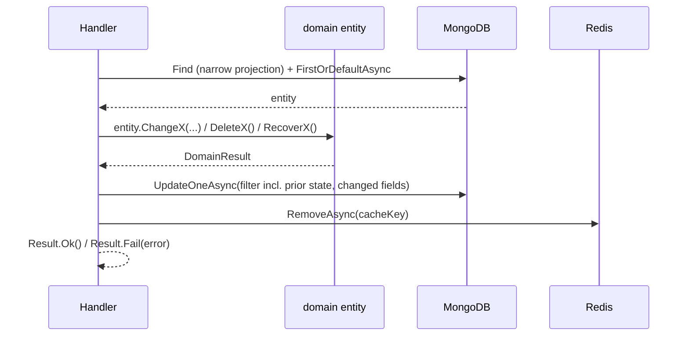

### 7. Cursor pagination

`app/common/pagination/` holds the whole mechanism, layered:

- **`CursorPageRequest(string? Cursor, int PageSize = 20)`** / **`CursorPageResult<T>(IReadOnlyList<T> Items, string? NextCursor, bool HasMore)`** — the request/result pair every paginated query uses.
- **`CursorCodec`** — encodes a page boundary as `{CreatedAt:O}|{Id}` Base64Url; `Decode` fails closed (any `FormatException`/`IndexOutOfRangeException` is caught and treated as "no cursor," restarting from page one).
- **`CursorPaginator.PaginateAsync<T>`** — clamps `PageSize` to `[1, 100]`, builds a keyset filter (`CreatedAt < cursor.CreatedAt OR (CreatedAt == cursor.CreatedAt AND Id < cursor.Id)`), sorts `CreatedAt DESC, Id DESC`, fetches `pageSize + 1` to compute `HasMore`.
- **`CachedCursorPaginator.PaginateAsync<TEntity, TDto>`** — wraps the above in the same Redis get/miss/populate cycle as single-entity reads, entity→DTO mapping folded in, always at `CacheKey.DefaultListTTL` (2 minutes).
- **`GetMostReactedPostHandler`** and **`GetMostRatedShopHandler`** sort by a field other than `CreatedAt` (`ReactionAmount`, `Rate`), so they sit outside `CursorPaginator`'s keyset logic: each keeps its own inline cache-aside block, a flat `Limit(pageSize)` page with no keyset cursor, and always returns `HasMore: false`.
- **`EmbeddedArrayPaginator`** / **`CachedEmbeddedArrayPaginator.PaginateAsync<TParent, TItem, TDto>`** — the counterpart for paginating a child array that lives *inside* a parent document (`Account.Followers`/`Followings`, `Post.Reactions`, `Comment.Reactions`). Runs `$match → $project → $unwind → $match (keyset) → $sort → $limit → $replaceRoot`, using the child object's own timestamp (`FollowedAt`/`ReactedAt`) as the order key and its `AccountId` as the tiebreaker.

```mermaid
sequenceDiagram
    participant H as Handler
    participant R as Redis
    participant CP as CursorPaginator /<br/>EmbeddedArrayPaginator
    participant M as MongoDB

    H->>R: GetAsync&lt;CursorPageResult&lt;TDto&gt;&gt;(cacheKey)
    alt cache hit
        R-->>H: page
    else cache miss
        R-->>H: null
        H->>CP: PaginateAsync(collection/parentFilter, ..., request)
        CP->>M: Find/Aggregate (keyset filter, sort, limit pageSize+1)
        M-->>CP: pageSize+1 items (or fewer)
        CP-->>H: CursorPageResult&lt;TEntity/TItem&gt;
        H->>H: map items -> TDto, build CursorPageResult&lt;TDto&gt;
        H->>R: SetAsync(cacheKey, dtoPage, DefaultListTTL)
    end
    H-->>H: Result.Ok(dtoPage)
```

### 8. Atomic embedded-array mutation

`Account.Followers`/`Followings`, `Post.Reactions`/`Comment.Reactions`, and `Account.Avatars` are all mutated through MongoDB's atomic array operators (`$push` via `Update.Push`, `$pull` via `Update.PullFilter`), guarded by a filter clause that checks array membership at the database level.

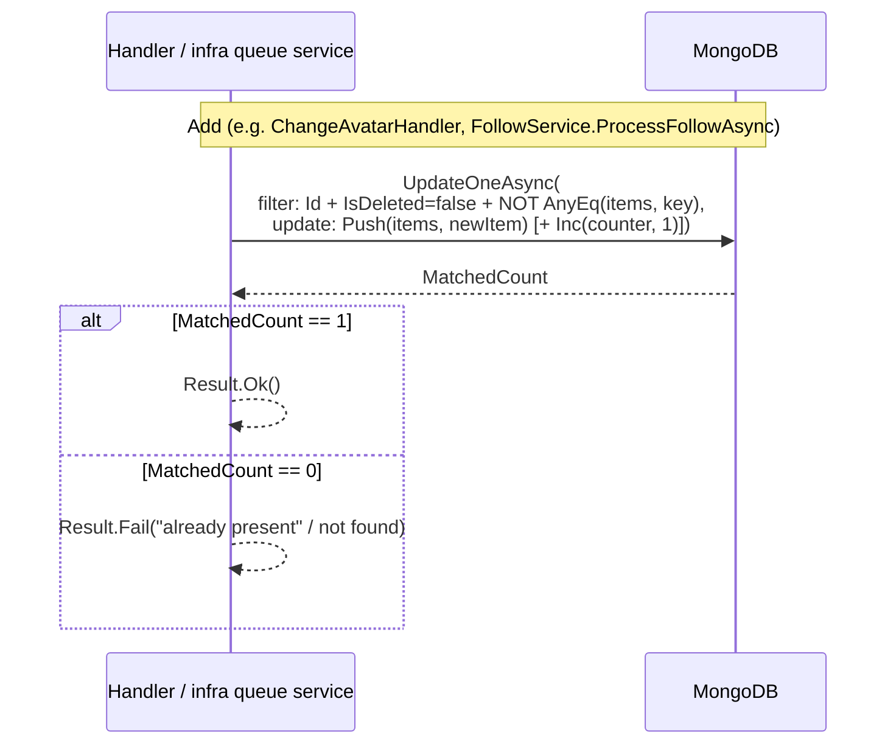

The remove side mirrors this exactly: filter requires the item to currently be present (`AnyEq`), update is `PullFilter`. `FollowService` additionally spans two `Account` documents in one `BulkWriteAsync` (not atomic across documents) — see `doc/infra-operation.md` for how it detects and repairs a partial write via retry.

### 9. Domain event dispatch

After a write that produces domain events, a handler calls `_dbContext.DispatchEventAsync(entity.Events, cancellationToken)`, which wraps each event in `DomainEventNotification<TEvent>` and publishes it via MediatR's `IPublisher`. `PostCreatedEventHandler` and `CommentedPostEventHandler` implement `INotificationHandler<DomainEventNotification<TEvent>>`; each `Handle` method returns `Task.CompletedTask`.

```mermaid
sequenceDiagram
    participant H as Handler
    participant M as MongoDB
    participant Ctx as DbContext.DispatchEventAsync
    participant Pub as MediatR IPublisher
    participant EH as &lt;Event&gt;Handler

    H->>M: InsertOneAsync(entity) — commits
    H->>Ctx: DispatchEventAsync(entity.Events, ct)
    loop each raised event
        Ctx->>Pub: Publish(DomainEventNotification&lt;TEvent&gt;)
        Pub->>EH: Handle(notification, ct)
    end
    Ctx-->>H: (returns)
```

## Feature Areas

| Feature | Commands | Queries | Notes |
|---|---|---|---|
| `account` | Create, ChangeName, ChangeEmail, ChangePassword, ChangeBio, ChangeAvatar, RemoveAvatar, Delete, Recover | GetMyAccount, GetSpecificAccount, GetAllAccount, GetAccountByEmail, GetAccountByName, GetAccountByKeyword | `ChangeEmail`/`Create` both consume a `registrationToken` from `email`'s OTP flow, not a raw email field |
| `auth` | Login, RequestNewAccessToken | GetAllRefreshToken, GetSpecificRefreshToken | No Redis anywhere in this feature — `RefreshToken` is a security-sensitive credential |
| `email` | SendEmailForRegister, SendEmailForVerify, VerifyEmail | — | Not command/query split: one-off notification use cases, each takes `Email email` directly |
| `post` | Create, ChangeCaption, ChangeRate, Delete | GetSpecificPost, GetMyPost, GetLatestPost, GetPostByAccount, GetPostByShop, GetPostByKeyword, GetMostReactedPost | `Create` resolves-or-creates the post's `Shop` first |
| `comment` | Create, ChangeContent, Delete | GetSpecificComment, GetCommentByPost, GetMyCommentHistory | `Create` raises `CommentedPostEvent` |
| `follow` | — | GetMyFollower, GetMyFollowing, GetFollowerByAccount, GetFollowingByAccount | |
| `reaction` | — | GetReactionByPost, GetReactionByComment | |
| `report` | Create | GetAllReport, GetSpecificReport, GetReportByTarget | `GetReportByTarget` discriminates on the `ReportTarget` enum (declared in `app`, not `domain` — see `doc/project-rules.md`) |
| `shop` | Delete | GetAllShop, GetSpecificShop, GetShopByName, GetShopByAddress, GetShopByKeyword, GetMostRatedShop | No `Create` command — every `Shop` comes into existence as a side effect of `post/command/Create` |

Every use case below has its own diagram, using its actual command/handler/entity names.

### Account

#### Create

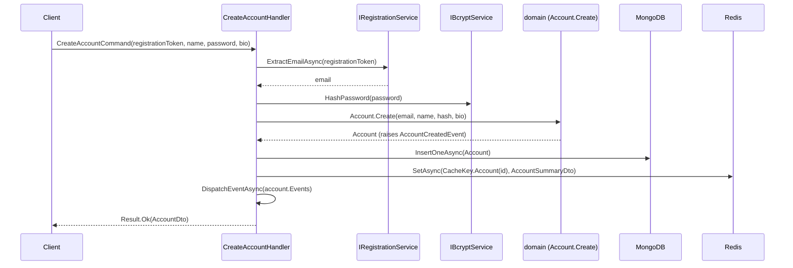

#### ChangeName

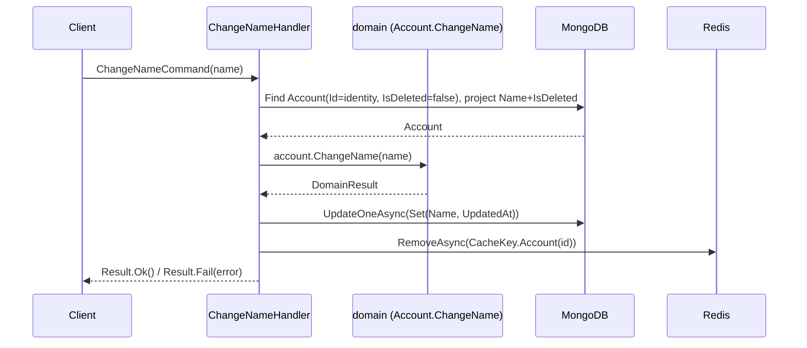

#### ChangeEmail

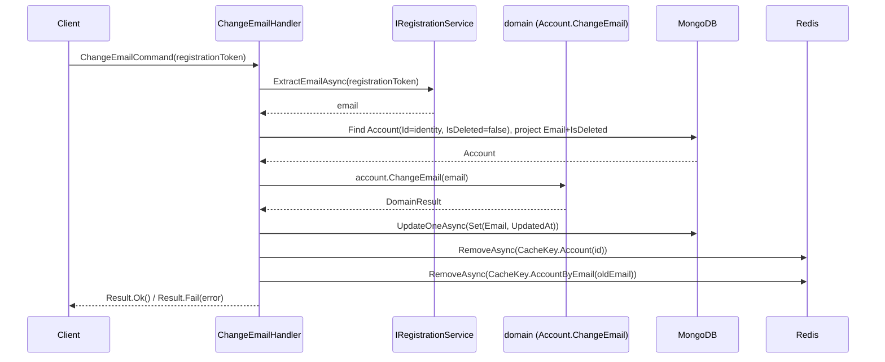

#### ChangePassword

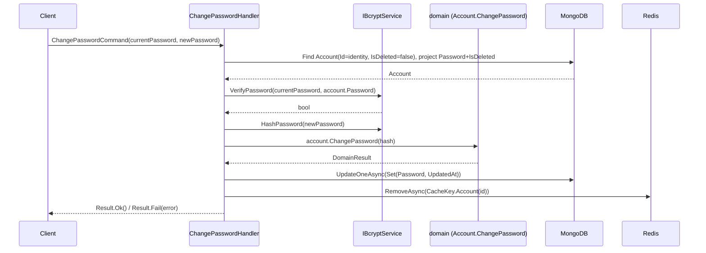

#### ChangeBio

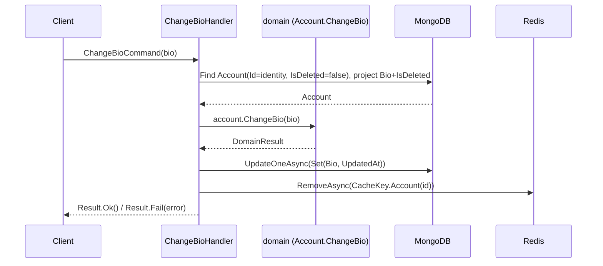

#### ChangeAvatar

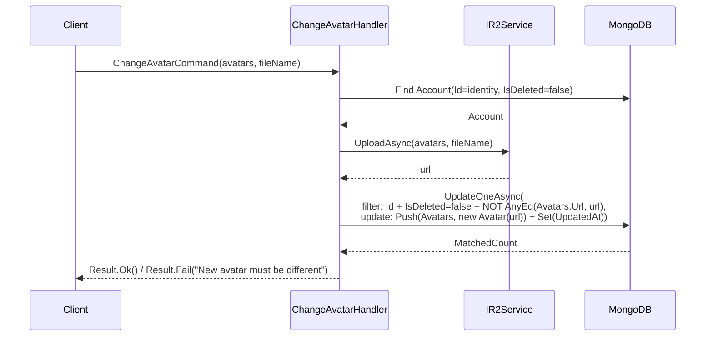

#### RemoveAvatar

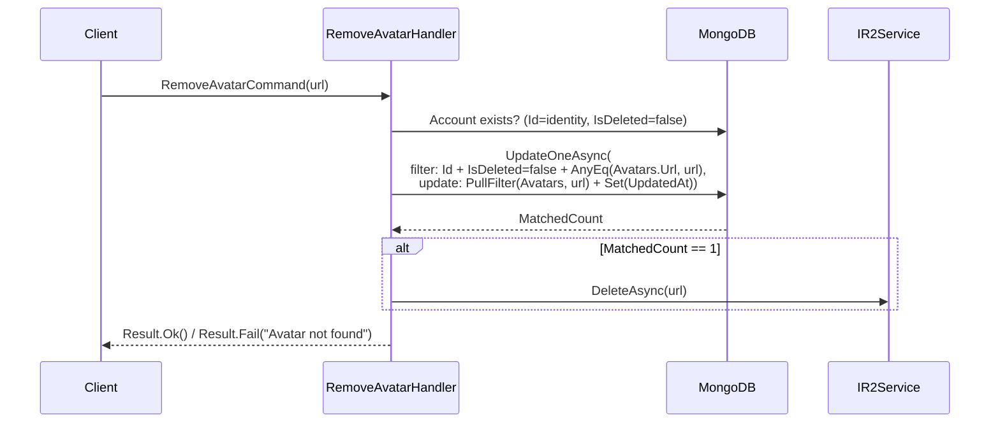

#### Delete

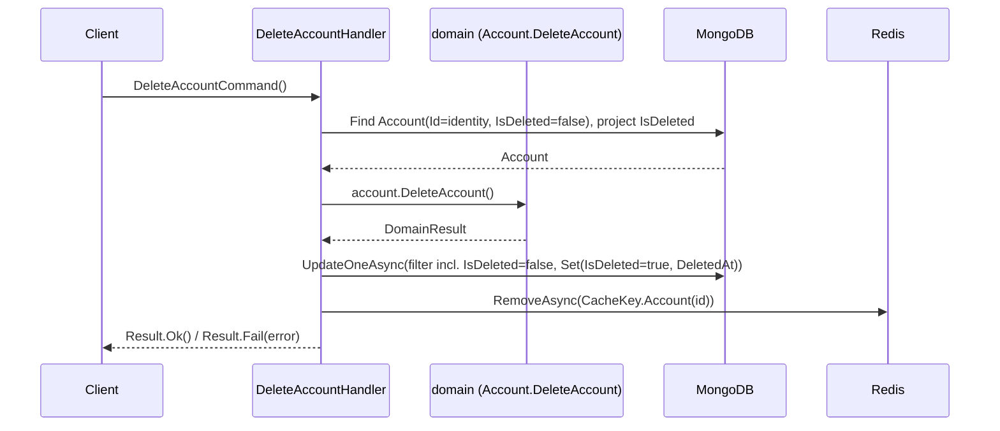

#### Recover

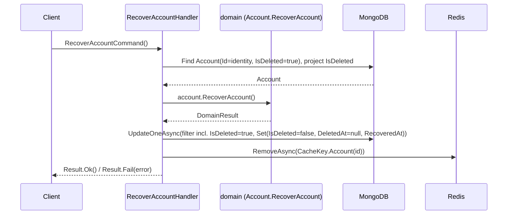

#### GetMyAccount

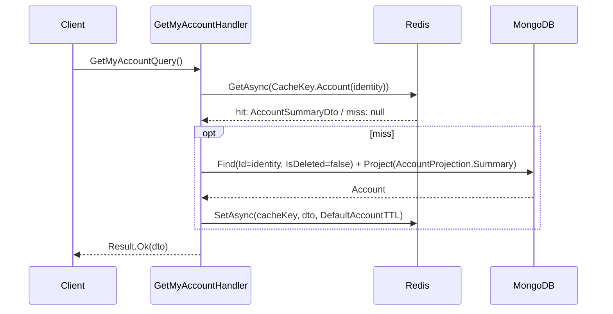

#### GetSpecificAccount

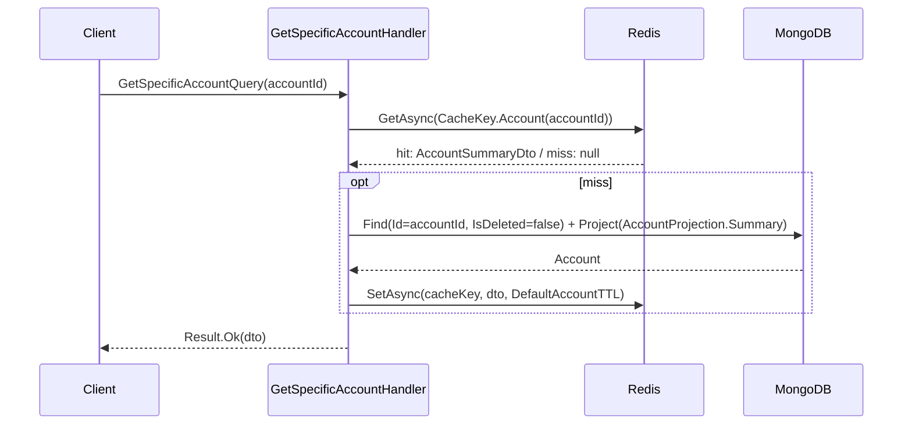

#### GetAllAccount

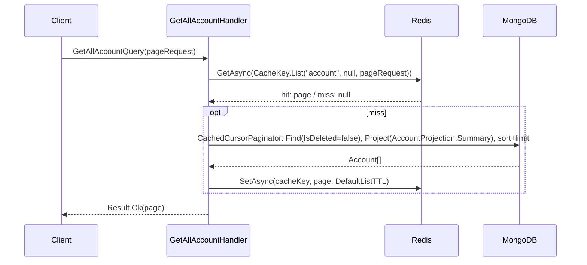

#### GetAccountByEmail

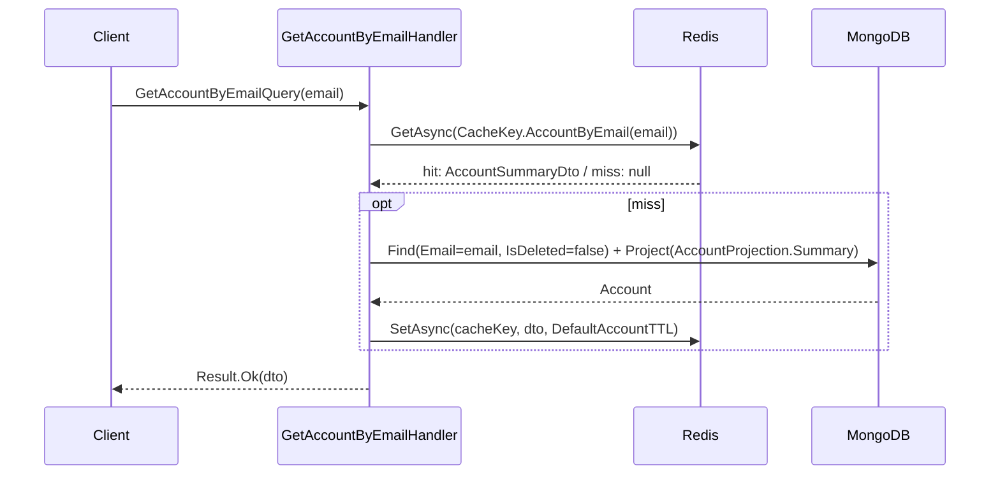

#### GetAccountByName

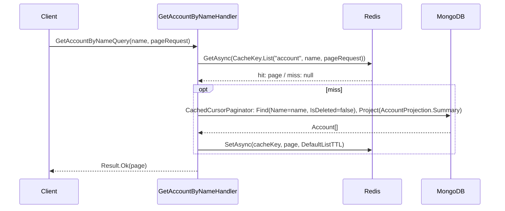

#### GetAccountByKeyword

```mermaid
sequenceDiagram
    participant C as Client
    participant H as GetAccountByKeywordHandler
    participant R as Redis
    participant M as MongoDB

    C->>H: GetAccountByKeywordQuery(keyword, pageRequest)
    H->>H: Regex.Escape(keyword)
    H->>R: GetAsync(CacheKey.List("account", keyword, pageRequest))
    R-->>H: hit: page / miss: null
    opt miss
        H->>M: CachedCursorPaginator: Find(Name.Value =~ BsonRegularExpression(escaped, "i"))
        M-->>H: Account[]
        H->>R: SetAsync(cacheKey, page, DefaultListTTL)
    end
    H-->>C: Result.Ok(page)
```

### Auth

#### Login

```mermaid
sequenceDiagram
    participant C as Client
    participant H as LoginHandler
    participant Bc as IBcryptService
    participant Jwt as IJwtService
    participant D as domain (RefreshToken.Create)
    participant M as MongoDB

    C->>H: LoginCommand(email, password)
    H->>M: Find Account(Email=email, IsDeleted=false), project Password+Role+IsDeleted
    M-->>H: Account
    H->>Bc: VerifyPassword(password, account.Password)
    Bc-->>H: bool
    H->>Jwt: GenerateAccessToken(accountId, role)
    Jwt-->>H: accessToken
    H->>D: RefreshToken.Create(accountId)
    D-->>H: RefreshToken
    H->>M: InsertOneAsync(RefreshToken)
    H-->>C: Result.Ok(AuthResult(accessToken, refreshToken.Token))
```

#### RequestNewAccessToken

```mermaid
sequenceDiagram
    participant C as Client
    participant H as RequestNewAccessTokenHandler
    participant D as domain (RefreshToken.Validate/Revoke)
    participant Jwt as IJwtService
    participant M as MongoDB

    C->>H: RequestNewAccessTokenCommand(refreshToken)
    H->>M: Find RefreshToken(Token=refreshToken)
    M-->>H: RefreshToken
    H->>D: currentToken.Validate()
    D-->>H: DomainResult
    H->>D: currentToken.Revoke()
    D-->>H: DomainResult
    H->>M: UpdateOneAsync(filter: Id + IsRevoked=false, Set(IsRevoked=true))
    M-->>H: MatchedCount
    H->>M: Find Account(Id=currentToken.AccountId, IsDeleted=false), project Role
    M-->>H: Account
    H->>Jwt: GenerateAccessToken(accountId, role)
    Jwt-->>H: accessToken
    H->>D: RefreshToken.Create(accountId)
    D-->>H: new RefreshToken
    H->>M: InsertOneAsync(new RefreshToken)
    H-->>C: Result.Ok(AuthResult(accessToken, newRefreshToken.Token))
```

#### GetAllRefreshToken

```mermaid
sequenceDiagram
    participant C as Client
    participant H as GetAllRefreshTokenHandler
    participant M as MongoDB

    C->>H: GetAllRefreshTokenQuery(pageRequest)
    H->>M: CursorPaginator.PaginateAsync: Find(IsDeleted=false), sort+limit(pageSize+1)
    M-->>H: RefreshToken[]
    H->>H: map -> RefreshTokenDto[]
    H-->>C: Result.Ok(CursorPageResult&lt;RefreshTokenDto&gt;)
```

#### GetSpecificRefreshToken

```mermaid
sequenceDiagram
    participant C as Client
    participant H as GetSpecificRefreshTokenHandler
    participant M as MongoDB

    C->>H: GetSpecificRefreshTokenQuery(refreshTokenId)
    H->>M: Find(Id=refreshTokenId, IsDeleted=false)
    M-->>H: RefreshToken
    H->>H: map -> RefreshTokenDto
    H-->>C: Result.Ok(dto) / Result.Fail("RefreshToken not found")
```

### Email

#### SendEmailForRegister

```mermaid
sequenceDiagram
    participant C as Client
    participant H as SendEmailForRegisterHandler
    participant M as MongoDB
    participant Otp as IOtpService
    participant Em as IEmailService

    C->>H: SendEmailForRegisterCommand(email)
    H->>M: Account exists for email?
    M-->>H: bool
    H->>Otp: GenerateAsync(email.Value)
    Otp-->>H: code
    H->>Em: SendOtpRegistrationEmailAsync(email, code)
    H-->>C: Result.Ok() / Result.Fail("Email already exists")
```

#### SendEmailForVerify

```mermaid
sequenceDiagram
    participant C as Client
    participant H as SendEmailForVerifyHandler
    participant M as MongoDB
    participant Otp as IOtpService
    participant Em as IEmailService

    C->>H: SendEmailForVerifyCommand(email)
    H->>M: Account exists for email?
    M-->>H: bool
    H->>Otp: GenerateAsync(email.Value)
    Otp-->>H: code
    H->>Em: SendOtpRegistrationEmailAsync(email, code)
    H-->>C: Result.Ok() / Result.Fail("Email not found")
```

#### VerifyEmail

```mermaid
sequenceDiagram
    participant C as Client
    participant H as VerifyEmailHandler
    participant Otp as IOtpService
    participant Reg as IRegistrationService

    C->>H: VerifyEmailCommand(email, otp)
    H->>Otp: VerifyAsync(email.Value, otp)
    Otp-->>H: bool
    H->>Reg: GenerateTokenAsync(email.Value)
    Reg-->>H: registrationToken
    H-->>C: Result.Ok(registrationToken) / Result.Fail("Otp is incorrect")
```

### Post

#### Create

```mermaid
sequenceDiagram
    participant H as CreatePostHandler
    participant M as MongoDB
    participant D as domain (Shop.Create / Post.Create)

    H->>M: Find Shop by Name+Address, not deleted
    alt Shop exists
        M-->>H: existing Shop
    else no match
        H->>D: Shop.Create(name, address)
        D-->>H: Shop
        H->>M: InsertOneAsync(Shop)
        H->>H: cache Shop (write-through)
    end
    H->>D: Post.Create(accountId, shopId, caption, rate, urls)
    D-->>H: Post (raises PostCreatedEvent)
    H->>M: InsertOneAsync(Post)
    H->>H: cache PostSummaryDto (write-through)
    H->>H: DispatchEventAsync(post.Events)
```

#### ChangeCaption

```mermaid
sequenceDiagram
    participant C as Client
    participant H as ChangeCaptionHandler
    participant D as domain (Post.ChangeCaption)
    participant M as MongoDB
    participant R as Redis

    C->>H: ChangeCaptionCommand(postId, caption)
    H->>M: Find Post(Id + AccountId=identity + IsDeleted=false), project Caption+IsDeleted
    M-->>H: Post
    H->>D: post.ChangeCaption(caption)
    D-->>H: DomainResult
    H->>M: UpdateOneAsync(filter incl. AccountId+IsDeleted, Set(Caption, UpdatedAt))
    H->>R: RemoveAsync(CacheKey.Post(id))
    H-->>C: Result.Ok() / Result.Fail(error)
```

#### ChangeRate

```mermaid
sequenceDiagram
    participant C as Client
    participant H as ChangeRateHandler
    participant D as domain (Post.ChangeRate)
    participant M as MongoDB
    participant R as Redis

    C->>H: ChangeRateCommand(postId, rate)
    H->>M: Find Post(Id + AccountId=identity + IsDeleted=false), project Rate+IsDeleted
    M-->>H: Post
    H->>D: post.ChangeRate(rate)
    D-->>H: DomainResult
    H->>M: UpdateOneAsync(filter incl. AccountId+IsDeleted, Set(Rate, UpdatedAt))
    H->>R: RemoveAsync(CacheKey.Post(id))
    H-->>C: Result.Ok() / Result.Fail(error)
```

#### Delete

```mermaid
sequenceDiagram
    participant C as Client
    participant H as DeletePostHandler
    participant D as domain (Post.DeletePost)
    participant M as MongoDB
    participant R2 as IR2Service
    participant R as Redis

    C->>H: DeletePostCommand(postId)
    H->>M: Find Post(Id + AccountId=identity + IsDeleted=false), project Images+IsDeleted
    M-->>H: Post
    H->>D: post.DeletePost()
    D-->>H: DomainResult
    H->>M: UpdateOneAsync(filter incl. AccountId+IsDeleted, Set(IsDeleted=true, DeletedAt))
    loop each image
        H->>R2: DeleteAsync(image.Url)
    end
    H->>R: RemoveAsync(CacheKey.Post(id))
    H-->>C: Result.Ok() / Result.Fail(error)
```

#### GetSpecificPost

```mermaid
sequenceDiagram
    participant C as Client
    participant H as GetSpecificPostHandler
    participant R as Redis
    participant M as MongoDB

    C->>H: GetSpecificPostQuery(postId)
    H->>R: GetAsync(CacheKey.Post(postId))
    R-->>H: hit: PostSummaryDto / miss: null
    opt miss
        H->>M: Find(Id=postId, IsDeleted=false) + Project(PostProjection.Summary)
        M-->>H: Post
        H->>R: SetAsync(cacheKey, dto, DefaultPostTTL)
    end
    H-->>C: Result.Ok(dto)
```

#### GetMyPost

```mermaid
sequenceDiagram
    participant C as Client
    participant H as GetMyPostHandler
    participant R as Redis
    participant M as MongoDB

    C->>H: GetMyPostQuery(pageRequest)
    H->>R: GetAsync(CacheKey.List("post", identity, pageRequest))
    R-->>H: hit: page / miss: null
    opt miss
        H->>M: CachedCursorPaginator: Find(AccountId=identity, IsDeleted=false), Project(PostProjection.Summary)
        M-->>H: Post[]
        H->>R: SetAsync(cacheKey, page, DefaultListTTL)
    end
    H-->>C: Result.Ok(page)
```

#### GetLatestPost

```mermaid
sequenceDiagram
    participant C as Client
    participant H as GetLatestPostHandler
    participant R as Redis
    participant M as MongoDB

    C->>H: GetLatestPostQuery(pageRequest)
    H->>R: GetAsync(CacheKey.List("post", null, pageRequest))
    R-->>H: hit: page / miss: null
    opt miss
        H->>M: CachedCursorPaginator: Find(IsDeleted=false), Project(PostProjection.Summary), sort CreatedAt DESC
        M-->>H: Post[]
        H->>R: SetAsync(cacheKey, page, DefaultListTTL)
    end
    H-->>C: Result.Ok(page)
```

#### GetPostByAccount

```mermaid
sequenceDiagram
    participant C as Client
    participant H as GetPostByAccountHandler
    participant R as Redis
    participant M as MongoDB

    C->>H: GetPostByAccountQuery(accountId, pageRequest)
    H->>R: GetAsync(CacheKey.List("post", accountId, pageRequest))
    R-->>H: hit: page / miss: null
    opt miss
        H->>M: CachedCursorPaginator: Find(AccountId=accountId, IsDeleted=false), Project(PostProjection.Summary)
        M-->>H: Post[]
        H->>R: SetAsync(cacheKey, page, DefaultListTTL)
    end
    H-->>C: Result.Ok(page)
```

#### GetPostByShop

```mermaid
sequenceDiagram
    participant C as Client
    participant H as GetPostByShopHandler
    participant R as Redis
    participant M as MongoDB

    C->>H: GetPostByShopQuery(shopId, pageRequest)
    H->>R: GetAsync(CacheKey.List("post", shopId, pageRequest))
    R-->>H: hit: page / miss: null
    opt miss
        H->>M: CachedCursorPaginator: Find(ShopId=shopId, IsDeleted=false), Project(PostProjection.Summary)
        M-->>H: Post[]
        H->>R: SetAsync(cacheKey, page, DefaultListTTL)
    end
    H-->>C: Result.Ok(page)
```

#### GetPostByKeyword

```mermaid
sequenceDiagram
    participant C as Client
    participant H as GetPostByKeywordHandler
    participant R as Redis
    participant M as MongoDB

    C->>H: GetPostByKeywordQuery(keyword, pageRequest)
    H->>H: Regex.Escape(keyword)
    H->>R: GetAsync(CacheKey.List("post", keyword, pageRequest))
    R-->>H: hit: page / miss: null
    opt miss
        H->>M: CachedCursorPaginator: Find(Caption =~ BsonRegularExpression(escaped, "i"))
        M-->>H: Post[]
        H->>R: SetAsync(cacheKey, page, DefaultListTTL)
    end
    H-->>C: Result.Ok(page)
```

#### GetMostReactedPost

```mermaid
sequenceDiagram
    participant C as Client
    participant H as GetMostReactedPostHandler
    participant R as Redis
    participant M as MongoDB

    C->>H: GetMostReactedPostQuery(pageRequest)
    H->>R: GetAsync(CacheKey.List("post", "mostReacted", pageRequest))
    R-->>H: hit: page / miss: null
    opt miss
        H->>M: Find(IsDeleted=false), sort ReactionAmount DESC, CreatedAt DESC, Id DESC, Limit(pageSize), Project(PostProjection.Summary)
        M-->>H: Post[pageSize]
        H->>R: SetAsync(cacheKey, page, DefaultListTTL)
    end
    H-->>C: Result.Ok(page) — HasMore always false
```

### Comment

#### Create

```mermaid
sequenceDiagram
    participant C as Client
    participant H as CreateCommentHandler
    participant R2 as IR2Service
    participant D as domain (Comment.Create)
    participant M as MongoDB
    participant R as Redis
    participant Pub as MediatR IPublisher
    participant EH as CommentedPostEventHandler

    C->>H: CreateCommentCommand(postId, content, images)
    opt images present
        H->>R2: UploadAsync(image) per image
        R2-->>H: url
    end
    H->>D: Comment.Create(accountId, postId, content, urls)
    D-->>H: Comment (raises CommentedPostEvent)
    H->>M: InsertOneAsync(Comment)
    H->>R: SetAsync(CacheKey.Comment(id), CommentSummaryDto)
    H->>Pub: DispatchEventAsync(comment.Events)
    Pub->>EH: Handle(DomainEventNotification&lt;CommentedPostEvent&gt;)
    H-->>C: Result.Ok(CommentDto)
```

#### ChangeContent

```mermaid
sequenceDiagram
    participant C as Client
    participant H as ChangeContentHandler
    participant D as domain (Comment.ChangeContent)
    participant M as MongoDB
    participant R as Redis

    C->>H: ChangeContentCommand(commentId, content)
    H->>M: Find Comment(Id + AccountId=identity + IsDeleted=false), project Content+IsDeleted
    M-->>H: Comment
    H->>D: comment.ChangeContent(content)
    D-->>H: DomainResult
    H->>M: UpdateOneAsync(filter incl. AccountId+IsDeleted, Set(Content, UpdatedAt))
    H->>R: RemoveAsync(CacheKey.Comment(id))
    H-->>C: Result.Ok() / Result.Fail(error)
```

#### Delete

```mermaid
sequenceDiagram
    participant C as Client
    participant H as DeleteCommentHandler
    participant D as domain (Comment.DeleteComment)
    participant M as MongoDB
    participant R2 as IR2Service
    participant R as Redis

    C->>H: DeleteCommentCommand(commentId)
    H->>M: Find Comment(Id + AccountId=identity + IsDeleted=false), project Images+IsDeleted
    M-->>H: Comment
    H->>D: comment.DeleteComment()
    D-->>H: DomainResult
    H->>M: UpdateOneAsync(filter incl. AccountId+IsDeleted, Set(IsDeleted=true, DeletedAt))
    loop each image
        H->>R2: DeleteAsync(image.Url)
    end
    H->>R: RemoveAsync(CacheKey.Comment(id))
    H-->>C: Result.Ok() / Result.Fail(error)
```

#### GetSpecificComment

```mermaid
sequenceDiagram
    participant C as Client
    participant H as GetSpecificCommentHandler
    participant R as Redis
    participant M as MongoDB

    C->>H: GetSpecificCommentQuery(commentId)
    H->>R: GetAsync(CacheKey.Comment(commentId))
    R-->>H: hit: CommentSummaryDto / miss: null
    opt miss
        H->>M: Find(Id=commentId, IsDeleted=false) + Project(CommentProjection.Summary)
        M-->>H: Comment
        H->>R: SetAsync(cacheKey, dto, DefaultCommentTTL)
    end
    H-->>C: Result.Ok(dto)
```

#### GetCommentByPost

```mermaid
sequenceDiagram
    participant C as Client
    participant H as GetCommentByPostHandler
    participant R as Redis
    participant M as MongoDB

    C->>H: GetCommentByPostQuery(postId, pageRequest)
    H->>R: GetAsync(CacheKey.List("comment", postId, pageRequest))
    R-->>H: hit: page / miss: null
    opt miss
        H->>M: CachedCursorPaginator: Find(PostId=postId, IsDeleted=false), Project(CommentProjection.Summary)
        M-->>H: Comment[]
        H->>R: SetAsync(cacheKey, page, DefaultListTTL)
    end
    H-->>C: Result.Ok(page)
```

#### GetMyCommentHistory

```mermaid
sequenceDiagram
    participant C as Client
    participant H as GetMyCommentHistoryHandler
    participant R as Redis
    participant M as MongoDB

    C->>H: GetMyCommentHistoryQuery(pageRequest)
    H->>R: GetAsync(CacheKey.List("comment", identity, pageRequest))
    R-->>H: hit: page / miss: null
    opt miss
        H->>M: CachedCursorPaginator: Find(AccountId=identity, IsDeleted=false), Project(CommentProjection.Summary)
        M-->>H: Comment[]
        H->>R: SetAsync(cacheKey, page, DefaultListTTL)
    end
    H-->>C: Result.Ok(page)
```

### Follow

#### GetFollowerByAccount

```mermaid
sequenceDiagram
    participant C as Client
    participant H as GetFollowerByAccountHandler
    participant R as Redis
    participant M as MongoDB

    C->>H: GetFollowerByAccountQuery(accountId, pageRequest)
    H->>R: GetAsync(CacheKey.List("account:follower", accountId, pageRequest))
    R-->>H: hit: page / miss: null
    opt miss
        H->>M: $match Account(Id=accountId) -> $project Followers -> $unwind -> $match (keyset on FollowedAt/AccountId) -> $sort -> $limit -> $replaceRoot
        M-->>H: Follower[]
        H->>R: SetAsync(cacheKey, page, DefaultListTTL)
    end
    H-->>C: Result.Ok(CursorPageResult&lt;FollowerDto&gt;)
```

#### GetFollowingByAccount

```mermaid
sequenceDiagram
    participant C as Client
    participant H as GetFollowingByAccountHandler
    participant R as Redis
    participant M as MongoDB

    C->>H: GetFollowingByAccountQuery(accountId, pageRequest)
    H->>R: GetAsync(CacheKey.List("account:following", accountId, pageRequest))
    R-->>H: hit: page / miss: null
    opt miss
        H->>M: $match Account(Id=accountId) -> $project Followings -> $unwind -> $match (keyset on FollowedAt/AccountId) -> $sort -> $limit -> $replaceRoot
        M-->>H: Following[]
        H->>R: SetAsync(cacheKey, page, DefaultListTTL)
    end
    H-->>C: Result.Ok(CursorPageResult&lt;FollowingDto&gt;)
```

#### GetMyFollower

```mermaid
sequenceDiagram
    participant C as Client
    participant H as GetMyFollowerHandler
    participant R as Redis
    participant M as MongoDB

    C->>H: GetMyFollowerQuery(pageRequest)
    H->>R: GetAsync(CacheKey.List("account:follower", identity, pageRequest))
    R-->>H: hit: page / miss: null
    opt miss
        H->>M: $match Account(Id=identity) -> $project Followers -> $unwind -> $match (keyset) -> $sort -> $limit -> $replaceRoot
        M-->>H: Follower[]
        H->>R: SetAsync(cacheKey, page, DefaultListTTL)
    end
    H-->>C: Result.Ok(CursorPageResult&lt;FollowerDto&gt;)
```

#### GetMyFollowing

```mermaid
sequenceDiagram
    participant C as Client
    participant H as GetMyFollowingHandler
    participant R as Redis
    participant M as MongoDB

    C->>H: GetMyFollowingQuery(pageRequest)
    H->>R: GetAsync(CacheKey.List("account:following", identity, pageRequest))
    R-->>H: hit: page / miss: null
    opt miss
        H->>M: $match Account(Id=identity) -> $project Followings -> $unwind -> $match (keyset) -> $sort -> $limit -> $replaceRoot
        M-->>H: Following[]
        H->>R: SetAsync(cacheKey, page, DefaultListTTL)
    end
    H-->>C: Result.Ok(CursorPageResult&lt;FollowingDto&gt;)
```

### Reaction

#### GetReactionByPost

```mermaid
sequenceDiagram
    participant C as Client
    participant H as GetReactionByPostHandler
    participant R as Redis
    participant M as MongoDB

    C->>H: GetReactionByPostQuery(postId, pageRequest)
    H->>R: GetAsync(CacheKey.List("post:reaction", postId, pageRequest))
    R-->>H: hit: page / miss: null
    opt miss
        H->>M: $match Post(Id=postId) -> $project Reactions -> $unwind -> $match (keyset on ReactedAt/AccountId) -> $sort -> $limit -> $replaceRoot
        M-->>H: Reaction[]
        H->>R: SetAsync(cacheKey, page, DefaultListTTL)
    end
    H-->>C: Result.Ok(CursorPageResult&lt;ReactionDto&gt;)
```

#### GetReactionByComment

```mermaid
sequenceDiagram
    participant C as Client
    participant H as GetReactionByCommentHandler
    participant R as Redis
    participant M as MongoDB

    C->>H: GetReactionByCommentQuery(commentId, pageRequest)
    H->>R: GetAsync(CacheKey.List("comment:reaction", commentId, pageRequest))
    R-->>H: hit: page / miss: null
    opt miss
        H->>M: $match Comment(Id=commentId) -> $project Reactions -> $unwind -> $match (keyset on ReactedAt/AccountId) -> $sort -> $limit -> $replaceRoot
        M-->>H: Reaction[]
        H->>R: SetAsync(cacheKey, page, DefaultListTTL)
    end
    H-->>C: Result.Ok(CursorPageResult&lt;ReactionDto&gt;)
```

### Report

#### Create

```mermaid
sequenceDiagram
    participant C as Client
    participant H as CreateReportHandler
    participant D as domain (Report.Create)
    participant M as MongoDB
    participant R as Redis

    C->>H: CreateReportCommand(postId?, commentId?, accountId?, reason)
    H->>D: Report.Create(reporterId=identity, postId, commentId, accountId, reason)
    D-->>H: Report
    H->>M: InsertOneAsync(Report)
    H->>H: map -> ReportDto
    H->>R: SetAsync(CacheKey.Report(id), dto, DefaultReportTTL)
    H-->>C: Result.Ok(ReportDto)
```

#### GetAllReport

```mermaid
sequenceDiagram
    participant C as Client
    participant H as GetAllReportHandler
    participant R as Redis
    participant M as MongoDB

    C->>H: GetAllReportQuery(pageRequest)
    H->>R: GetAsync(CacheKey.List("report", null, pageRequest))
    R-->>H: hit: page / miss: null
    opt miss
        H->>M: CachedCursorPaginator: Find(IsDeleted=false), no projection
        M-->>H: Report[]
        H->>R: SetAsync(cacheKey, page, DefaultListTTL)
    end
    H-->>C: Result.Ok(page)
```

#### GetSpecificReport

```mermaid
sequenceDiagram
    participant C as Client
    participant H as GetSpecificReportHandler
    participant R as Redis
    participant M as MongoDB

    C->>H: GetSpecificReportQuery(reportId)
    H->>R: GetAsync(CacheKey.Report(reportId))
    R-->>H: hit: ReportDto / miss: null
    opt miss
        H->>M: Find(Id=reportId, IsDeleted=false)
        M-->>H: Report
        H->>R: SetAsync(cacheKey, dto, DefaultReportTTL)
    end
    H-->>C: Result.Ok(dto)
```

#### GetReportByTarget

```mermaid
sequenceDiagram
    participant C as Client
    participant H as GetReportByTargetHandler
    participant R as Redis
    participant M as MongoDB

    C->>H: GetReportByTargetQuery(target, targetId, pageRequest)
    H->>H: build filter from ReportTarget discriminator (PostId/CommentId/AccountId/ReporterId = targetId)
    H->>R: GetAsync(CacheKey.List("report", target+targetId, pageRequest))
    R-->>H: hit: page / miss: null
    opt miss
        H->>M: CachedCursorPaginator: Find(discriminated filter, IsDeleted=false)
        M-->>H: Report[]
        H->>R: SetAsync(cacheKey, page, DefaultListTTL)
    end
    H-->>C: Result.Ok(page)
```

### Shop

#### Delete

```mermaid
sequenceDiagram
    participant C as Client
    participant H as DeleteShopHandler
    participant D as domain (Shop.DeleteShop)
    participant M as MongoDB
    participant R as Redis

    C->>H: DeleteShopCommand(shopId)
    H->>M: Find Shop(Id + IsDeleted=false), project IsDeleted
    M-->>H: Shop
    H->>D: shop.DeleteShop()
    D-->>H: DomainResult
    H->>M: UpdateOneAsync(filter incl. IsDeleted=false, Set(IsDeleted=true, DeletedAt))
    H->>R: RemoveAsync(CacheKey.Shop(id))
    H-->>C: Result.Ok() / Result.Fail(error)
```

`Shop.Create` is not a standalone use case — every `Shop` comes into existence inside `CreatePostHandler` (see Post → Create above).

#### GetAllShop

```mermaid
sequenceDiagram
    participant C as Client
    participant H as GetAllShopHandler
    participant R as Redis
    participant M as MongoDB

    C->>H: GetAllShopQuery(pageRequest)
    H->>R: GetAsync(CacheKey.List("shop", null, pageRequest))
    R-->>H: hit: page / miss: null
    opt miss
        H->>M: CachedCursorPaginator: Find(IsDeleted=false), Project(ShopProjection.Summary)
        M-->>H: Shop[]
        H->>R: SetAsync(cacheKey, page, DefaultListTTL)
    end
    H-->>C: Result.Ok(page)
```

#### GetSpecificShop

```mermaid
sequenceDiagram
    participant C as Client
    participant H as GetSpecificShopHandler
    participant R as Redis
    participant M as MongoDB

    C->>H: GetSpecificShopQuery(shopId)
    H->>R: GetAsync(CacheKey.Shop(shopId))
    R-->>H: hit: ShopDto / miss: null
    opt miss
        H->>M: Find(Id=shopId, IsDeleted=false) + Project(ShopProjection.Summary)
        M-->>H: Shop
        H->>R: SetAsync(cacheKey, dto, DefaultShopTTL)
    end
    H-->>C: Result.Ok(dto)
```

#### GetShopByName

```mermaid
sequenceDiagram
    participant C as Client
    participant H as GetShopByNameHandler
    participant R as Redis
    participant M as MongoDB

    C->>H: GetShopByNameQuery(name, pageRequest)
    H->>R: GetAsync(CacheKey.List("shop", name, pageRequest))
    R-->>H: hit: page / miss: null
    opt miss
        H->>M: CachedCursorPaginator: Find(Name=name, IsDeleted=false), Project(ShopProjection.Summary)
        M-->>H: Shop[]
        H->>R: SetAsync(cacheKey, page, DefaultListTTL)
    end
    H-->>C: Result.Ok(page)
```

#### GetShopByAddress

```mermaid
sequenceDiagram
    participant C as Client
    participant H as GetShopByAddressHandler
    participant R as Redis
    participant M as MongoDB

    C->>H: GetShopByAddressQuery(address, pageRequest)
    H->>R: GetAsync(CacheKey.List("shop", address, pageRequest))
    R-->>H: hit: page / miss: null
    opt miss
        H->>M: CachedCursorPaginator: Find(Address=address, IsDeleted=false), Project(ShopProjection.Summary)
        M-->>H: Shop[]
        H->>R: SetAsync(cacheKey, page, DefaultListTTL)
    end
    H-->>C: Result.Ok(page)
```

#### GetShopByKeyword

```mermaid
sequenceDiagram
    participant C as Client
    participant H as GetShopByKeywordHandler
    participant R as Redis
    participant M as MongoDB

    C->>H: GetShopByKeywordQuery(keyword, pageRequest)
    H->>H: Regex.Escape(keyword)
    H->>R: GetAsync(CacheKey.List("shop", keyword, pageRequest))
    R-->>H: hit: page / miss: null
    opt miss
        H->>M: CachedCursorPaginator: Find(Name =~ BsonRegularExpression(escaped, "i"))
        M-->>H: Shop[]
        H->>R: SetAsync(cacheKey, page, DefaultListTTL)
    end
    H-->>C: Result.Ok(page)
```

#### GetMostRatedShop

```mermaid
sequenceDiagram
    participant C as Client
    participant H as GetMostRatedShopHandler
    participant R as Redis
    participant M as MongoDB

    C->>H: GetMostRatedShopQuery(pageRequest)
    H->>R: GetAsync(CacheKey.List("shop", "mostRated", pageRequest))
    R-->>H: hit: page / miss: null
    opt miss
        H->>M: Find(IsDeleted=false), sort Rate DESC, Limit(pageSize), Project(ShopProjection.Summary)
        M-->>H: Shop[pageSize]
        H->>R: SetAsync(cacheKey, page, DefaultListTTL)
    end
    H-->>C: Result.Ok(page) — HasMore always false
```
