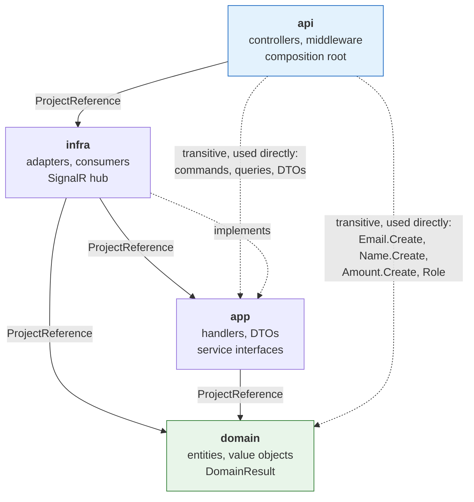
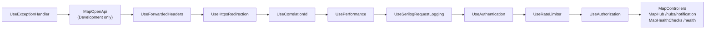

# Architecture

Layering, dependency rules, and where cross-cutting concerns live. Runtime flows are in
[`system-design.md`](./system-design.md); conventions are in [`project-rules.md`](./project-rules.md).

## Architectural style

A **four-project layered monolith** with a **CQRS-shaped application layer** (MediatR
request/handler per use case) and **dependency inversion for infrastructure services** (`app`
declares interfaces, `infra` implements them).

It is deliberately *not* textbook Clean Architecture, and the differences are structural rather than
incidental:

- **Handlers talk to MongoDB directly.** `IMongoDbContext`
  (`src/app/common/interface/persistence/`) has a single member,
  `IMongoCollection<T> GetCollection<T>(string name)`, and handlers build `FilterDefinition<T>`,
  `UpdateDefinition<T>` and `ProjectionDefinition<T>` themselves — so `app.csproj` carries a direct
  `PackageReference` to `MongoDB.Driver 3.11.0`.
- **Domain entities are the MongoDB documents.** They stay free of persistence attributes because
  all mapping is declared externally in `BsonConfiguration`
  (`src/infra/persistence/configuration/`), but the coupling exists.
- **Command and query handlers share one store and one model.** The `command/` and `query/` folder
  split is a naming convention over a single read/write path.

The single genuinely inverted boundary is service access: 18 interfaces in
`src/app/common/interface/` (1 persistence, 7 queue, 10 service) are implemented in `infra` and
resolved through DI, so `app` never names a concrete adapter.

## Project reference rules

Enforced by MSBuild — these are the only `ProjectReference` entries that exist.

| Project | May depend on | Must not depend on | Evidence |
|---|---|---|---|
| `domain` | nothing | everything | `domain.csproj` has **zero** `PackageReference` and zero `ProjectReference` |
| `app` | `domain` | `infra`, `api` | `app.csproj` → `domain.csproj` only |
| `infra` | `domain`, `app` | `api` | `infra.csproj` → `domain.csproj`, `app.csproj` |
| `api` | `infra` (and `domain`, `app` transitively) | — | `api.csproj` → `infra.csproj` only |

Dependencies point inward toward `domain`, which has no outward edges. `infra → app` is the correct
direction for this design because `app` owns the interfaces; `infra` supplies the implementations.

## Architectural decisions evidenced in the code

**Soft delete is universal.** `BaseEntity` (`src/domain/core/entity/BaseEntity.cs`) owns `IsDeleted`,
`DeletedAt`, `RecoveredAt` and the `Update()`/`Delete()`/`Recover()` transitions. `Update()` and
`Delete()` refuse to act on an already-deleted entity. Practically every query filters
`!x.IsDeleted`, and unique indexes are **partial** on `IsDeleted: false` so a deleted account's email
can be reused. Soft is not forever: `SoftDeletePurgeHost` hard-deletes accounts, posts, comments and
shops 30 days after `DeletedAt` (see `doc/infrastructure.md`), which is also the window `Recover()` has to
run in.

**Entities are only constructible through static factories.** Every entity has a private constructor
plus a `static DomainResult<T> Create(...)`, and mutations return `DomainResult`. Invariants live on
the entity, not in handlers.

**Writes that fan out are queued; writes that must be read back are synchronous.** Reactions,
follows, saves, comment notifications, shop-rate recalculation and the delete cascades return **202
Accepted** and complete in a `QueueConsumerHost`. Account, post, comment and report creation are
synchronous and return the created DTO.

**Concurrency is handled by conditional updates, not transactions.** No MongoDB session or
transaction is used anywhere. Instead, filters encode the precondition — `ReactPostService` matches
"post exists AND not already reacted by this account" and treats `MatchedCount != 1` as the conflict
signal. `FollowService` bulk-writes both sides of the relationship, where each side's filter excludes
the state it writes, making `MatchedCount == 1` a self-healing repair of a half-applied follow.

**Counters are denormalized and maintained with `$inc` in the same update as the array mutation.**
`Post.ReactionAmount`, `Post.CommentAmount`, `Account.FollowerAmount`, `Account.FollowingAmount`,
`Comment.ReactionAmount`.

**Queue delivery is at-least-once with explicit idempotency.** `RabbitMQService.ConsumeAsync` uses
manual ack with `prefetchCount: 1`, keys each message by a `MessageId` GUID under
`rabbitmq:idempotency:{queue}:{id}` for 24 h, stores a SHA-256 of the payload to detect key reuse
with different content, counts retries in an `x-retry-count` header, and dead-letters to
`{queue}.dlq` after `MaxAttempts = 3`.

**List caches are invalidated by version counter, not by key deletion.** `ListCache` bumps
`list-version:{entity}:{signature}`; the version is a component of every page key, so all pages and
page sizes retire together. The rule a write has to satisfy is *bump every signature whose
projection carries a field this write changed*, not just the entity it wrote to: the comment
handlers move `Post.CommentAmount`, which `PostProjection.Summary` includes, so they bump the post
feed's signatures alongside the comment ones.

**Search uses precomputed normalized fields.** `TextNormalizer.RemoveDiacriticsAndLower` (Vietnamese
`đ`/`Đ` folding plus Unicode `FormD` mark stripping) populates `Post.CaptionNormalized`,
`Shop.NameNormalized` and `Shop.AddressNormalized` at write time; keyword search runs a
`Regex.Escape`d case-insensitive regex against those fields.

## Boundary violations and inconsistencies

These are real, evidenced, and worth knowing before extending the system.

**1. Business logic lives in `infra`.** The eight queue services — `FollowService`,
`ReactPostService`, `ReactCommentService`, `SaveService`, `CommentService`, `ShopRateService`,
`AccountService`, `PostService` — hold domain rules (counter maintenance, cascade semantics,
notification triggering, rate averaging) but sit in the infrastructure project. Their interfaces are
in `src/app/common/interface/queue/`, so `app` declares the contract while `infra` owns the policy.
`AccountService.ProcessAfterDeleteAsync` is ~270 lines of cascade logic in the adapter layer.

**2. `infra` contains web-framework concerns.** `infra.csproj` declares
`<FrameworkReference Include="Microsoft.AspNetCore.App" />`, and the project holds `NotificationHub`
(SignalR), `AccountIdUserIdProvider` (`HubConnectionContext`), and `CurrentIdentityService`
(`IHttpContextAccessor`). The hub is defined in `infra` but routed from `api`'s `Program.cs`.

**3. Persistence technology reaches into `app`.** Because there is no repository, MongoDB types appear
throughout the application layer — including in shared helpers like `ReactionMembership` and
`SaveMembership`, which take `IMongoCollection<T>` parameters directly.

**4. Domain value objects cross the API contract.** `PostSummaryDto` exposes `Amount Rate`,
`Amount ReactionAmount`, `Amount CommentAmount` rather than `int`. This is why
`AmountJsonConverter`, `EmailJsonConverter` and `NameJsonConverter` exist in
`src/infra/serialization/` — to flatten value objects for the Redis JSON payloads.

**5. Validation is spread across three layers with no single authority.**
Value-object factories (`domain`), FluentValidation validators (`app`, 38 of 78 handlers), and
`ImageUpload` (`api`). Some rules are duplicated and have drifted: `Account.BioMaxLength` is 2000 in
the entity and `MaximumLength(2000)` in `CreateAccountValidator`; password length (10–40) is enforced
**only** in validators, while the entity checks only that the hash is 60 characters. Caption length
(2000) and `Report.Reason` length (2000) likewise live **only** in `CreatePostValidator`,
`ChangeCaptionValidator` and `CreateReportValidator` — neither `Post` nor `Report` caps them.

**6. Authorization decisions happen inside handlers.** Beyond `[Authorize]` and the `Admin` role
attribute, ownership checks are handler-level Mongo filters — `DeletePostHandler` filters
`x.AccountId == identity.Value`. Authorization is expressed inline in each handler, which repeats
`GetAccountId()` plus a null check.

**7. `PerformanceBehavior` and `PerformanceMiddleware` both warn at 500 ms**, at the MediatR and HTTP
layers respectively, producing two warnings for one slow request.

**8. `ValidationBehavior` assumes every response is a `FluentResults` type.** It calls
`Activator.CreateInstance<TResponse>()` and casts to `ResultBase`. A handler returning anything else
would fail at runtime, not compile time.

**9. `Amount` serves two incompatible roles.** It is both a 1–5 user rating and an unbounded counter,
so it cannot carry an upper bound. The 1–5 constraint therefore lives in `CreatePostValidator` and
`ChangeRateValidator` instead of the value object.

## Cross-cutting concerns

| Concern | Where it lives | Mechanism |
|---|---|---|
| **Authentication** | `api` | JWT bearer, HS256, `MapInboundClaims = false`, validating issuer/audience/lifetime/key. `RoleClaimType = "role"`. Hub connections read the token from the `access_token` query string for `/hubs` paths. |
| **Identity access** | `app` interface, `infra` implementation | `ICurrentIdentityService.GetAccountId()` reads the `accountId` claim via `IHttpContextAccessor`. **Returns `null` in queue consumers**, which have no HTTP context — consumers pass ids explicitly in the message instead. |
| **Authorization** | `api` + `app` | `[Authorize]` on all 12 controllers; `[Authorize(Roles = nameof(Role.Admin))]` on 15 endpoints; ownership enforced by filters inside handlers. |
| **Validation** | `domain` + `app` + `api` | Value-object factories; `ValidationBehavior` running `IValidator<TRequest>`; `ImageUpload` at the upload trust boundary. |
| **Error handling** | all four | `DomainResult` (domain) → `Result` + `AppError` status metadata (app) → `ResultStatusMapper`/`ResultExtensions` → `ProblemDetails` (api). `UseExceptionHandler()` + `AddProblemDetails()` catch anything unhandled. |
| **Logging** | `api` + `app` | Serilog, single console sink. Both the bootstrap logger and the configured logger share one `ExpressionTemplate` `const` in `Program.cs`, emitting one-line JSON the host platform can parse and query; `appsettings.json` supplies minimum levels only. `LoggingBehavior` per MediatR request; `UseSerilogRequestLogging()`; a `catch` around the host logs `Log.Fatal` before `CloseAndFlush`. |
| **Correlation** | `api` | `CorrelationIdMiddleware` pushes `CorrelationId` into the Serilog `LogContext` for the request scope. |
| **Rate limiting** | `api` | Global fixed window (200/min) partitioned by `account:{id}` or `ip:{addr}`, plus four sliding-window policies: `auth` 10/min, `email` 5/min, `search` 20/min, `upload` 10/min. |
| **Caching** | `app` + `infra` | `CacheKey`/`ListCache` define keys and versions; `RedisService` executes. |
| **Serialization** | `infra` | `BsonConfiguration` for MongoDB; `DomainJsonOptions` with three value-object converters for Redis. |

## Startup composition

`Program.cs` builds the pipeline in this order — note `UseExceptionHandler` is outermost and
`UseAuthentication` precedes `UseRateLimiter`, so the limiter can partition by authenticated
`accountId`:

`AddApi` → `AddApp` → `AddInfra` is the registration chain. Lifetimes: `IConnectionMultiplexer`,
`IMongoClient`, `IAmazonS3` and `IConnection` are **singletons**; 17 services are registered
`AddScoped` and `IEmailService` via `AddHttpClient` (also scoped); `AddInfra` contributes **14
hosted services** — 10 queue consumers plus `IndexInitializer`,
`NormalizedFieldBackfillInitializer`, `AdminSeeder` and `SoftDeletePurgeHost` — which resolve to 16
`IHostedService` descriptors in total once the framework's own Data Protection and health-check
publisher services are counted.

Queue consumers are registered with `AddSingleton<IHostedService>` rather than `AddHostedService`
deliberately: `AddHostedService` routes through `TryAddEnumerable`, which deduplicates by
implementation type, and several queues share a message type and therefore close the same
`QueueConsumerHost<TMessage>` generic. Using `AddHostedService` here silently drops 3 of the 10
consumers with no error at build or startup. The comment at `src/infra/DependencyInjection.cs`
records this; **there is currently no automated check that all 10 survive registration.**
