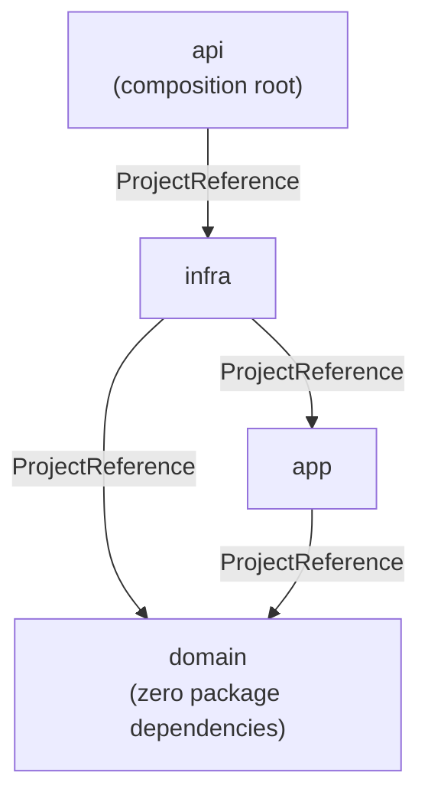
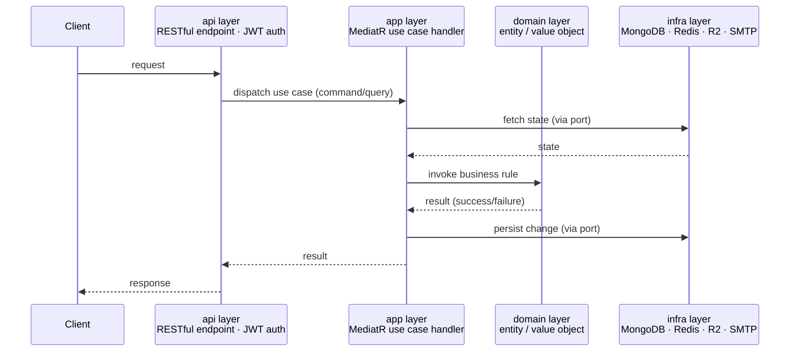

# Architecture

This document covers layer boundaries, the dependency rule between layers, and how layers interact at runtime. For folder-by-folder responsibilities and code-level conventions (naming, OOP/DDD patterns, formatting), see `doc/project-rules.md`.

This document is the authoritative source for layer boundaries, the dependency rule, and how layers interact; new or changed code MUST conform to it.

## Architectural Style

- **Clean Architecture (Onion Architecture)**: four concentric layers, each its own .NET project (`domain`, `app`, `infra`, `api`), with a one-way dependency rule enforced at compile time by `ProjectReference`s — inner layers cannot reference outer layers.
- **`domain` is 100% pure**: independent from every framework and library, with zero exceptions. `domain.csproj` has no `ProjectReference` and no `PackageReference` at all — no MongoDB, no MediatR, no ASP.NET Core, nothing. This is the strictest, most non-negotiable rule in the codebase; every other layer may take on framework or library dependencies, `domain` never does.
- **CQRS via MediatR**: every use case is a single command or query record plus one handler; there is no shared "service" class per feature, and no repository layer — handlers talk to `IMongoDbContext` directly.
- **Ports and adapters**: `app` declares interfaces (`IMongoDbContext`, `IJwtService`, `IRedisService`, …) it needs but does not implement; `infra` supplies the concrete implementation for every one of them.

## Layer Boundaries

- **`domain`** — the innermost layer. Pure business/domain model: entities, value objects, the `DomainResult` result type. No project or package references at all, and **must stay that way**: `domain` may never reference `app`, `infra`, `api`, or any NuGet package — not MongoDB, not MediatR, not FluentResults, nothing. This is the one dependency the project treats as non-negotiable; the `MongoDB.Driver` exception below applies only to `app`, never to `domain`. `domain` has no domain-event mechanism — an earlier version of the codebase raised events from aggregates and dispatched them via MediatR from `app`/`infra`; that mechanism was removed, and no `Event` type exists anywhere in the codebase today (see `doc/domain-operation.md`).
- **`app`** — the use-case layer. Contains CQRS commands/queries/handlers/validators, DTOs, mapping profiles, and the port interfaces that `infra` must implement. Knows nothing about Redis, ASP.NET Core, or any other concrete technology — with one exception: it references the `MongoDB.Driver` package directly (see "Clean Architecture Compliance" below).
- **`infra`** — the implementation layer. Implements every port declared in `app` using concrete technology: MongoDB, Redis, Cloudflare R2, MailKit/SMTP, BCrypt, JWT, ASP.NET Core Data Protection.
- **`api`** — the entry-point layer and composition root. Hosts the ASP.NET Core process, composes the other layers' service registrations into one container, authenticates and authorizes incoming requests, and exposes the application to clients as a RESTful API.

## Dependency Rule

- `domain` is referenced by `app` and `infra`, but references nothing itself.
- `app` references only `domain`.
- `infra` references both `domain` and `app` — it sits between the use-case layer and the entry point precisely so it can implement `app`'s ports.
- `api` declares a `ProjectReference` to `infra` only, transitively pulling in `app` and `domain`. It does name `app` in one place — `AddApi` calls `AddApp()` — but never `domain`.

A dependency can only point inward, toward `domain`. `domain` has zero package dependencies. `app` is free of ASP.NET Core and Redis, but does take a direct dependency on the `MongoDB.Driver` package (see "Clean Architecture Compliance" below).

## Clean Architecture Compliance

- **Followed — domain independence**: `domain` referencing nothing is treated as a hard rule, not just a current fact — the project-reference dependency rule is enforced at compile time (`domain` cannot reference `app`/`infra`/`api`, and `app` cannot reference `infra`/`api`), and `domain.csproj` has zero `PackageReference`s. The `MongoDB.Driver` exception noted below is scoped to `app` only; it must never be allowed to reach `domain`. There is also no repository abstraction hiding behind `IMongoDbContext`; that is a separate, deliberate, documented convention (see `project-rules.md`), not an accident.
- **Not followed — persistence is not abstracted out of the use-case layer**: `app.csproj` references the `MongoDB.Driver` package directly, `IMongoDbContext.GetCollection<T>` returns the driver's own `IMongoCollection<T>`, and handlers (`ChangeNameHandler`, `GetMyAccountHandler`, others) and `CursorPaginator` build queries with the driver's `Builders<T>.Filter`/`.Projection`/`.Update` API. In canonical Clean Architecture, the use-case layer should depend only on a technology-agnostic port (e.g. `Task<Account?> FindByIdAsync(Guid id)`), with all MongoDB-specific query construction confined to `infra`. Today, swapping the database would require rewriting `app`, not just `infra` — the Dependency Rule holds at the project-reference level, but persistence details are not fully inverted behind an abstraction the way the pattern intends.
- **Third-party frameworks in `app`** (MediatR, AutoMapper, FluentValidation, FluentResults) are a common, pragmatic deviation from strict "use cases have zero framework dependencies" Clean Architecture and are treated as acceptable here, consistent with most real-world .NET Clean Architecture codebases — unlike the MongoDB driver dependency above, which couples `app` to a specific database technology rather than a cross-cutting library.

## How Layers Interact

Layers interact in two ways: through the **composition root** (wiring, at startup) and through the **request pipeline** (message passing, at runtime).

### Composition Root

Wiring is split across three `DependencyInjection` classes, one per outer layer, each registering only what its own project owns:

- `app.DependencyInjection.AddApp()` registers MediatR, AutoMapper and FluentValidation via assembly scan of `app` itself, so every new handler/validator/mapping profile is picked up automatically, and names each pipeline behavior explicitly via `AddOpenBehavior` (an open generic cannot be found by a scan).
- `infra.DependencyInjection.AddInfra(configuration)` is the only place in the codebase that references an `app` interface and its `infra` implementation together — e.g. `services.AddScoped<IJwtService, JwtService>()`. It also registers the long-lived external clients, the ASP.NET Core services those implementations depend on, and the startup work described below. Everywhere else, `app` code depends on the interface only and never sees which `infra` type is behind it.
- `api.DependencyInjection.AddApi(configuration)` calls `AddApp()` and `AddInfra(configuration)`, then adds what only the host needs: OpenAPI, JWT bearer authentication, and authorization.

`Program.cs` calls `AddApi(builder.Configuration)` and contains no registration of its own; after `builder.Build()` it holds only the middleware pipeline, in which `UseAuthentication()` precedes `UseAuthorization()`.

Startup work that DI registration cannot express runs inside `AddInfra` instead: `BsonConfiguration.Register()` is called directly, because the MongoDB driver's class maps must exist before anything serializes a domain object, and `IndexConfiguration.CreateAsync(...)` is deferred to the `IndexInitializer` hosted service, which the host awaits once during start-up — before the first request is served — to declare indexes. Both are described in `doc/infra-operation.md`.

Authentication is where the composition root names an `infra` type directly to read a constant off it: `JwtService` mints the `accountId` and `role` claims and exposes their names as constants, and `AddApi` feeds `JwtService.RoleClaimType` into `TokenValidationParameters` with `MapInboundClaims` disabled, so the token's own claim names survive validation unchanged and role-based authorization matches what `JwtService` wrote.

### Request Pipeline

The diagram below is a **generic reference flow**, not a snapshot of any specific feature's code — it's the shape every request must follow through the four layers, and the template to build new use cases against.

Rules that apply to every request, for every feature, present or future:
- `api` only ever exchanges one use-case message with `app` — it dispatches a command/query in and receives a result back; it never reaches into `domain` or `infra` directly.
- `app` is the only layer that calls both `domain` and `infra` in a single request — it coordinates business rules and state, but contains no business rules or persistence logic of its own.
- `domain` never calls outward — it is invoked by `app` and returns a value; it does not call `app` or `infra`.
- `infra` never initiates a call — it only responds to `app`, through the interfaces `app` defines; it never calls `domain` or `api`.

Any new feature that doesn't fit this shape — a layer skipping another, a call going outward instead of inward, business logic living outside `domain` — is a deviation from the architecture and should be treated as a design smell, not a shortcut.
