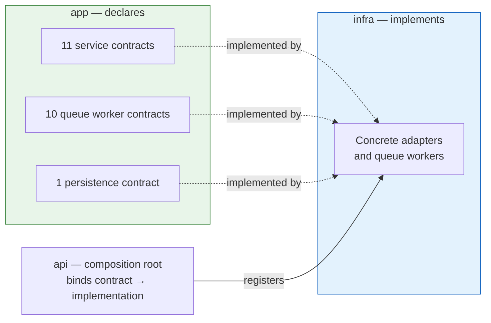
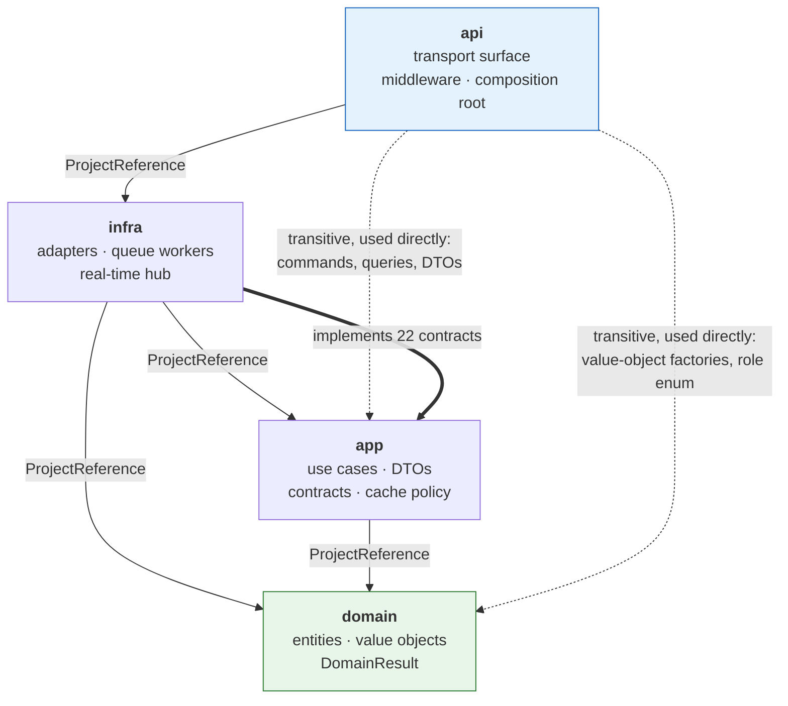
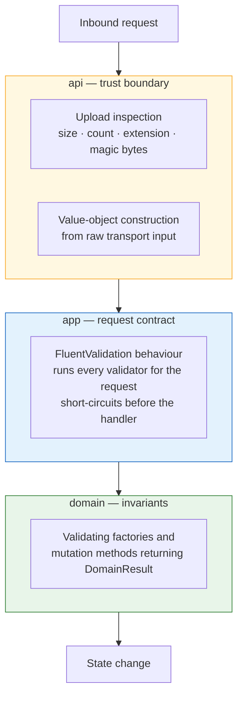
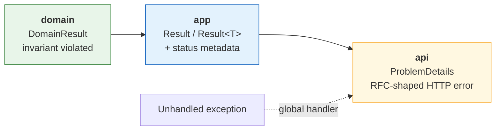
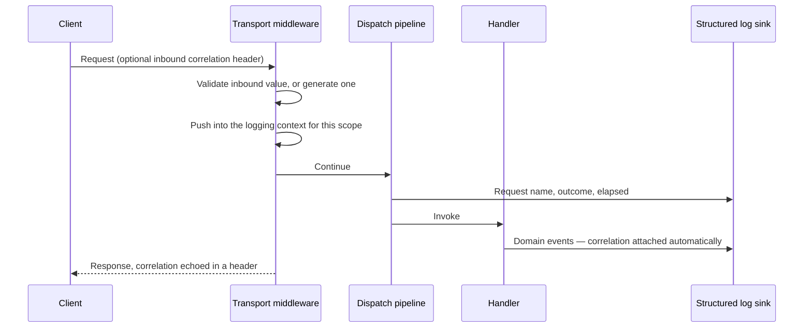

# Software Architecture & Layering Specification

The normative rules governing how code in this system is layered, what each layer may depend on, and
what is prohibited. This is the document to consult before adding a project, introducing a dependency,
or deciding where a new piece of logic belongs.

System-level design and quality attributes are in [`system-design.md`](./system-design.md);
implementation inventory and file layout are in [`developer-guide.md`](./developer-guide.md);
conventions for naming and scaffolding are in [`project-rules.md`](./project-rules.md).

---

## 1. Architectural Style & Core Principles

### 1.1 Style

A **four-project layered monolith** with a **pragmatic CQRS application layer** and **dependency
inversion at the infrastructure boundary**.

Layers are declared innermost-first. Each layer may know about the layers before it and must remain
ignorant of those after it:

```
domain  →  app  →  infra  →  api
```

| Layer | Owns | Knows nothing about |
|---|---|---|
| `domain` | Entities, value objects, domain invariants, the `DomainResult` outcome type, text normalization | Persistence, transport, frameworks, other layers |
| `app` | Use cases (commands and queries), DTOs, validation rules, cache key policy, pagination, and the **interface contracts** for every infrastructure capability | Concrete adapters, HTTP, SignalR, the composition root |
| `infra` | Implementations of those contracts: persistence, cache, messaging, object storage, email, push, real-time hub, and background workers | The `api` project |
| `api` | Transport binding, the HTTP and WebSocket surface, middleware, and composition of the object graph | — |

### 1.2 Pragmatic CQRS

Commands and queries are separated as **use-case units**, not as separate models or stores.

| Aspect | Decision | Rationale |
|---|---|---|
| Dispatch | One MediatR request type and one handler per use case | Every use case has exactly one entry point and one place to change |
| Segregation | `command` and `query` are folder-level classifications | Makes intent explicit without a second model to maintain |
| Data store | **A single store serves both sides** | No projection lag, no read-model rebuild, no dual-write problem |
| Read model | Queries project directly into DTO shapes at the store | Avoids loading full aggregates for list reads |

**This is CQRS as a code-organisation discipline, not as an eventually-consistent read-model
architecture.** A query handler reads the same documents a command handler wrote, through the same
driver. The benefit taken is comprehensibility and a uniform pipeline; the benefit deliberately not
taken is independent read/write scaling.

### 1.3 Dependency inversion at the infrastructure boundary

This is the one genuinely inverted boundary in the system, and it is the reason `infra` references
`app` rather than the reverse.



**22 interfaces** are declared in `app` and implemented in `infra`:

| Category | Count | Covers |
|---|---|---|
| Persistence | 1 | Collection access |
| Queue workers | 10 | The business operation behind each category of deferred work |
| Services | 11 | Cache, messaging, object storage, email, push, token issuance, hashing, one-time passcodes, registration tokens, identity access |

Consequences that must be preserved:

- **`app` never names a concrete adapter.** It depends on contracts only, resolved through the
  container.
- **Adding an infrastructure capability means declaring the contract in `app` first**, then
  implementing it in `infra`. The reverse order will not compile, and that is intentional.
- **Queue worker contracts live in `app` while their policy lives in `infra`.** This is a knowing
  deviation, documented in §5.4.

---

## 2. Project Reference Rules & Dependencies

### 2.1 Normative dependency rules

These are enforced by MSBuild. The table is exhaustive — no other `ProjectReference` exists or may be
added.

| Project | May reference | Must never reference | Enforcement |
|---|---|---|---|
| `domain` | **nothing** | everything | Zero `ProjectReference`, and **zero `PackageReference`** — the domain has no third-party dependencies at all |
| `app` | `domain` | `infra`, `api` | Single `ProjectReference` to `domain` |
| `infra` | `domain`, `app` | `api` | References both; implements the contracts `app` declares |
| `api` | `infra` only | — | Reaches `app` and `domain` transitively |

### 2.2 Dependency topology



All arrows point inward toward `domain`, which has no outward edge. `infra → app` is **not** an
inversion violation: `app` owns the contracts, `infra` supplies the implementations, and the arrow
follows the compile-time dependency while control flows the other way at runtime.

### 2.3 Permitted transitive usage

`api` references only `infra` but legitimately uses types from `app` and `domain`:

| `api` uses from | Permitted | Prohibited |
|---|---|---|
| `domain` | Value-object factories to parse request input; the role enum for authorization attributes | Invoking entity behaviour or enforcing invariants |
| `app` | Command and query types; DTO types for response shaping | Reaching into handlers, validators or cache policy |
| `infra` | Nothing directly except composition-root registration and hub routing | Calling an adapter from a controller |

### 2.4 Adding a project

A new project is justified only when it introduces a genuinely new dependency direction. Before
adding one, confirm it cannot be a folder inside an existing project. If it is added, it must take a
position in the chain above and declare its references explicitly — **no project may reference `api`.**

---

## 3. Domain & Persistence Guidelines

### 3.1 Entity encapsulation

Every entity follows the same construction and mutation protocol:

| Rule | Mechanism |
|---|---|
| Entities are not constructible from outside | Private constructor |
| Construction is validating | `static DomainResult<T> Create(...)` — returns a failure result instead of throwing |
| Mutation is validating | Instance methods return `DomainResult`, never `void` |
| State is not publicly settable | `private set` on every property; collections exposed as read-only projections over private backing fields |
| Invariants live with the data | Enforced inside the entity, never in a handler |

`DomainResult` is the domain's outcome type: a success/failure carrier with a message, and
`DomainResult<T>` adds a value. It exists so the domain can reject an operation **without exceptions
and without referencing a result library**, which is what keeps `domain` free of package dependencies.

Lifecycle transitions are owned by the shared entity base: an update or delete is refused on an
already-deleted entity, and recovery is refused on a live one. **Soft delete is universal** — see
[`system-design.md`](./system-design.md#36-lifecycle-management--soft-delete-and-scheduled-purge)
for the retention policy.

### 3.2 Value objects

Three value objects wrap primitives with validation: an email address, a display name, and a bounded
numeric amount. Each is constructed through the same validating factory pattern.

**A value object is used wherever the primitive would permit an invalid state.** Value objects are
constructed at the transport boundary, so a malformed input is rejected before any use case is
dispatched.

One deliberate constraint: the numeric amount serves two roles — a bounded user rating and an
unbounded counter — and therefore **cannot carry an upper bound**. Range constraints on ratings live
in the validation layer instead (§4.1).

### 3.3 MongoDB integration model

The system uses the MongoDB driver **directly from the application layer**. There is no repository
abstraction.

| Decision | Detail | Consequence |
|---|---|---|
| **Direct driver reference in `app`** | Handlers compose filters, updates and projections themselves; the persistence contract exposes only typed collection access | `app` carries a driver package reference. Query composition is explicit and reviewable at the use-case site, not hidden behind a generic repository |
| **Entities are the stored documents** | No persistence attributes on any entity | The domain stays framework-clean, but **a property rename is a schema change** |
| **Mapping is declared externally** | `BsonConfiguration` registers class maps centrally | Private backing fields are surfaced under their public names and remain queryable; value objects deserialize through their validating factories rather than bypassing them |
| **Optional fields are omitted, not nulled** | Ignore-if-null on optional fields | Required for sparse and geospatial indexes to skip documents that lack the field rather than fail on it |

Rationale for rejecting a repository layer: with a single store, no second persistence technology on
the roadmap, and query shapes that differ per use case, a repository would be a pass-through
abstraction that obscures index usage — the single most important property of a query here — without
buying substitutability the system will not use.

### 3.4 Concurrency and atomicity

**No multi-document transactions. No sessions. No pessimistic locks.**

Aggregate boundaries are drawn so that every contended mutation fits in **one document**, which makes
a single atomic update sufficient:

| Technique | Applied to |
|---|---|
| Conditional update — the filter encodes the precondition | "React only if not already reacted"; "follow only if the edge is absent" |
| Counter maintenance via `$inc` **in the same operation** as the array push or pull | Every denormalised count |
| Zero-match as the conflict signal | A matched-count of zero means the precondition failed; it is translated into a domain failure, never retried blindly |
| Bulk write with mutually exclusive filters per side | Two-sided relationships, where a partially applied edge self-repairs on the next attempt |

**The rule this establishes:** a write that mutates a collection and a counter summarising it must do
so in one operation. A read-modify-write sequence is prohibited (§5.2), because it reintroduces the
lost-update problem that this model exists to avoid.

### 3.5 Caching policy ownership

Cache **key shape, TTL and invalidation policy are declared in `app`**; cache **execution lives in
`infra`**. A handler decides what to cache and what to invalidate; it never constructs a Redis
command.

The invalidation contract a write must satisfy — bump every feed signature whose projection contains
a field this write changed — is specified in
[`system-design.md`](./system-design.md#33-cache-invalidation--version-counter-strategy).

---

## 4. Cross-Cutting Concerns & Validation Pipeline

### 4.1 Multi-layered validation model

Validation is distributed across three layers, each owning a different **class** of rule. The layering
is intentional: each rule sits at the innermost layer capable of expressing it.



| Layer | Owns | Examples |
|---|---|---|
| **`domain`** | Format and structural invariants that must hold for the type to exist at all | Email shape, display-name constraints, lifecycle transition legality |
| **`app`** | Request-contract rules: presence, range, length, and cross-field consistency | Password length, caption and reason length ceilings, rating range, pagination bounds |
| **`api`** | Trust-boundary rules over untrusted binary input | Upload size and count ceilings, extension allowlist, content-signature inspection |

**Where a rule cannot be expressed on the entity, it lives in the validation layer and applies only to
the entry points that declare it.** Rating range is the canonical case (§3.2). This has a direct
implication for extension: **a new entry point into an existing operation does not inherit the
existing validator** — it must declare its own.

The validation behaviour runs **before** the handler and short-circuits on failure, so a handler may
assume its request has already satisfied every declared rule.

### 4.2 Error handling standard

One outcome type per layer, translated exactly once at each boundary. **Exceptions are not the
control-flow mechanism for expected failures.**



| Stage | Contract |
|---|---|
| `domain` | Returns `DomainResult` / `DomainResult<T>`; never throws for a business rule |
| `app` | Every handler returns `Result` or `Result<T>`. Failures carry **status metadata** naming the intended HTTP semantic — not found, conflict, forbidden, bad request |
| `api` | Translates the result into a success status with a body, an accepted status for deferred work, or an RFC-shaped error. The status is taken from the metadata; the default is a client error, never a server error |
| Anything unhandled | Caught globally and rendered in the same error shape, so no raw exception escapes to a client |

**`Result<T>` is mandatory for every handler.** The validation behaviour constructs the response type
reflectively when short-circuiting, so a handler returning any other type fails at runtime rather than
at compile time. This is a hard constraint, restated as a guardrail in §5.1.

### 4.3 Distributed tracing and logging

A **correlation identifier** is established at the transport boundary and propagated through every
layer for the lifetime of a request:



| Property | Rule |
|---|---|
| **Inbound trust** | An inbound correlation value is accepted only if it satisfies a length and character-set constraint; otherwise one is generated. Client-supplied values are never used unvalidated |
| **Propagation** | Pushed into the ambient logging context, so every event emitted within the request scope carries it without being passed explicitly |
| **Echo** | Returned to the client, so a user-reported failure can be traced to exact server events |
| **Format** | One structured JSON object per event with properties flattened to the top level, so a log backend can filter on any property without parsing nested objects |
| **Sink** | Console only, by design — the runtime host owns capture, retention and shipping |

**Performance instrumentation is deliberately doubled.** The elapsed time of a request is measured at
both the transport layer and the dispatch layer against the same threshold. The difference between the
two readings isolates middleware and serialization cost from use-case cost, which is the first
diagnostic question when the latency SLA is breached.

### 4.4 Concern ownership summary

| Concern | Declared in | Executed in |
|---|---|---|
| Authentication | `api` | `api` |
| Authorization — role | `api` | `api` |
| Authorization — ownership | `app` | `app`, as a query precondition |
| Identity access | `app` (contract) | `infra` |
| Validation | all three layers, by class of rule (§4.1) | — |
| Error translation | each layer translates once (§4.2) | — |
| Logging, correlation, performance | `api` and `app` | `api` and `app` |
| Rate limiting | `api` | `api` |
| Cancellation scope | `app` | `app`, as a pipeline behaviour |
| Cache policy | `app` | `infra` |
| Serialization mapping | `infra` | `infra` |

**Identity access has one behaviour every contributor must know: it resolves from the HTTP context and
therefore returns nothing inside a queue worker.** Workers have no request scope. Any identity a
worker needs must be carried in the message payload.

---

## 5. Architectural Guardrails (Banned Practices)

Violations of the rules in this section are architectural defects, not style preferences. Each states
the rule, the reason, and the correct alternative.

### 5.1 Layer responsibility

> **Do not put domain logic in a controller.**
> A controller binds input, constructs value objects, dispatches one request, and maps the outcome.
> Branching on business state, composing queries, or deciding what a valid operation is belongs in a
> handler.

> **Do not mutate state outside a handler or a queue worker.** These are the only two places a write
> may originate. Middleware, controllers, validators, mappers and serializers are read-only with
> respect to system state.

> **Do not return anything but `Result` or `Result<T>` from a handler.** The validation pipeline
> constructs the response type reflectively; any other return type fails at runtime rather than at
> compile time (§4.2).

> **Do not bypass the dispatch pipeline.** A controller must not call a service, an adapter or another
> handler directly. Every use case enters through one dispatch so that logging, performance
> measurement and validation apply uniformly.

> **Do not put business policy in `api`.** If a rule would still be true for a non-HTTP caller, it does
> not belong in the transport layer.

### 5.2 Persistence

> **Do not introduce multi-document transactions or sessions.** Aggregate boundaries are drawn so that
> every contended write fits in one document. A change that appears to need a transaction is a signal
> that the aggregate boundary is wrong — fix the boundary, not the isolation level.

> **Do not read-modify-write a contended field.** Express the precondition in the update filter and
> treat a zero match as the conflict. A load-then-save sequence reintroduces lost updates (§3.4).

> **Do not mutate a collection without maintaining its counter in the same operation.** There is no
> reconciliation process; a counter that drifts stays drifted.

> **Do not carry the caller's cancellation token into the second and later writes of a command.**
> A command is rarely one write, and a client that disconnects mid-request cancels the token — which
> used to commit the first write and skip the rest. The pipeline substitutes a non-cancellable token
> for every command, so this holds by default; a handler that reintroduces a request-scoped token
> after its first write breaks it again.

> **Do not enumerate a cascade's targets by a predicate the cascade itself falsifies.** Listing rows
> as live and then marking them deleted means the list is empty on every redelivery, so a failure
> between the two loses the remaining work silently. Enumerate on the post-state.

> **Do not hard-delete.** Deletion is soft everywhere, and the retention sweep owns permanence. A hard
> delete removes the recovery window and desynchronises any cascade that expects the row to still be
> addressable.

> **Do not add a unique index without scoping it to live rows.** A global uniqueness constraint makes a
> deleted account's email permanently unusable.

> **Do not add persistence attributes to a domain entity.** Mapping is declared centrally; an attribute
> on an entity puts a storage concern inside the dependency-free layer.

### 5.3 Caching

> **Do not invalidate by deleting keys.** Increment the version counter. Key deletion cannot enumerate
> every cursor, page size and viewer variant.

> **Do not include viewer-specific data in an invalidation counter key.** A writer cannot compute a
> viewer's filter set, so a viewer-scoped counter is one no write can reach (§3.5).

> **Do not cache a per-viewer result under a shared key.** Membership flags and filtered feeds must
> either carry a viewer discriminator in the **page** key or not be cached at all.

> **Do not interpolate unsanitised user input into a cache key.** Keys are delimiter-structured; raw
> input can forge a key belonging to another reader. Hash user-supplied key components.

> **Do not treat the cache as optional for token-protection key material.** It is authoritative for
> that data (see [`system-design.md`](./system-design.md#35-the-cache-exception-token-protection-key-material)).

### 5.4 Messaging

> **Do not add a non-idempotent queue worker.** Redelivery is guaranteed, and the idempotency record is
> written after the work completes. Every worker's effect must be safe to apply twice — normally by
> expressing it as a conditional update.

> **Do not split an operation and its inverse across two queues.** They share one queue and a
> distinguishing flag, because concurrent consumption reorders them
> ([`system-design.md`](./system-design.md#43-sequential-ordering-for-inverse-operation-pairs)).

> **Do not perform unbounded work inside a single message.** A cascade over a collection whose size
> grows with user activity must emit one message per item, so each unit retries independently.

> **Do not let a notification-transport failure fail the message.** Delivery side effects are wrapped
> so a transport error cannot unwind committed work or trigger a retry of it.

> **Do not read request identity inside a worker.** There is no request scope; identity travels in the
> payload (§4.4).

### 5.5 Contracts and dependencies

> **Do not reference a concrete adapter from `app`.** Declare a contract and inject it. This is the one
> boundary the architecture actually inverts, and it is what keeps use cases testable.

> **Do not add a package reference to `domain`.** It has none, deliberately. A domain concept that
> appears to need a library is a signal the concept belongs in `app`.

> **Do not reference `api` from any project.** It is the composition root and terminal by definition.

> **Do not register a background worker in a way that deduplicates by implementation type.** Several
> queues legitimately share a generic worker type; a registration path that deduplicates silently
> drops all but the first, with no build or startup error.

### 5.6 Known deviations

These already exist, are deliberate, and are **not** precedents to extend.

| Deviation | Why it stands | The constraint it imposes |
|---|---|---|
| **Queue-worker business policy lives in `infra`** while its contract lives in `app` | Workers are the transactional edge of the messaging adapter; splitting policy from transport would fragment a single unit of work | New deferred work follows the same placement. Do not scatter half of it into a handler |
| **`infra` carries a web-framework reference** for the real-time hub and identity access | The hub is an adapter over a transport, and identity access reads the ambient request context | Confined to the hub, the identity reader and push transport. Do not add controllers or HTTP routing to `infra` |
| **Persistence types appear in `app`** because there is no repository (§3.3) | Keeps index usage explicit at the query site | Confined to handlers and query helpers. Do not let driver types reach `domain` |
| **Domain value objects cross the API contract** rather than being flattened to primitives in DTOs | Avoids a parallel primitive DTO hierarchy | Any DTO exposing a value object requires a registered converter before it can be serialized to the cache |
| **Two independent performance measurements** at the transport and dispatch layers (§4.3) | The delta is a diagnostic signal | Expect two warnings per slow request; this is intended, not duplication to remove |
