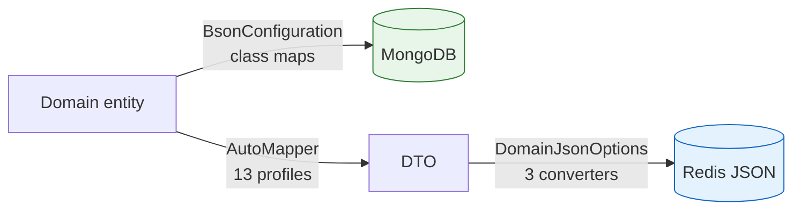
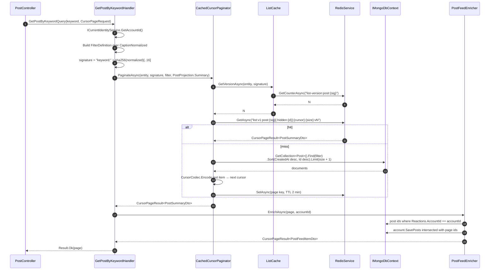

# Developer Guide

Implementation-level reference for working in this codebase: what exists and how much of it, where
files live, how queues and workers are wired, how documents and cache payloads are serialized, and the
exact call sequences behind the three non-obvious runtime flows.

This is the onboarding document. The rules it operates under are in
[`architecture.md`](./architecture.md); the system-level rationale is in
[`system-design.md`](./system-design.md); naming and scaffolding conventions are in
[`project-rules.md`](./project-rules.md); per-endpoint behaviour is in [`features.md`](./features.md).

All counts below are measured from the tree, not estimated. Re-measure before trusting them after a
feature lands.

---

## 1. Codebase Inventory

### 1.1 Totals

| Metric | Value |
|---|---|
| `.cs` files (excluding `bin/`, `obj/`) | 407 |
| Projects | 4 — `domain`, `app`, `infra`, `api`, all targeting `net9.0` |
| Build result | **0 errors, 55 warnings** (`Release`) — all `CS8600` / `CS8604` / `CS8618` nullable warnings; not treated as errors |

### 1.2 `api` — transport surface

| Artifact | Count | Notes |
|---|---|---|
| **Controllers** | **13** | All carry a class-level `[Authorize]` |
| **Endpoints** | **83** | 41 `GET`, 19 `POST`, 8 `PUT`, 15 `DELETE` |
| Anonymous endpoints | 8 | `AccountController` 3, `AuthController` 2, `EmailController` 3 |
| Administrator endpoints | 15 | `[Authorize(Roles = nameof(Role.Admin))]` |
| **Request records** | **16** | `src/api/request/` |
| Middleware | 2 | `CorrelationIdMiddleware`, `PerformanceMiddleware`, each with a `UseX` extension |
| Common helpers | 4 | `ResultExtensions`, `ResultStatusMapper`, `RateLimiterPolicy`, `ImageUpload` |

Endpoints per controller:

| Controller | Endpoints | Controller | Endpoints |
|---|---|---|---|
| `AccountController` | 17 | `FollowController` | 6 |
| `PostController` | 12 | `ReactionController` | 6 |
| `CommentController` | 8 | `SaveController` | 6 |
| `ShopController` | 7 | `AuthController` | 5 |
| `NotificationController` | 4 | `BlockController` | 3 |
| `ReportController` | 4 | `EmailController` | 3 |
| `DashboardController` | 2 | | |

The 16 request records: `ChangeBioRequest`, `ChangeCaptionRequest`, `ChangeContentRequest`,
`ChangeEmailRequest`, `ChangeNameRequest`, `ChangePasswordRequest`, `ChangeRateRequest`,
`CreateAccountRequest`, `CreateReportRequest`, `LoginRequest`, `RecoverAccountRequest`,
`RegisterDeviceRequest`, `RequestNewAccessTokenRequest`, `ResetPasswordRequest`, `SendEmailRequest`,
`VerifyEmailRequest`.

### 1.3 `app` — use cases

| Artifact | Count | Notes |
|---|---|---|
| **MediatR handlers** | **83** | 42 commands + 41 queries |
| Commands | 42 | 39 under `command/`, plus the 3 email use cases that sit directly under `feature/email/` |
| Queries | 41 | |
| **Validators** | **46** | 41 of 42 commands; 5 of 41 queries |
| **DTO shapes** | **21** | |
| AutoMapper profiles | 13 | One per aggregate |
| Queue message records | 9 | |
| Pipeline behaviours | 4 | `LoggingBehavior` → `PerformanceBehavior` → `ValidationBehavior` → `WriteCancellationBehavior` |
| Pagination types | 7 | |
| Membership helpers | 5 | |
| Interfaces | 22 | 1 persistence, 10 queue, 11 service |

**The only command without a validator** is `DeleteAccount`, which takes no parameters.
**The 5 queries that have one** are `GetAccountByKeyword`, `GetPostByKeyword`, `GetShopByKeyword`,
`GetReportByTarget` and `GetBestShopAround` — the ones taking constrained input rather than an id
alone.

The 21 DTOs: `AccountDto`, `AccountSummaryDto`, `AvatarDto`, `BlockDto`, `CommentDto`,
`CommentSummaryDto`, `DashboardActivityDto`, `DashboardStatsDto`, `FollowerDto`, `FollowingDto`,
`ImageDto`, `NotificationSummaryDto`, `PostDto`, `PostFeedItemDto`, `PostSummaryDto`, `ReactionDto`,
`RefreshTokenDto`, `ReportDto`, `ShopDetailDto`, `ShopDto`, `ShopSummaryDto`.

The 7 pagination types: `CursorCodec`, `CursorPageRequest`, `CursorPageResult`, `CursorPaginator`,
`EmbeddedArrayPaginator`, `CachedCursorPaginator`, `CachedEmbeddedArrayPaginator`.

The 5 membership helpers: `ReactionMembership`, `SaveMembership`, `PostFeedEnricher`,
`BlockedAccountSet`, `BlockGuard`.

### 1.4 `infra` — adapters and workers

| Artifact | Count | Notes |
|---|---|---|
| Service adapters | 13 | 11 implement `app` contracts; `ApnsTokenProvider` and `RabbitMQPublishChannel` are supporting singletons |
| **Queue workers** | **10** | |
| Queues | 12 | Plus 12 `.retry` and 12 `.dlq` — **36 total** |
| **Hosted services** | **16** | 12 `QueueConsumerHost<TMessage>` + 4 lifecycle services |
| Health checks | 3 | `MongoHealthCheck`, `RedisHealthCheck`, `RabbitMQHealthCheck` |
| JSON converters | 3 | Plus `DomainJsonOptions` |
| Persistence configuration | 7 | Class maps, serializer, indexes, initializers, seeder, purge host |
| Index models | 44 | Declared in `IndexConfiguration` |

The 15 adapters: `ApnsService`, `ApnsTokenProvider`, `ApplePlaceService`, `BCryptService`,
`CurrentIdentityService`, `EmailService`, `JwtService`, `MapsTokenProvider`, `NotificationService`,
`OtpService`, `R2Service`, `RabbitMQPublishChannel`, `RabbitMQService`, `RedisService`,
`RegistrationService`.

`RabbitMQPublishChannel` is a singleton holding one channel and the set of queues declared on it.
`RabbitMQService` is scoped and used to open a channel and redeclare the queue on every publish —
three broker round trips to send one message, on the path every reaction, follow, save and comment
takes.

The 4 non-queue hosted services: `IndexInitializer`, `NormalizedFieldBackfillInitializer`,
`AdminSeeder`, `SoftDeletePurgeHost`.

### 1.5 `domain`

| Artifact | Count | Names |
|---|---|---|
| Entities | 16 + `BaseEntity` | `Account`, `Avatar`, `Block`, `Comment`, `DeviceToken`, `Follower`, `Following`, `Image`, `Notification`, `Post`, `Reaction`, `RefreshToken`, `Report`, `SavedPost`, `SavedShop`, `Shop` |
| Value objects | 3 | `Amount`, `Email`, `Name` |
| Enums | 3 | `Role` (2 values), `NotificationType` (4 values), `ApnsEnvironment` (2 values) |
| Common | 2 | `DomainResult` / `DomainResult<T>`, `TextNormalizer` |
| Package references | **0** | |

Only 8 of the 16 entities own a collection. The rest are embedded:

| Embedded in | Types |
|---|---|
| `account` | `Avatar`, `Follower`, `Following`, `Block`, `SavedPost`, `SavedShop` |
| `post` | `Image`, `Reaction` |
| `comment` | `Image`, `Reaction` |

### 1.6 Namespaces and type conventions

Namespaces are **flat and lowercase, one per project**. A type under
`app/feature/post/query/GetMyPost/` is still `namespace app;` — folders carry no namespace meaning, so
**every type name must be unique within its project.**

| Namespace | Files |
|---|---|
| `namespace app;` | 303 |
| `namespace infra;` | 40 |
| `namespace api;` | 38 |
| `namespace domain;` | 25 |

406 of 407 files declare one; `Program.cs` uses top-level statements. 354 types are `sealed`; the four
that are not are `BaseEntity` (abstract), `DomainResult`, `DomainResult<T>` (inherited from) and
`DbContext`.

---

## 2. Directory Structure

Counts in brackets are `.cs` files **directly** in that folder, not recursive.

```
src/
├── Bump.sln
│
├── domain/                     [0]  zero project and package dependencies
│   ├── common/                 [2]  DomainResult / DomainResult<T>; TextNormalizer
│   └── core/
│       ├── entity/             [17] aggregates + embedded types + BaseEntity
│       ├── enum/               [3]  Role, NotificationType, ApnsEnvironment
│       └── valueobject/        [3]  Amount, Email, Name
│
├── app/                        [1]  DependencyInjection.cs — AddApp
│   ├── common/                 [3]  CollectionName, QueueName, AppError
│   │   ├── behavior/           [3]  Logging → Performance → Validation
│   │   ├── cache/              [2]  CacheKey, ListCache
│   │   ├── dto/                [21] response and cache shapes
│   │   ├── interface/
│   │   │   ├── persistence/    [1]  IMongoDbContext
│   │   │   ├── queue/          [10] one per queue worker
│   │   │   └── service/        [11] adapter contracts
│   │   ├── mapping/            [13] one AutoMapper Profile per aggregate
│   │   ├── membership/         [5]  per-viewer flags and filters
│   │   ├── message/            [9]  queue payloads; every one carries a MessageId
│   │   └── pagination/         [7]  cursor codec, paginators, cached wrappers
│   └── feature/                     83 use cases
│       └── <area>/
│           ├── <Area>Projection.cs        area-shared Mongo projection
│           ├── command/<UseCase>/         Command + Handler + Validator
│           └── query/<UseCase>/           Query + Handler (+ Validator if constrained)
│
├── infra/                      [1]  DependencyInjection.cs — AddInfra
│   ├── health/                 [3]  one IHealthCheck per backing service
│   ├── hub/                    [2]  NotificationHub, AccountIdUserIdProvider
│   ├── persistence/
│   │   ├── configuration/      [7]  BsonConfiguration, BackingFieldBsonSerializer,
│   │   │                            IndexConfiguration, IndexInitializer,
│   │   │                            NormalizedFieldBackfillInitializer,
│   │   │                            AdminSeeder, SoftDeletePurgeHost
│   │   └── dbcontext/          [1]  DbContext
│   ├── queue/                  [1]  QueueConsumerHost<TMessage>
│   │   ├── account/            [1]  AccountService — the delete cascade
│   │   ├── block/              [1]  BlockService
│   │   ├── comment/            [1]  CommentService
│   │   ├── follow/             [1]  FollowService
│   │   ├── post/               [1]  PostService
│   │   ├── profile/            [1]  ProfileService
│   │   ├── reaction/           [2]  ReactPostService, ReactCommentService
│   │   ├── save/               [1]  SaveService
│   │   └── shop/               [1]  ShopRateService
│   ├── serialization/          [4]  value-object JSON converters + DomainJsonOptions
│   └── service/                [13] Redis, RabbitMQ, R2, email, JWT, BCrypt,
│                                    OTP, identity, registration, APNs ×2, notification
│
└── api/                        [2]  Program.cs, DependencyInjection.cs
    ├── Properties/             [0]  launchSettings.json only
    ├── common/                 [4]  ResultExtensions, ResultStatusMapper,
    │                                RateLimiterPolicy, ImageUpload
    ├── controller/             [13] one per resource
    ├── middleware/             [4]  CorrelationId + Performance, each with a UseX extension
    └── request/                [16] HTTP body records
```

### 2.1 Placement rules

| Scope | Location |
|---|---|
| Used by exactly one use case | Inside that use case's folder — e.g. `ReportTarget.cs` lives in `query/GetReportByTarget/` |
| Shared across one area | One level up, at `feature/<area>/` — the `*Projection.cs` files and `AuthResult.cs` |
| Shared across areas | `app/common/<role>/` |
| Cross-controller plumbing | `api/common/` |

**Two structural exceptions exist in the tree**, both intentional and both worth knowing so they are
not mistaken for a pattern to copy:

- `app/feature/email/` omits the `command`/`query` level — its three use cases sit directly under the
  area folder.
- `infra/queue/<area>/` holds only the worker. The consumer host is the single generic one level up;
  area folders never contain a host.

### 2.2 Type visibility

| Type | Accessibility | Reason |
|---|---|---|
| Handlers | `internal sealed` | Nothing outside `app` dispatches them directly |
| Validators | `internal sealed` | Registered with `includeInternalTypes: true` |
| Commands, queries, DTOs | `public sealed` | `api` references them |
| Entities | `public sealed` with private constructors | Constructed only through static factories |

---

## 3. Queue & Message Worker Specs

### 3.1 Queue topology

Every queue is provisioned as a three-tier set:

| Tier | Name | Consumer | Purpose |
|---|---|---|---|
| Work | `{queue}` | `QueueConsumerHost<TMessage>` | Live processing |
| Delay | `{queue}.retry` | **none** | `x-message-ttl` of 30 s, then dead-letters back to `{queue}` |
| Dead letter | `{queue}.dlq` | **none** | Terminal; retained for inspection |

All queues are declared `durable: true`, non-exclusive, non-auto-delete. Messages are published with
`Persistent = true`. Consumers use `prefetchCount: 1` with manual ack.

### 3.2 The 12 queues

Queue names are constants on `QueueName` (`src/app/common/QueueName.cs`). Registration happens in
`AddInfra` via the private `AddQueueConsumer<TMessage>` helper.

| Queue | Message record | Contract | Worker method(s) |
|---|---|---|---|
| `follow` | `FollowMessage` | `IFollowService` | `ProcessFollowAsync` / `ProcessUnfollowAsync` |
| `block` | `BlockMessage` | `IBlockService` | `ProcessBlockAsync` / `ProcessUnblockAsync` |
| `react-post` | `ReactionMessage` | `IReactPostService` | `ProcessReactPostAsync` / `ProcessUnreactPostAsync` |
| `react-comment` | `ReactionMessage` | `IReactCommentService` | `ProcessReactCommentAsync` / `ProcessUnreactCommentAsync` |
| `create-comment` | `CommentMessage` | `ICommentService` | `ProcessCreateCommentAsync` |
| `recalculate-shop-rate` | `RecalculateShopRateMessage` | `IShopRateService` | `ProcessRecalculateShopRateAsync` |
| `save-post` | `SaveMessage` | `ISaveService` | `ProcessSavePostAsync` / `ProcessUnsavePostAsync` |
| `save-shop` | `SaveMessage` | `ISaveService` | `ProcessSaveShopAsync` / `ProcessUnsaveShopAsync` |
| `delete-account` | `AccountMessage` | `IAccountService` | `ProcessAfterDeleteAsync` |
| `delete-post` | `PostMessage` | `IPostService` | `ProcessAfterDeleteAsync` |
| `delete-comment` | `CommentMessage` | `ICommentService` | `ProcessAfterDeleteAsync` |
| `profile-changed` | `ProfileMessage` | `IProfileService` | `ProcessProfileChangedAsync` |

**Rows with two methods share one queue and branch on the message's `IsUndo` flag.** Registering the
inverse on its own queue would let the two be consumed concurrently and apply out of order.

`profile-changed` needs no such pairing and no ordering guarantee: the worker re-reads the account's
current name and avatar rather than applying a delta, so two changes consumed out of order still
leave the latest values in place.

### 3.3 Message payloads

All 9 records carry a `MessageId` as their first parameter; it is the idempotency key.

| Record | Payload beyond `MessageId` |
|---|---|
| `FollowMessage` | `FollowerId`, `FollowingId`, `IsUndo` |
| `BlockMessage` | `BlockerId`, `BlockedId`, `IsUndo` |
| `ReactionMessage` | `AccountId`, `TargetId`, `IsUndo` |
| `SaveMessage` | `AccountId`, `TargetId`, `IsUndo` |
| `CommentMessage` | `AccountId`, `CommentId` |
| `RecalculateShopRateMessage` | `ShopId` |
| `AccountMessage` | `AccountId` |
| `PostMessage` | `PostId` |
| `ProfileMessage` | `AccountId` |

### 3.4 Registration mechanics — why not `AddHostedService`

The 12 registrations close only **9 distinct** `QueueConsumerHost<TMessage>` generics:

| Message type | Queues closing the same generic |
|---|---|
| `ReactionMessage` | `react-post`, `react-comment` |
| `CommentMessage` | `create-comment`, `delete-comment` |
| `SaveMessage` | `save-post`, `save-shop` |

`AddHostedService` routes through `TryAddEnumerable`, which **deduplicates by implementation type**.
Using it here would silently drop 3 of the 12 consumers with no error at build or startup. The helper
therefore registers directly:

```csharp
services.AddSingleton<IHostedService>(provider => new QueueConsumerHost<TMessage>(
    queueName, messageId, handle,
    provider.GetRequiredService<IServiceScopeFactory>(),
    provider.GetRequiredService<ILogger<QueueConsumerHost<TMessage>>>()));
```

### 3.5 Consumer runtime behaviour

| Constant | Value | Defined in |
|---|---|---|
| `MaxAttempts` | 3 | `RabbitMQService` |
| `RetryDelay` | 30 s | `RabbitMQService` |
| `IdempotencyTtl` | 24 h | `RabbitMQService` |
| `RetryCountHeader` | `x-retry-count` | `RabbitMQService` |
| Consume-loop restart delay | 5 s | `QueueConsumerHost` |

Each consumer resolves a **fresh DI scope per message**, so scoped services behave as they do in a
request. `ICurrentIdentityService.GetAccountId()` returns `null` inside a worker — there is no HTTP
context, and every identity a worker needs travels in the payload.

### 3.6 Adding a new queue

1. Add a constant to `QueueName`.
2. Add a `*Message` record under `app/common/message/` with `MessageId` first.
3. Declare the contract in `app/common/interface/queue/`.
4. Implement the worker in `infra/queue/<area>/`.
5. Register the scoped service and add one `services.AddQueueConsumer<TMessage>(...)` line in
   `AddInfra`.
6. Publish from the handler with `IRabbitMQService.PublishAsync`.

The work must be **idempotent** — normally by expressing it as a conditional update whose precondition
is already false after the first application.

### 3.7 Non-queue hosted services

| Service | Trigger | Behaviour |
|---|---|---|
| `IndexInitializer` | Startup | Creates the 45 index models without blocking startup |
| `NormalizedFieldBackfillInitializer` | Startup | Cursor-scans for documents missing normalized fields, applies `BulkWriteAsync` per batch |
| `AdminSeeder` | Startup | Creates or promotes the administrator from `Admin__Email` / `Admin__Password`; skipped and logged when unset |
| `SoftDeletePurgeHost` | `PeriodicTimer` | 10-minute startup delay, then every 6 h; purges rows deleted more than 30 days ago in batches of 500 with a 200 ms pause |

---

## 4. Data Serialization & Mongo Mapping

Two independent serialization paths exist and must not be confused: **BSON** for the document store,
and **System.Text.Json** for cache payloads.



### 4.1 BSON class maps

`BsonConfiguration.Register()` runs first in `AddInfra`. It exists because **entities carry no
persistence attributes** — all mapping is declared centrally so `domain` stays framework-free.

It performs three jobs:

**1. Private backing-field mapping.** Collections are exposed as `IReadOnlyCollection<T>` over private
`List<T>` fields, which the driver cannot map by convention. Nine fields are mapped explicitly under
their public names:

| Backing field | Public name | Declared on |
|---|---|---|
| `_avatars` | `Avatars` | `Account` |
| `_followers` | `Followers` | `Account` |
| `_followings` | `Followings` | `Account` |
| `_blocks` | `Blocks` | `Account` |
| `_blockedBy` | `BlockedBy` | `Account` |
| `_savePosts` | `SavePosts` | `Account` |
| `_saveShops` | `SaveShops` | `Account` |
| `_images` | `Images` | `Post`, `Comment` |
| `_reactions` | `Reactions` | `Post`, `Comment` |

`BackingFieldBsonSerializer<T>` accompanies these so the fields **remain queryable** — without it,
filters such as `Reactions.AccountId` and `SavePosts.PostId` could not be expressed, and the multikey
indexes backing them would be unusable.

**2. Value-object creator mapping.** Value objects deserialize through `MapCreator` calls into their
static factories rather than being materialised field-by-field, so a document can never produce a
value object that bypasses its own validation.

**3. Null omission.** `Shop.Location` is configured to be **omitted entirely when null** rather than
stored as `null`. This is a hard requirement of the 2dsphere index: a sparse geospatial index skips
documents lacking the field but fails to extract a geo key from an explicit `null`. A shop posted
without a place pick would otherwise break every geospatial query.

### 4.2 JSON converters for cache payloads

DTOs expose **domain value objects** rather than primitives — `PostSummaryDto` carries
`Amount Rate`, `Amount ReactionAmount`, `Amount CommentAmount`. Value objects have private
constructors and no parameterless constructor, so `System.Text.Json` can neither write them usefully
nor read them back.

| Converter | Flattens |
|---|---|
| `AmountJsonConverter` | `Amount` ↔ `int` |
| `EmailJsonConverter` | `Email` ↔ `string` |
| `NameJsonConverter` | `Name` ↔ `string` |

`DomainJsonOptions` registers all three and is the options instance `RedisService` uses for every
read and write.

> **When adding a DTO that exposes a new value object, register a converter before caching it.**
> Without one, the cached payload round-trips into an unusable object.

### 4.3 Cache key construction

| Shape | TTL |
|---|---|
| `{entity}:v1:id:{guid}` | 7 days |
| `account:v1:email:{email}` | 7 days |
| `list:v1:{entity}:{signature}:{cursor}:{size}:v{version}` | 2 minutes |
| `list-version:{entity}:{signature}` | 1 day, sliding |
| `affinity:v1:account:{guid}` | 1 hour |
| `otp:{email}`, `registration:{token}` | 10 minutes |
| `rabbitmq:idempotency:{queue}:{messageId}` | 24 hours |
| `bump:dataprotection-keys` | none |

**User input in a key component is hashed, never interpolated.** Keys are colon-delimited, so a
keyword shaped like `foo:hidden:{16 hex}` would otherwise forge the page key a block-filtering viewer
reads. Keyword signatures use `sha256(normalized keyword)[..16]`, which also collapses case and
diacritic variants onto one cached page.

### 4.4 Text normalization

`TextNormalizer.RemoveDiacriticsAndLower` performs Vietnamese `đ`/`Đ` folding plus Unicode `FormD`
mark stripping. It populates three fields **at write time**:

| Field | Source |
|---|---|
| `Post.CaptionNormalized` | `Post.Caption` |
| `Shop.NameNormalized` | `Shop.Name` |
| `Shop.AddressNormalized` | `Shop.Address` |

Keyword search runs a `Regex.Escape`d case-insensitive regex against the normalized field.
`NormalizedFieldBackfillInitializer` fills these for documents written before the field existed.

---

## 5. Sequence Flows

### 5.1 List pagination with cached pages

Entry point: any cursor-paginated query handler. Shown here with `GetPostByKeywordHandler`.



**Two facts to hold onto:**

- `limit(size + 1)` is how `HasNext` is determined without a count query. The extra document is
  trimmed before the page is returned.
- `PostFeedEnricher` issues **two additional Mongo queries per request**, never cached because they
  are per-viewer. This is a deliberate floor under feed latency
  ([`system-design.md`](./system-design.md#63-per-viewer-enrichment-is-not-cacheable)).

**Two endpoints deviate, one of them completely.** `GetBestShopAround` skips the paginator and
issues a `$nearSphere` query against the 2dsphere index, because its answer depends on a location
that only arrives with the request.

`GetRelatedPost` no longer runs this flow at all. It walks **five tiers in parallel**, each with its
own keyset position and its own phase recorded in the cursor, and merges them into one page by
weighted quota. Phase A — the band newer than the viewer's last session — calls `CursorPaginator`
directly and is deliberately **uncached**, because its lower bound is that viewer's own high-water
mark and the page key would be shared with nobody; Phase B uses `CachedCursorPaginator` unchanged.

Three consequences for anyone reading that handler expecting the shape above. `HasMore` is not one
paginator's answer but "every tier terminal **and** the backstop exhausted". `NextCursor` is always
populated, because it carries the viewer's whole feed position rather than one stream's offset, so
a null cursor is not the end-of-feed signal there. And a page can come back empty mid-stream when
filtering consumes everything fetched, which the single-stream endpoints never do. See
[`features.md` §77](./features.md).

### 5.2 Asynchronous fan-out write

Entry point: any reaction, follow, block or save command. Shown here with `ReactPostHandler`.

```mermaid
sequenceDiagram
    autonumber
    participant Ctl as ReactionController
    participant H as ReactPostHandler
    participant Q as RabbitMQService
    participant B as RabbitMQ
    participant Host as QueueConsumerHost&lt;ReactionMessage&gt;
    participant R as RedisService
    participant S as ReactPostService
    participant M as MongoDB
    participant N as NotificationService

    Ctl->>H: ReactPostCommand(postId)
    H->>H: GetAccountId() — 401 if null
    H->>Q: PublishAsync("react-post", ReactionMessage(Guid.NewGuid(), accountId, postId, IsUndo: false))
    Q->>B: CreateChannel → QueueDeclare → BasicPublish(Persistent) → dispose
    H-->>Ctl: Result.Ok()
    Ctl-->>Ctl: ToAcceptedResult() → 202

    B->>Host: Deliver (prefetch 1, manual ack)
    Host->>Host: Read x-retry-count header
    Host->>R: GET rabbitmq:idempotency:react-post:{MessageId}

    alt key present, payload hash matches
        Host->>B: BasicAck — duplicate discarded
    else key present, payload hash differs
        Host->>B: Publish to react-post.dlq, then ack
    else first delivery
        Host->>Host: CreateScope()
        Host->>S: ProcessReactPostAsync(accountId, postId)
        S->>M: UpdateOne(post matched AND Reactions.AccountId != accountId)<br/>$push Reactions · $inc ReactionAmount

        alt MatchedCount != 1
            S-->>Host: Result.Fail("Already reacted to this post")
            Note over Host: Throws → retry path
        else applied
            S->>R: ListCache bump — post + post-reaction signatures
            S->>N: CreateAsync(NotificationType.PostReaction)
            N->>M: InsertOne(Notification)
            N->>N: SignalR push — try/catch isolated
            N->>N: APNs push per live DeviceToken — try/catch isolated
            N->>M: MarkAsSent
            Host->>R: SET idempotency key, TTL 24 h
            Host->>B: BasicAck
        end
    end
```

**The failure path**, taken whenever the worker throws:

```
attempt + 1 → if < MaxAttempts(3): publish to react-post.retry (TTL 30 s) → ack
              if = MaxAttempts(3): publish to react-post.dlq        → ack
```

The original message is **always acked** — the copy is republished with an incremented
`x-retry-count`. The `.retry` queue has no consumer; its TTL expiry dead-letters the message back to
the work queue, which is what makes the 30 seconds a delay rather than a stall of the consumer.

**The idempotency key is written after the work, not before.** A crash in that window causes
reprocessing, which is safe only because the update is conditional and its precondition is already
false. Any new worker performing a non-conditional write breaks this
([`architecture.md`](./architecture.md#54-messaging)).

### 5.3 Registration token workflow

Three HTTP calls. The OTP proves control of the address; the registration token carries that proof
between calls.

```mermaid
sequenceDiagram
    autonumber
    participant C as Client
    participant EC as EmailController
    participant AC as AccountController
    participant O as OtpService
    participant Reg as RegistrationService
    participant DP as DataProtection
    participant R as Redis
    participant Mail as Resend
    participant M as MongoDB

    rect rgb(232, 245, 233)
        Note over C,M: Call 1 — request a passcode
        C->>EC: POST /Email/send-for-register {email}  [email 5/min]
        EC->>M: Any live account with this email?
        alt exists
            EC-->>C: 409 Conflict
        else
            EC->>O: GenerateAsync(email)
            O->>R: SET otp:{email} {Code, Attempts: 0, ExpiresAt} TTL 10 min
            EC->>Mail: POST /emails — 6-digit code
            EC-->>C: 204 No Content
        end
    end

    rect rgb(227, 242, 253)
        Note over C,R: Call 2 — prove control
        C->>EC: POST /Email/verify {email, otp}
        EC->>O: VerifyAsync(email, otp)
        O->>R: GET otp:{email}
        alt code matches
            Note over O,R: Correct code is NOT deleted — left to expire
            EC->>Reg: GenerateTokenAsync(email)
            Reg->>DP: Protect(email)
            Reg->>R: SET registration:{token} TTL 10 min
            EC-->>C: 200 OK {registrationToken}
        else code wrong
            O->>R: SET with Attempts + 1; DEL when Attempts reaches 3
            EC-->>C: 400 Bad Request
        end
    end

    rect rgb(255, 248, 225)
        Note over C,M: Call 3 — spend the proof
        C->>AC: POST /Account {registrationToken, name, password, bio}
        AC->>Reg: ExtractEmailAsync(token)
        Reg->>R: GET registration:{token}
        Note over Reg,R: Read WITHOUT deleting
        Reg->>DP: Unprotect → email
        AC->>AC: BCrypt.HashPassword · Account.Create
        AC->>M: InsertOne(account)
        AC->>Reg: ConsumeTokenAsync(token)
        Reg->>R: DEL registration:{token}
        Note over Reg,R: Deleted only after the write committed
        AC->>R: SET account:v1:id:{id} TTL 7 days
        AC-->>C: 200 OK {AccountDto}
    end
```

**The design rule both credentials follow: read non-destructively, spend only after the work they
authorise commits.**

| Behaviour | Consequence |
|---|---|
| Registration token read without deletion | A failure between extract and insert — a domain rule, a Mongo throw — leaves the token valid, so the caller retries the same request instead of restarting from a new OTP |
| `ConsumeTokenAsync` after the insert | The token dies exactly when it has been used |
| Correct OTP never deleted | A lost `/Email/verify` response is recoverable by re-sending the same code |
| Wrong OTP increments, deletes at 3 | Brute force is still capped; neither relaxation widens it, and both keys expire in 10 minutes regardless |
| Partial unique index on `Account.Email` | A retry whose first attempt *did* commit is answered 409, not a 500 |

**The same mechanism is reused by three other flows** — `POST /Account/recover`,
`PUT /Account/reset-password` and `PUT /Account/me/email` — with `POST /Email/send-for-verify` as the
entry point for accounts that already exist.

**Data Protection keys live in Redis** under `bump:dataprotection-keys` with a fixed application name.
The default per-instance key ring would invalidate every token in flight on each deploy and would not
be shared between replicas — failing silently, with no error the caller could act on.

---

## 6. Local Development

```bash
docker compose up -d
```

Brings up Mongo, Redis, RabbitMQ and a MinIO instance standing in for R2 (`docker-compose.yml` at the
repository root); `minio-init` runs once to create the `bump-dev` bucket and exits — an "Exited (0)"
status for it is success, not a crash. `docker compose down` stops them; add `-v` to also drop the
named volumes (`mongo-data`, `rabbitmq-data`, `minio-data`) and start from an empty state. Point the
matching `.env` / user-secrets values at `localhost` and the credentials in the compose file
(`bump-dev` / `bump-dev-secret` for MinIO). Resend, APNs and Apple Maps have no local container; run
without those three variable groups and the corresponding paths degrade the way
[`infrastructure.md`](./infrastructure.md#optional-variables--8) describes, or stub them in tests.

```bash
dotnet build src/Bump.sln -c Release
```

```bash
dotnet run --project src/api
```

MongoDB, Redis and RabbitMQ must all be reachable **before** the process serves traffic. All three are
constructed as singletons in `AddInfra`, and the RabbitMQ factory blocks on
`.CreateConnectionAsync().GetAwaiter().GetResult()` — an unreachable broker prevents startup entirely.

| Profile | URLs | Environment |
|---|---|---|
| `http` | `http://0.0.0.0:5294` | `Development` |
| `https` | `https://localhost:7191`, `http://0.0.0.0:5294` | `Development` |

Configuration is read from process environment variables using `A__B` → `A:B` nesting. The full
variable table is in [`infrastructure.md`](./infrastructure.md#configuration). In `Development`,
OpenAPI is served at `/openapi/v1.json`; `GET /health` is available in every environment.
