# Features

Every capability implemented in the codebase — **all 83 use cases, each with an end-to-end flow
diagram** running from the HTTP client, through the controller, the MediatR pipeline and the handler,
out to MongoDB / Redis / RabbitMQ / R2, and back to the HTTP response.

Endpoint count equals handler count: 13 controllers → 83 actions → 83 handlers (42 commands,
41 queries). All routes are prefixed `api/v1/[controller]`.

## How to read these diagrams

Every request first passes the same ASP.NET pipeline, which the diagrams do not repeat:

```
UseExceptionHandler → UseForwardedHeaders → UseHttpsRedirection → UseCorrelationId
→ UsePerformance → UseSerilogRequestLogging → UseAuthentication → UseRateLimiter → UseAuthorization
```

Each diagram then covers four stages:

1. **Client** — method, route and payload.
2. **Controller** — model binding, plus any value object built with `Email.Create` / `Name.Create` /
   `Amount.Create` before the request is sent. A failure here short-circuits to a `ProblemDetails`
   response without ever reaching MediatR.
3. **MediatR pipeline** — `LoggingBehavior` → `PerformanceBehavior` → `ValidationBehavior` →
   `WriteCancellationBehavior`, then the handler. The last one substitutes
   `CancellationToken.None` for every `*Command`, so a command that has begun writing finishes
   even if the caller disconnects; queries keep the caller's token. The validator is named where one exists: **41 of 42 commands** have one (only
   `DeleteAccount`, which takes no parameters, does not), and **5 of 41 queries** —
   `GetAccountByKeyword`, `GetPostByKeyword`, `GetShopByKeyword`, `GetReportByTarget` and
   `GetBestShopAround` — the ones taking constrained input rather than an id alone.
4. **Handler → infrastructure → response** — the work itself, then
   `ResultExtensions.ToActionResult()` (200 with a body, or 204) or `ToAcceptedResult()` (202).
   Failures pass through `ResultStatusMapper`, which reads the `status` metadata attached by
   `AppError` and defaults to 400.

**Legend.** **anon** = `[AllowAnonymous]`; **admin** = `[Authorize(Roles = nameof(Role.Admin))]`;
otherwise a valid JWT is required. Rate-limit policies in brackets: `[auth]` 10/min, `[email]` 5/min,
`[search]` 20/min, `[upload]` 10/min, `[report]` 10/min, over a global 200/min window. `[auth]` and
`[email]` partition by client address; the rest partition by account where a session exists.

**Notation.** `identity` is `ICurrentIdentityService.GetAccountId()`, read from the `accountId` JWT
claim. `bump <entity>:<sig>` is `ListCache.InvalidateAsync`, which increments
`list-version:{entity}:{sig}` so every cached page and page size for it is retired. For the mechanics
behind cache versioning, queue idempotency and retry, see [`system-design.md`](./system-design.md).

---

## Contents

| Area | Endpoints | Area | Endpoints |
|---|---|---|---|
| [Account](#account) | 16 | [Reaction](#reaction) | 6 |
| [Auth](#auth) | 4 | [Follow](#follow) | 6 |
| [Email](#email) | 3 | [Save](#save) | 6 |
| [Post](#post) | 10 | [Report](#report) | 4 |
| [Comment](#comment) | 6 | [Notification](#notification) | 4 |
| [Shop](#shop) | 7 | [Dashboard](#dashboard) | 1 |
| [Administrator additions](#administrator-additions) | 7 | [Block](#block) | 3 |

---

## Account

### 1. Create account — `POST /Account` · **anon** `[auth]`

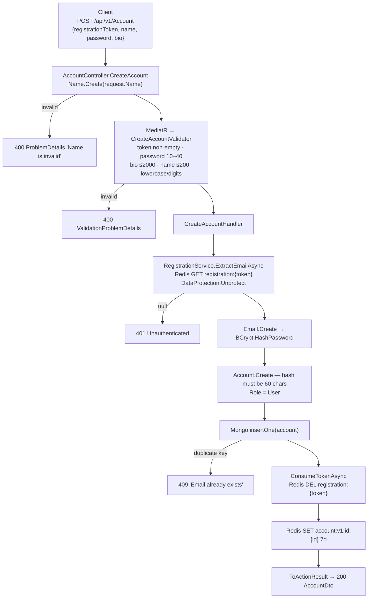
The email comes from the token, never the body. Duplicate emails are caught by the partial unique
index on `Email` and mapped to the same 409 `/Email/send-for-register` gives.

The token is read without deleting and spent only after the insert commits. Every failure between
those two points — a domain rule, a Mongo throw — leaves the token alive for its remaining TTL, so
the caller can retry the same request instead of restarting the OTP flow.

### 2. Get my account — `GET /Account/me`

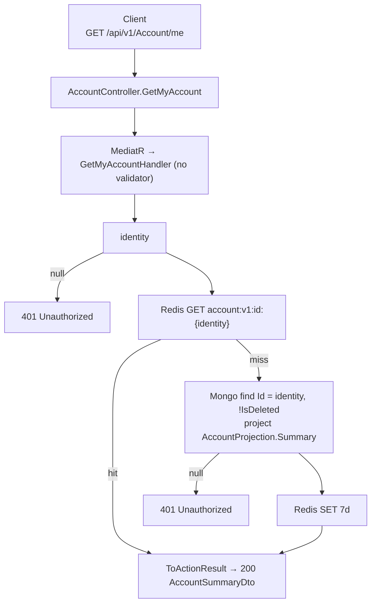
`AccountProjection.Summary` = `Name, Avatars, Bio, FollowerAmount, FollowingAmount`; password and
email never reach the DTO.

### 3. Change name — `PUT /Account/me/name`

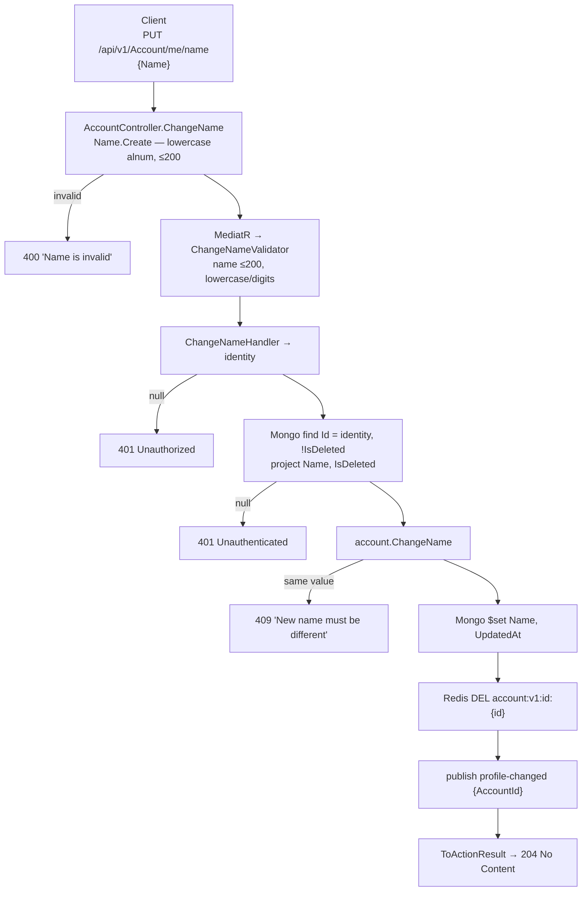
The account row is not the only copy of the name: follow, block and react each embed it in the
other party's document. `ProfileService` refreshes those; see #3 in
[`developer-guide.md`](./developer-guide.md) for the arrays it touches.

### 4. Change bio — `PUT /Account/me/bio`

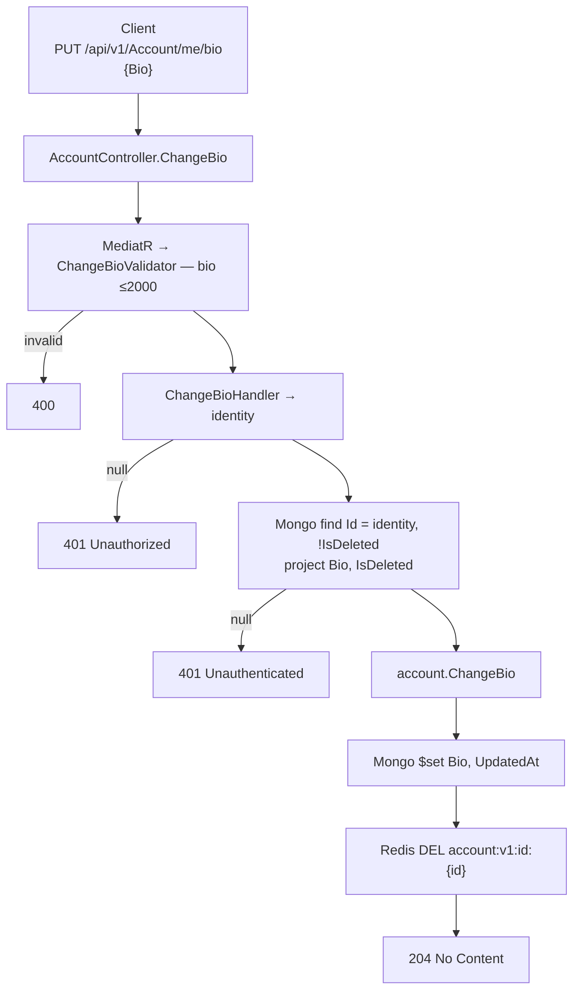
Bio carries no "must be different" rule, so resubmitting the same value succeeds.

### 5. Change password — `PUT /Account/me/password`

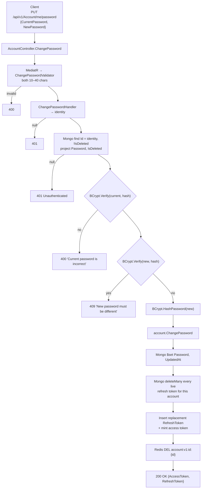
**Answers 200 with a fresh pair, not 204.** Changing the password drops every refresh token on
the account, the caller's own included, so the response has to carry a replacement or the user is
silently logged out the moment their current access token expires. A client that ignores the body
degrades to exactly that — it holds a token that no longer exists and is logged out at its next
refresh.

Those rows are **deleted, not marked revoked**. A revoked row is the signal #18 uses to detect a
replayed token, and a credential change is not a replay: marking them left every other device
holding something indistinguishable from a stolen token, so the next device to refresh would cut
the session this endpoint had just issued. Deletion makes that path a plain 401 instead.

Eviction is bounded by `Jwt:ExpiryMinutes`, not immediate: JWTs are not revocable, so access
tokens already issued stay valid until they expire.

"New password must be different" is checked with `BCrypt.Verify(new, storedHash)` in the handler.
It used to live on `Account.ChangePassword` as `Password == password`, comparing two BCrypt
hashes — random salts mean two hashes of one plaintext never match, so the rule never fired.

### 6. Change email — `PUT /Account/me/email`

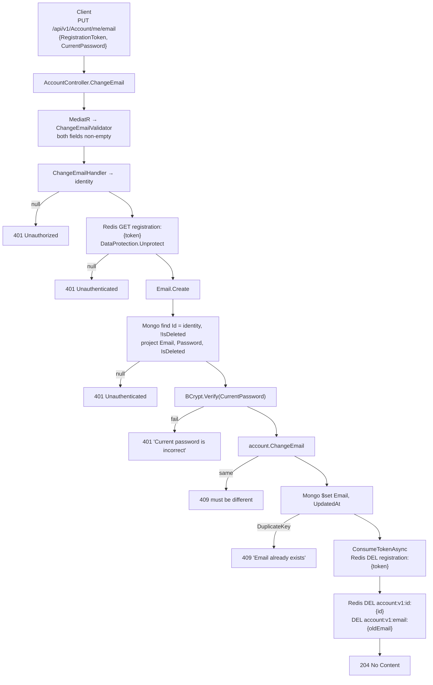
The new address is proven beforehand via `/Email/send-for-verify` + `/Email/verify`.

**The current password is required**, as it is for #5. This endpoint decides which address can
later prove ownership through #11, so it is a credential change in everything but name: without the
check, an access token on its own was enough to move the account to an attacker-controlled address
and then reset the password from there.

### 7. Change avatar — `POST /Account/me/avatar` `[upload]`

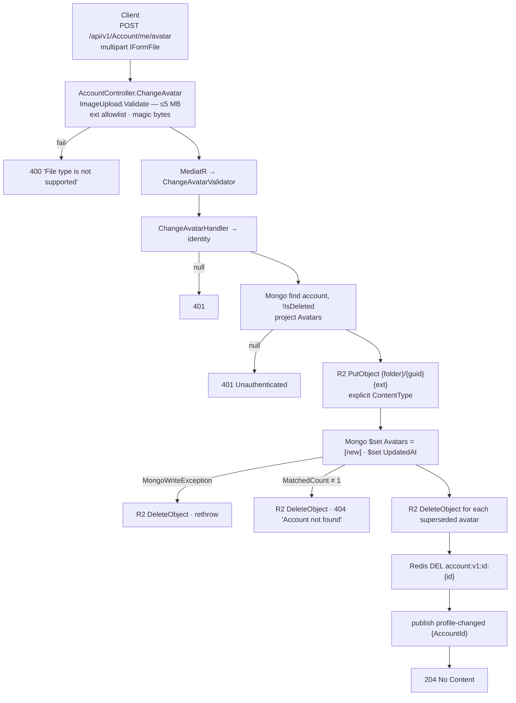
The array is **replaced, not appended to**. Every reader takes `Avatars.LastOrDefault()`, so earlier
entries were never current and never readable — they only grew the document and kept their R2
objects alive, one leaked image per change. The superseded objects are released only after the row
has stopped naming them, so no failure path can leave the account pointing at a deleted object.

Every exit after the upload removes it: both the write failure and the account-vanished path now
delete, where the second used to return and orphan the object.

### 8. Remove avatar — `DELETE /Account/me/avatar?url=`

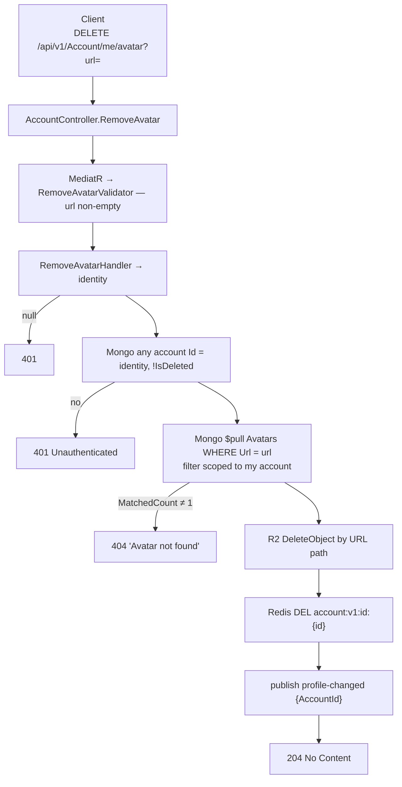
Ownership is proven by the filter before the R2 delete, so an arbitrary URL cannot remove another
account's object. The fan-out clears the avatar from the denormalized copies as well, which
otherwise keep rendering an image whose object no longer exists.

### 9. Delete account — `DELETE /Account/me`

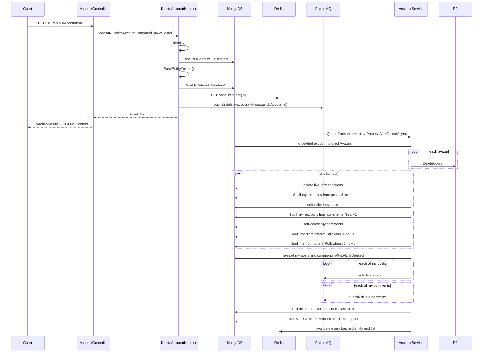
The only command without a validator. The cascade is retry-safe: each `$pull` + `$inc` is guarded by
an `ElemMatch` that stops matching once applied. Post and comment cleanup is fanned out rather than
inlined, so no single message's cost scales with how much the account posted; notifications are hard
deleted, not soft, because nothing can read them once the account is gone.

**The publish list is re-read after the flip, on `IsDeleted == true`.** Taking it before the flip on
`IsDeleted == false` looked equivalent and was not: the pre-flip list is empty on every redelivery,
because the first attempt already flipped the rows. A crash or a broker blip between the fan-out and
the publish loop therefore lost the cascade permanently — the images stayed in R2 with no document
left to name them, and other accounts' comments survived pointing at a post the retention sweep
would hard-delete. Reading the post-state is what lets a retry finish the job. `PostService` had the
same shape and the same fix.

The counter decrements still read their list **before** the flip, for the opposite reason: those
must apply exactly once, and an empty list on redelivery is precisely what stops them double-
applying. The two lists answer different questions and are deliberately taken at different moments.

### 10. Recover account — `POST /Account/recover` · **anon** `[auth]`

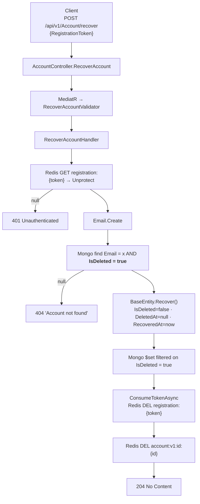
The only query in the system searching for `IsDeleted == true`. It restores the account row; content
removed by the `delete-account` cascade stays gone.

### 11. Reset password — `PUT /Account/reset-password` · **anon** `[auth]`

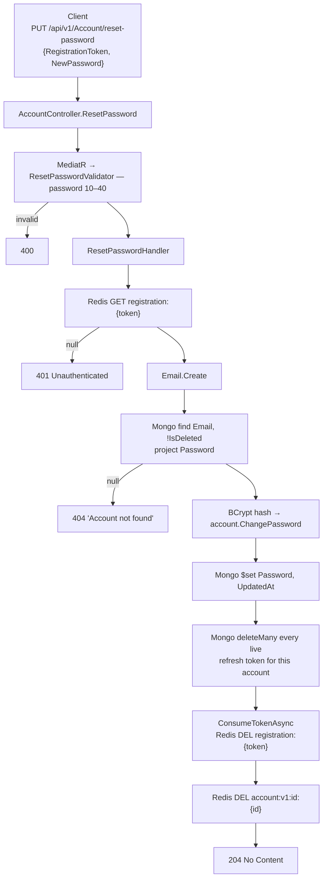
Every session on the account is dropped, which is the point of the recovery flow — an attacker
holding a refresh token is cut off. Deleted rather than marked revoked, for the reason #5 gives. No replacement pair is returned here, unlike #5: the caller is
unauthenticated at this point and logs in with the new password next. Eviction is bounded by
`Jwt:ExpiryMinutes` for access tokens already in circulation.

### 12. List accounts — `GET /Account` · **admin**

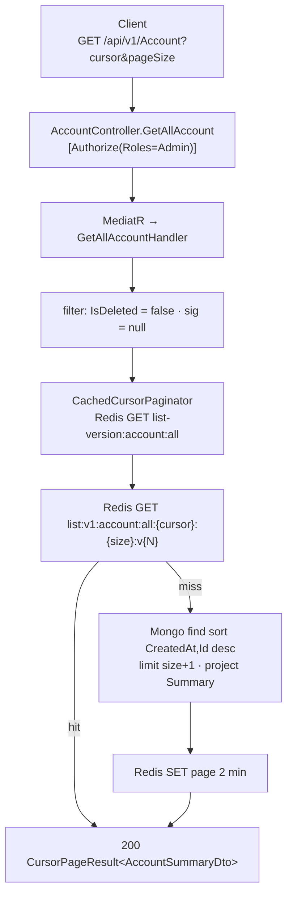

### 13. Get account by id — `GET /Account/{accountId}`

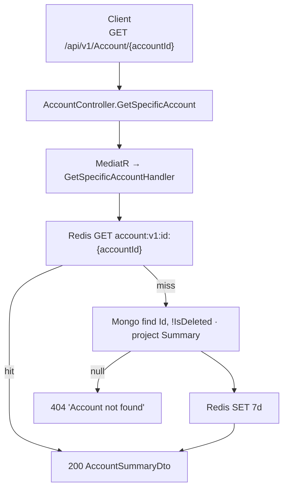
Any authenticated caller may read any account summary.

### 14. Get account by email — `GET /Account/by-email?email=` · **admin**

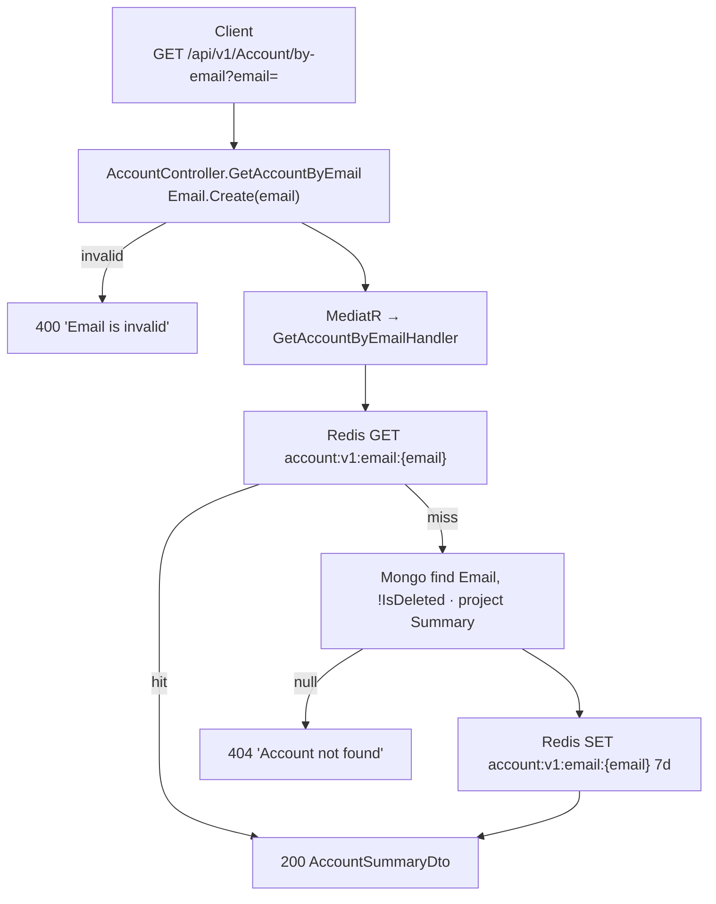
The only consumer of the `account:v1:email:*` key, invalidated on email change (#6).

### 15. Get accounts by name — `GET /Account/by-name?name=` `[search]`

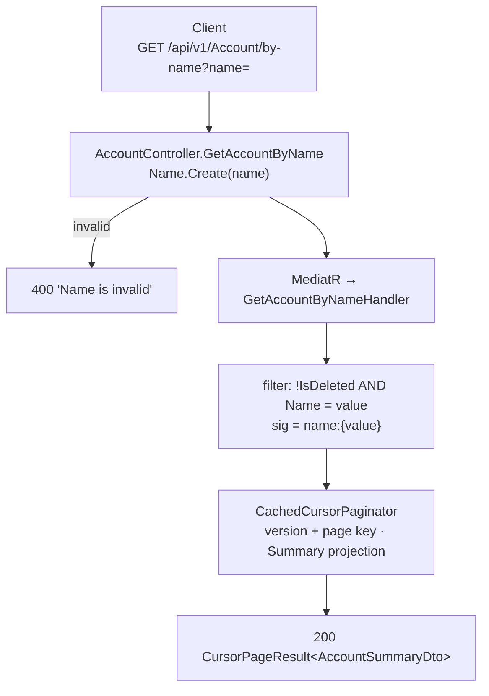
Exact match on the value object, not a prefix search.

### 16. Search accounts — `GET /Account/search?keyword=` `[search]`

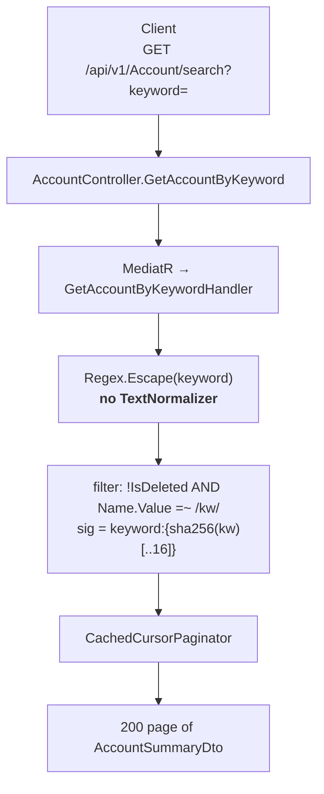
All three searches normalize the keyword first and validate it: `NotEmpty`, because an empty
keyword escapes to a match-everything regex, and a 100-character cap, because the keyword reaches
both a MongoDB regex and — through `CacheKey.KeywordSignature` — a Redis key.

---

## Auth

### 17. Login — `POST /Auth/login` · **anon** `[auth]`

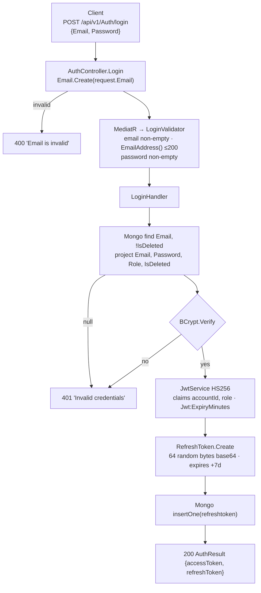
Both failure modes share one message, so account existence is not disclosed. Prior refresh tokens
remain valid.

### 18. Refresh — `POST /Auth/refresh` · **anon** `[auth]`

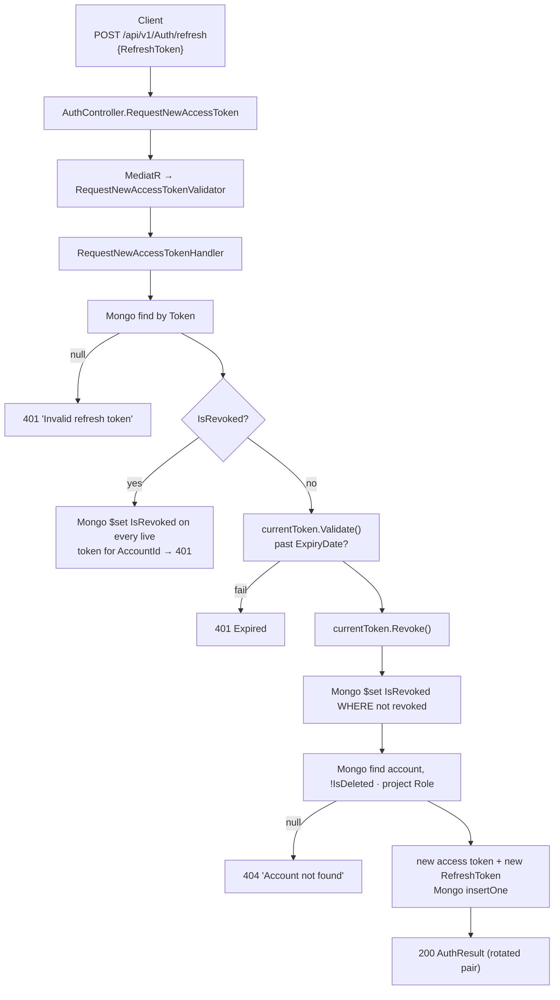
Single-use rotation. **Presenting an already-revoked token revokes every live token on the account**
— rotation has already replaced it, so whoever holds it either kept a copy or stole one, and there
is no way to tell which side is which. Cutting all sessions is the only certainly-correct answer:
the thief loses access and the legitimate holder signs in again with credentials the thief lacks.
Scoped to the account rather than a lineage because rotation inserts an independent row and carries
no parent, so the two sets are the same.

This is why the bulk-credential paths — #5, #11 and the delete cascade in #9 — **delete** the tokens they
retire instead of marking them. `IsRevoked` means *this token was rotated or an administrator cut
it*, and only those two cases should trip the reuse response. A token that is simply gone answers
401 and ends there, so changing a password on one device no longer arms every other device to
destroy the session that change just created. A TTL index on `ExpiryDate` purges expired rows, and
`SoftDeletePurgeHost` drops revoked ones sooner.

### 19. List refresh tokens — `GET /Auth/refresh-token` · **admin**

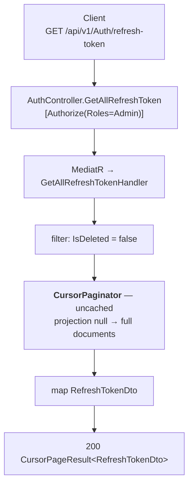
The only uncached list endpoint and the only one reading whole documents — appropriate for a
security-audit view.

### 20. Get refresh token — `GET /Auth/refresh-token/{id}` · **admin**

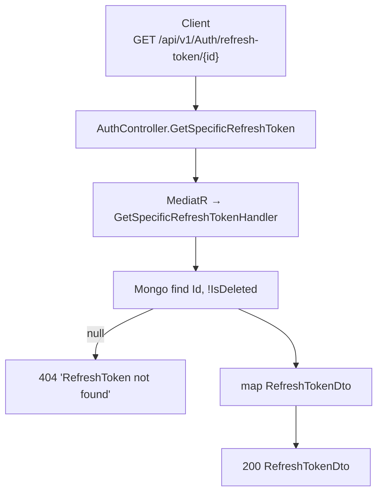

---

## Email

### 21. Send registration OTP — `POST /Email/send-for-register` · **anon** `[email]`

```mermaid
flowchart TD
    A["Client<br/>POST /api/v1/Email/send-for-register<br/>{Email}"] --> B["EmailController.SendForRegister<br/>Email.Create"]
    B -->|invalid| B1["400"]
    B --> C["MediatR → SendEmailForRegisterValidator<br/>EmailAddress() ≤200"] --> D["SendEmailForRegisterHandler"]
    D --> E{"Mongo any account Email = x<br/><b>AND !IsDeleted</b>"}
    E -->|yes| E1["409 'Email already exists'"]
    E -->|no| F["OtpService.GenerateAsync<br/>RandomNumberGenerator 6 digits"]
    F -->|"budget spent or locked"| F1["429 Too Many Requests"]
    F --> G["Redis INCR otp:gen:{email} 1 h<br/>SET otp:{email} 10 min"]
    G --> H["Resend POST /emails · HttpClient 10 s timeout"]
    H --> I["204 No Content"]
```
The 409 is kept rather than made opaque: the registration screen needs to say the address is taken,
and the caller learns the same fact from #1 regardless. The disclosure that mattered was on the
reset path — see #22.

### 22. Send verification OTP — `POST /Email/send-for-verify` · **anon** `[email]`

```mermaid
flowchart TD
    A["Client<br/>POST /api/v1/Email/send-for-verify<br/>{Email}"] --> B["EmailController.SendForVerify<br/>Email.Create"]
    B --> C["MediatR → SendEmailForVerifyValidator<br/>EmailAddress() ≤200"] --> D["SendEmailForVerifyHandler"]
    D --> E{"Mongo any account Email = x<br/><b>no IsDeleted filter</b>"}
    E -->|no| I["204 No Content"]
    E -->|yes| F["OtpService.GenerateAsync"]
    F -->|"budget spent or locked"| I
    F --> G["Redis INCR otp:gen:{email} 1 h<br/>SET otp:{email} 10 min"]
    G --> H["Resend POST /emails"] --> I
```
Deliberately omits `!IsDeleted` so a soft-deleted account can obtain a token for `/Account/recover`.
Note the asymmetry with #21.

**Every exit answers 204, whatever happened.** This used to return 404 for an unknown address, which
told an unauthenticated caller whether an account exists — the opening move of both credential
stuffing and a targeted OTP attack, and the more damaging of the two disclosures because this is the
password-reset path. A throttled address takes the same exit for the same reason: only a real
account ever reaches the generator, so answering differently would put the oracle straight back.

Not closed: the account-exists path pays a Redis write and a Resend round trip, so the two exits
remain distinguishable by latency. Closing that means dispatching the mail off the request thread.

### 23. Verify OTP — `POST /Email/verify` · **anon** `[email]`

```mermaid
flowchart TD
    A["Client<br/>POST /api/v1/Email/verify<br/>{Email, Otp}"] --> B["EmailController.Verify<br/>Email.Create"]
    B --> C["MediatR → VerifyEmailValidator<br/>EmailAddress() ≤200 · otp exactly 6 chars"] -->|invalid| C1["400"]
    C --> D["VerifyEmailHandler → OtpService.VerifyAsync"]
    D --> E["Redis GET otp:{email}"]
    E -->|"missing / expired"| E1["400 'Otp is incorrect'"]
    E --> F{"entry.Code == otp?"}
    F -->|no| G["attempts+1 · Redis re-SET<br/>DEL once attempts reach 3"] --> E1
    F -->|yes| H["entry left in place until its TTL"]
    H --> I["RegistrationService.GenerateTokenAsync<br/>32 random bytes base64url"]
    I --> J["Redis SET registration:{token}<br/>= Protect(email) 10 min"]
    J --> K["200 registrationToken (string)"]
```
`OtpService` carries one per-address counter alongside the code — `otp:gen:{email}:{yyyyMMddHH}`,
over a tumbling hour — because every rate-limit policy at the edge partitions by client address while the code is
keyed by email. Minting a fresh code resets the in-entry attempt count, so before it existed nothing
bounded how many codes one address could be issued: three guesses per code against a million values
is only safe if generations are finite. Five codes an hour holds the ceiling at fifteen values.

Failures are counted **per code only**, never per address. A per-address failure counter would let
anyone who knows an email lock its owner out of password reset by guessing wrong on their behalf,
and the generation cap already bounds the search without that.

A correct code is **not** deleted on use; it expires on its own 10 minute TTL. Deleting it made a
lost response unrecoverable — the caller never received the registration token the code was
exchanged for, and the code that would have earned another was already gone. Brute force is bounded
by the 3-attempt cap on wrong codes, which is unaffected. The read-then-`SET` on a wrong code is not
atomic, so concurrent wrong guesses can share an attempt slot.

The returned token is the credential for #1, #6, #10 and #11.

---

## Post

### 24. Create post — `POST /Post` `[upload]`

```mermaid
flowchart TD
    A["Client<br/>POST /api/v1/Post (multipart)<br/>placeId, shopName, shopAddress,<br/>latitude, longitude, caption, rate, images"] --> B["PostController.CreatePost<br/>Amount.Create(rate) ≥ 0"]
    B -->|invalid| B1["400"]
    B --> C["ImageUpload.ToStreams<br/>≤10 files · ≤5 MB · allowlist + magic bytes<br/>opens the streams only on success"]
    C -->|fail| C1["400"]
    C --> D["MediatR → CreatePostValidator<br/>rate 1–5 · caption ≤2000 · placeId ≤200<br/>name+address required only without a placeId<br/>lat/lng both-or-neither, in range"] -->|invalid| D1["400"]
    D --> E["CreatePostHandler → identity"] -->|null| E1["401"]
    E --> P{"placeId present?"}
    P -->|yes| P1["ApplePlaceService.ResolveAsync<br/>GET /v1/place/id"]
    P1 -->|null| P2["400 'Shop could not be verified'"]
    P1 --> Q["name, address, lat, lng := Apple's<br/>request text ignored"]
    P -->|no| Q2["name, address, lat, lng := the request's"]
    Q --> F["R2 PutObject per image — all in parallel"]
    Q2 --> F
    F --> G{"Mongo find Shop by PlaceId,<br/>then by Name + Address, !IsDeleted<br/>project Id, PlaceId"}
    G -->|"found, no PlaceId, place resolved"| G2["AdoptPlace → $set PlaceId, UpdatedAt<br/>drop shop cache"] --> H
    G -->|found| H["shopId = existing.Id"]
    G -->|none| I["Shop.Create(name, address, lat, lng, placeId)<br/>→ insertOne · Redis SET shop 7d<br/>bump shop:all"] --> H
    I -->|"DuplicateKey"| I2["re-read the shop the winner inserted"] --> H
    I -->|"other MongoWriteException"| X["R2 DeleteObject per image · rethrow"]
    H --> J["Post.Create — CaptionNormalized computed"]
    J --> K["Mongo insertOne(post)"]
    K -->|"MongoWriteException"| X
    K --> L["Redis SET post:v1:id 7d<br/>bump post:account:{me},<br/>post:shop:{id}"]
    L --> M["RabbitMQ publish recalculate-shop-rate"]
    M --> N["200 PostDto"]
    M -.-> O["ShopRateService: average live post rates<br/>$set Shop.Rate · bump shop lists"]
```
Images reach R2 before either insert, so a failed write can leave objects nothing references. Each
insert is wrapped to delete them on `MongoWriteException` and rethrow. The catch is deliberately no
wider than that: a rejected write proves the server stored nothing, while a timeout or a cancelled
request leaves the document's fate unknown, and deleting there could strip the images off a post
that did land. Deletes pass `CancellationToken.None`, since `R2Service` hands its token to the AWS
SDK and a delete on an aborted request would refuse to run.

Cleanup is best-effort in one direction only: a delete that itself throws replaces the
`MongoWriteException` the caller was about to receive, and abandons any images after it in the loop.
The `Result.Fail` paths above — `Shop.Create` and `Post.Create` rejecting their input — orphan
whatever was already uploaded.

The uploads run concurrently rather than one after another. Ten files at a couple of hundred
milliseconds each is seconds of wall clock inside a request the latency budget gives 500 ms;
`Task.WhenAll` preserves the order the client sent, which matters because that order is what the
images array renders in.

**A shop-creation race no longer fails the post.** Two people reviewing the same new shop at the
same moment both miss the read and both insert, and the partial unique index on `(Name, Address)`
lets exactly one through. The loser used to discard its uploads and rethrow, so it received a 500
and lost a post that should simply have joined the shop the winner had just created; it now re-reads
and attaches to that row. `CreateAccountHandler` already translated the identical collision, so this
brings the two into line.

**A shop comes in two tiers.** With a `placeId`, the identifier is resolved against the Apple Maps
Server API and the shop is created from the name, address and coordinate Apple answered; the
request's own `shopName`, `shopAddress`, `latitude` and `longitude` are not read at all. That is the
guarantee — a client can claim any name, but cannot invent an identifier Apple will return a place
for. Without a `placeId` the shop is whatever the client typed and is created unverified, which
keeps a street cart Apple has never heard of postable. `CreatePostValidator` requires the name and
address only on that second path.

**Resolution happens before the uploads.** Everything past the R2 block has to clean up after the
objects on its way out, and a rejected place is much the cheapest failure to answer while there is
still nothing to discard. A place that will not resolve — unknown to Apple, an Apple error, or no
Maps key configured — is `400 Shop could not be verified`.

An existing shop is looked up **by `PlaceId` first, then by exact `Name` + `Address`**, as two
queries rather than one `$or` because the order is load-bearing: a row already carrying the
identifier has to win. The text arm is what adopts a shop created before verification existed —
`Shop.AdoptPlace` stamps the identifier on it and the cached summary is dropped — so the catalogue
upgrades itself as people post, with no migration. Adoption only ever fills an empty slot, and a
duplicate-key collision there (Apple renamed the place and a second row grew under the new name)
skips the stamp rather than failing a valid post, leaving two rows for an administrator to merge.

Matching on the text arm uses the raw name and address, not the normalized fields, so "Cafe X" and
"cafe x" create two shops.

The coordinate reaches `Shop` only on the branch that inserts one: a post naming an existing shop
reuses the row and never overwrites `Location`, so on the unverified tier the first poster to name a
(name, address) pair fixes that shop's coordinate permanently. On the verified tier the coordinate is
Apple's. Both values must arrive together and within range or `CreatePostValidator` rejects the
request — checked there as well as in `Shop.Create` because the handler uploads every image to R2
before it reaches the entity, and a failure at the entity would orphan the uploaded objects. A post
created without a coordinate is not an error; the shop is simply absent from the 2dsphere index and
never appears in #78.

### 25. Change caption — `PUT /Post/{postId}/caption`

```mermaid
flowchart TD
    A["Client<br/>PUT /api/v1/Post/{postId}/caption<br/>{Caption}"] --> B["PostController.ChangeCaption"]
    B --> C["MediatR → ChangeCaptionValidator<br/>caption non-null ≤2000"] --> D["ChangeCaptionHandler → identity"]
    D -->|null| D1["401"]
    D --> E["Mongo find Id AND <b>AccountId = me</b> AND !IsDeleted<br/>project Caption, ShopId"]
    E -->|null| E1["404 'Post not found'<br/>(also when not the owner)"]
    E --> F["post.ChangeCaption — recomputes CaptionNormalized"]
    F --> G["Mongo $set Caption, CaptionNormalized, UpdatedAt"]
    G --> H["Redis DEL post:v1:id<br/>bump post:account:{me},<br/>post:shop:{id}"]
    H --> I["204 No Content"]
```

### 26. Change rate — `PUT /Post/{postId}/rate`

```mermaid
flowchart TD
    A["Client<br/>PUT /api/v1/Post/{postId}/rate<br/>{Rate}"] --> B["PostController.ChangeRate<br/>Amount.Create(rate)"]
    B -->|invalid| B1["400"]
    B --> C["MediatR → ChangeRateValidator — rate 1–5"] -->|invalid| C1["400 'Rate must be between 1 and 5'"]
    C --> D["ChangeRateHandler → identity"] -->|null| D1["401"]
    D --> E["Mongo find Id AND AccountId = me AND !IsDeleted<br/>project ShopId, Rate"]
    E -->|null| E1["404 'Post not found'"]
    E --> F["post.ChangeRate → Mongo $set Rate, UpdatedAt"]
    F --> G["Redis DEL post cache · bump 4 post lists"]
    G --> H["RabbitMQ publish recalculate-shop-rate"] --> I["204 No Content"]
    H -.-> J["ShopRateService recomputes Shop.Rate"]
```

### 27. Delete post — `DELETE /Post/{postId}`

```mermaid
sequenceDiagram
    participant C as Client
    participant Ctl as PostController
    participant H as DeletePostHandler
    participant M as MongoDB
    participant R2 as R2
    participant R as Redis
    participant Q as RabbitMQ
    participant S as PostService

    C->>Ctl: DELETE /api/v1/Post/{postId}
    Ctl->>H: MediatR → DeletePostValidator → handler
    H->>H: identity
    H->>M: find Id AND AccountId = me AND !IsDeleted
    H->>M: $set IsDeleted, DeletedAt
    H->>R: DEL post cache, bump 4 post lists
    H->>Q: publish recalculate-shop-rate
    H->>Q: publish delete-post
    H-->>Ctl: Result.Ok
    Ctl-->>C: 204 No Content
    Q->>S: ProcessAfterDeleteAsync
    loop each post image
        S->>R2: DeleteObject
    end
    S->>M: find non-deleted comments on the post
    S->>M: soft-delete those comments
    loop each comment
        S->>Q: publish delete-comment
    end
    S->>R: DEL each comment cache, bump comment:post:{id}<br/>and comment:account:{author} per distinct author
```
`Post.CommentAmount` is not reset; the shop rate is recomputed from remaining live posts. The
request makes no object-storage calls — the post's own images are deleted by the worker, so the
owner path and the administrator path (#73) share one implementation. The comments' images are not
deleted here either: a post's comment count is unbounded, so each one gets its own `delete-comment`
message and `CommentService.ProcessAfterDeleteAsync` stays the single place that cleans a comment's
images.

### 28. Get post — `GET /Post/{postId}`

```mermaid
flowchart TD
    A["Client<br/>GET /api/v1/Post/{postId}"] --> B["PostController.GetSpecificPost"]
    B --> C["MediatR → GetSpecificPostHandler → identity"]
    C -->|null| C1["401"]
    C --> D["Redis GET post:v1:id:{postId}"]
    D -->|hit| G["PostFeedEnricher"]
    D -->|miss| E["Mongo find Id, !IsDeleted<br/>project PostProjection.Summary"]
    E -->|null| E1["404 'Post not found'"]
    E --> F["Redis SET 7d"] --> G
    G --> H["Mongo ReactionMembership — reacted?<br/>Mongo SaveMembership — saved?"]
    H --> I["200 PostFeedItemDto {Post, IsReacted, IsSaved}"]
```
The two membership reads are per-viewer and never cached.

### 29. My posts — `GET /Post/mine`

```mermaid
flowchart TD
    A["Client<br/>GET /api/v1/Post/mine?cursor&pageSize"] --> B["PostController.GetMyPost"]
    B --> C["MediatR → GetMyPostHandler → identity"] -->|null| C1["401"]
    C --> D["filter: AccountId = me, !IsDeleted<br/>sig = account:{me}"]
    D --> E["CachedCursorPaginator<br/>version + page key · Summary"]
    E --> F["200 CursorPageResult&lt;PostSummaryDto&gt;"]
```
Returns bare `PostSummaryDto` — no enrichment, unlike #28/#32.

### 30. Posts by account — `GET /Post/account/{accountId}`

```mermaid
flowchart TD
    A["Client<br/>GET /api/v1/Post/account/{accountId}"] --> B["PostController.GetPostByAccount"]
    B --> C["MediatR → GetPostByAccountHandler"]
    C --> D["filter: AccountId = x, !IsDeleted<br/>sig = account:{x}"]
    D --> E["CachedCursorPaginator · Summary"] --> F["200 page of PostSummaryDto"]
```
No check that the target account exists or is live.

### 31. Posts by shop — `GET /Post/shop/{shopId}`

```mermaid
flowchart TD
    A["Client<br/>GET /api/v1/Post/shop/{shopId}"] --> B["PostController.GetPostByShop"]
    B --> C["MediatR → GetPostByShopHandler"]
    C --> D["filter: ShopId = x, !IsDeleted<br/>sig = shop:{x}"]
    D --> E["CachedCursorPaginator · Summary"] --> F["200 page of PostSummaryDto"]
```

### 32. Search posts — `GET /Post/search?keyword=` `[search]`

```mermaid
flowchart TD
    A["Client<br/>GET /api/v1/Post/search?keyword="] --> B["PostController.GetPostByKeyword"]
    B --> C["MediatR → GetPostByKeywordHandler → identity"] -->|null| C1["401"]
    C --> D["TextNormalizer.RemoveDiacriticsAndLower<br/>then Regex.Escape"]
    D --> E["filter: !IsDeleted AND<br/>CaptionNormalized =~ /kw/<br/>sig = keyword:{sha256(kw)[..16]}"]
    E --> F["CachedCursorPaginator"] --> G["PostFeedEnricher · +2 Mongo reads"]
    G --> H["200 page of PostFeedItemDto"]
```
No write path bumps a `keyword:*` version, so these pages refresh only on the 2-minute TTL.

### 77. Related posts — `GET /Post/related` `[search]`

```mermaid
flowchart TD
    A["Client<br/>GET /api/v1/Post/related"] --> B["PostController.GetRelatedPost"]
    B --> C["MediatR → GetRelatedPostHandler → identity"] -->|null| C1["401"]
    C --> D["Mongo find Account<br/>project Followings.AccountId<br/>read as raw BsonDocument"]
    C --> E{"Redis GET affinity:v1:account:{me}"}
    E -->|hit| G
    E -->|miss| F["Mongo aggregate on post<br/>$match Reactions.AccountId = me<br/>$sortByCount AccountId · $limit 20<br/>Redis SET affinity 1h"] --> G
    D --> G["union · drop self · cap 300"]
    G --> H["filter: AccountId $in ids AND !IsDeleted<br/>sig = related:{me}"]
    H --> I["CachedCursorPaginator · Summary"]
    I --> J["PostFeedEnricher · +2 Mongo reads"] --> K["200 page of PostFeedItemDto"]
```
Two sources, precomputed to different degrees. Followed accounts are embedded on the account
document, so they cost one projected read and stay exact. That read returns a raw `BsonDocument`
rather than a projected `Account`: deserializing a `Following` from a subdocument holding only
`AccountId` throws `No matching creator found for class domain.Following`, because the entity has no
creator satisfiable without `Name` and `Avatar`. Requesting the whole `Followings` array would
deserialize, at the cost of dragging every followed account's name and avatar across the wire to read
one field from each. Reaction affinity is the expensive half —
`$sortByCount` groups every post the account has ever reacted to — so it is resolved once an hour and
cached as a list of account ids under `affinity:v1:account:{id}`.

What is cached is the ranking, never the feed: the posts themselves are read live through an indexed
`$in`, so a followed account's new post appears within the 2-minute list TTL rather than waiting on
the hourly refresh. The `$in` is capped at 300 ids because MongoDB scans the `AccountId` index once
per value and merge-sorts the results.

Nothing bumps the `related:{me}` version counter — no write path knows which readers a post is
related to — so unlike the shared feeds these pages retire on the 2-minute TTL alone. That is the
deliberate trade against fanning an invalidation out to every follower on each new post.

---

## Comment

### 33. Create comment — `POST /Comment` `[upload]`

```mermaid
sequenceDiagram
    participant C as Client
    participant Ctl as CommentController
    participant H as CreateCommentHandler
    participant R2 as R2
    participant M as MongoDB
    participant R as Redis
    participant Q as RabbitMQ
    participant S as CommentService
    participant N as NotificationService

    C->>Ctl: POST /api/v1/Comment (postId, content, images)
    Ctl->>Ctl: ImageUpload.ToStreams — ≤10 files · ≤5 MB<br/>ext allowlist · magic bytes
    alt any image rejected
        Ctl-->>C: 400 'File type is not supported'
    end
    Ctl->>H: MediatR → CreateCommentValidator → handler
    H->>H: identity
    loop each image
        H->>R2: PutObject
    end
    H->>H: Comment.Create — content ≤2000
    H->>M: insertOne(comment)
    alt MongoWriteException
        H->>R2: DeleteObject per uploaded image, then rethrow
    end
    H->>M: updateOne(post, !IsDeleted) $inc CommentAmount +1
    H->>R: SET comment 7d, DEL post cache,<br/>bump comment:post:{id}, comment:account:{me}
    H->>Q: publish create-comment
    H-->>Ctl: Result.Ok(CommentDto)
    Ctl-->>C: 200 OK
    Q->>S: ProcessCreateCommentAsync
    S->>M: load comment → PostId, then post → AccountId
    alt commenter is the post author
        S-->>Q: Ok, no notification
    else
        S->>M: load actor Name + Avatars
        S->>N: CreateAsync(Comment, TargetId = PostId)
        N->>M: insert Notification
        N->>R: bump notification:account:{owner}
        N->>N: SignalR Clients.User(owner).SendAsync
        N->>M: MarkAsSent
    end
```
`Comment.Create` does not verify the post exists; the `$inc` is filtered on a live post so the
counter stays correct, but an orphan comment row is still inserted.

### 34. Change content — `PUT /Comment/{commentId}`

```mermaid
flowchart TD
    A["Client<br/>PUT /api/v1/Comment/{commentId}<br/>{Content}"] --> B["CommentController.ChangeContent"]
    B --> C["MediatR → ChangeContentValidator<br/>content non-null ≤2000"] --> D["ChangeContentHandler → identity"]
    D -->|null| D1["401"]
    D --> E["Mongo find Id AND AccountId = me AND !IsDeleted<br/>project Content, PostId"]
    E -->|null| E1["404 'Comment not found'"]
    E --> F["comment.ChangeContent ≤2000"]
    F --> G["Mongo $set Content, UpdatedAt"]
    G --> H["Redis DEL comment cache<br/>bump comment:post:{id}, comment:account:{me}"]
    H --> I["204 No Content"]
```

### 35. Delete comment — `DELETE /Comment/{commentId}`

```mermaid
flowchart TD
    A["Client<br/>DELETE /api/v1/Comment/{commentId}"] --> B["CommentController.DeleteComment"]
    B --> C["MediatR → DeleteCommentValidator"] --> D["DeleteCommentHandler → identity"]
    D -->|null| D1["401"]
    D --> E["Mongo find Id AND AccountId = me AND !IsDeleted<br/>project PostId"]
    E -->|null| E1["404 'Comment not found'"]
    E --> F["Mongo $set IsDeleted, DeletedAt"]
    F --> G["Mongo updateOne(post, !IsDeleted)<br/>$inc CommentAmount −1"]
    G --> H["Redis DEL comment + post cache<br/>bump comment:post, comment:account"]
    H --> I["RabbitMQ publish delete-comment"] --> J["204 No Content"]
    I --> K["CommentService.ProcessAfterDeleteAsync<br/>R2 DeleteObject per image"]
```
The soft delete, the parent's `CommentAmount` decrement and the cache invalidations stay in the
request because a caller returning before those land would serve stale reads. `CommentAmount` is
projected into `PostSummaryDto`, so `post:`, `post:account:{id}` and `post:shop:{id}` are all
bumped — the rule is the projection's, not the current UI's, and a grid that does not draw the
count today still holds the stale number in its cached payload. The author and shop come back from
the `FindOneAndUpdate` that performs the decrement, so this costs no extra round trip. Only the
image deletes move to the queue — nobody is waiting on object storage.

### 36. Get comment — `GET /Comment/{commentId}`

```mermaid
flowchart TD
    A["Client<br/>GET /api/v1/Comment/{commentId}"] --> B["CommentController.GetSpecificComment"]
    B --> C["MediatR → GetSpecificCommentHandler"]
    C --> D["Redis GET comment:v1:id:{id}"]
    D -->|hit| Z["200 CommentSummaryDto"]
    D -->|miss| E["Mongo find Id, !IsDeleted<br/>project CommentProjection.Summary"]
    E -->|null| E1["404 'Comment not found'"]
    E --> F["Redis SET 7d"] --> Z
```

### 37. Comments on a post — `GET /Comment/post/{postId}`

```mermaid
flowchart TD
    A["Client<br/>GET /api/v1/Comment/post/{postId}"] --> B["CommentController.GetCommentByPost"]
    B --> C["MediatR → GetCommentByPostHandler"]
    C --> D["filter: PostId = x, !IsDeleted<br/>sig = post:{x}"]
    D --> E["CachedCursorPaginator · CommentProjection.Summary"]
    E --> F["200 page of CommentSummaryDto"]
```

### 38. My comment history — `GET /Comment/mine`

```mermaid
flowchart TD
    A["Client<br/>GET /api/v1/Comment/mine"] --> B["CommentController.GetMyCommentHistory"]
    B --> C["MediatR → GetMyCommentHistoryHandler → identity"] -->|null| C1["401"]
    C --> D["filter: AccountId = me, !IsDeleted<br/>sig = account:{me}"]
    D --> E["CachedCursorPaginator"] --> F["200 page of CommentSummaryDto"]
```

---

## Shop

### 39. Delete shop — `DELETE /Shop/{shopId}` · **admin**

```mermaid
flowchart TD
    A["Client<br/>DELETE /api/v1/Shop/{shopId}"] --> B["ShopController.DeleteShop<br/>[Authorize(Roles=Admin)]"]
    B --> C["MediatR → DeleteShopValidator"] --> D["DeleteShopHandler → identity"]
    D -->|null| D1["401"]
    D --> E["Mongo find Id, !IsDeleted · project IsDeleted"]
    E -->|null| E1["404 'Shop not found'"]
    E --> P{"Mongo any post ShopId = id, !IsDeleted"}
    P -->|yes| P1["409 'Shop still has posts'"]
    P -->|no| F["shop.DeleteShop()"]
    F --> G["Mongo $set IsDeleted, DeletedAt"]
    G --> H["Redis DEL shop:v1:id<br/>bump shop:all"]
    H --> I["204 No Content"]
```
**Refused while the shop still has live posts.** A delete that only flipped the flag left every post
pointing at it — `GET /Post/shop/{id}` kept serving them, saved shops kept referencing it, and
because the unique index on `(Name, Address)` is scoped to live rows the same shop could immediately
be created again, stranding the old posts on a row nothing can reach.

Refusing rather than cascading, because the posts are other people's reviews and an administrator
removing a duplicate shop entry is not asking to destroy them. Deleting them is an explicit act.

### 40. Get shop — `GET /Shop/{shopId}`

```mermaid
flowchart TD
    A["Client<br/>GET /api/v1/Shop/{shopId}"] --> B["ShopController.GetSpecificShop"]
    B --> C["MediatR → GetSpecificShopHandler → identity"] -->|null| C1["401"]
    C --> D["Redis GET shop:v1:id:{id}"]
    D -->|hit| F["SaveMembership.HasSavedShopAsync"]
    D -->|miss| E["Mongo find Id, !IsDeleted (full document)"]
    E -->|null| E1["404 'Shop not found'"]
    E --> E2["Redis SET ShopDto 7d"] --> F
    F --> G["200 ShopDetailDto {Shop, IsSaved}"]
```
The only shop read with a per-viewer flag and the only one fetching the whole document.

### 41. List shops — `GET /Shop`

```mermaid
flowchart TD
    A["Client<br/>GET /api/v1/Shop?cursor&pageSize"] --> B["ShopController.GetAllShop"]
    B --> C["MediatR → GetAllShopHandler"]
    C --> D["filter: IsDeleted = false · sig = null"]
    D --> E["CachedCursorPaginator · ShopProjection.Summary"]
    E --> F["200 page of ShopSummaryDto"]
```

### 42. Search shops — `GET /Shop/search?keyword=` `[search]`

```mermaid
flowchart TD
    A["Client<br/>GET /api/v1/Shop/search?keyword="] --> B["ShopController.GetShopByKeyword"]
    B --> C["MediatR → GetShopByKeywordHandler"]
    C --> D["TextNormalizer → Regex.Escape"]
    D --> E["filter: !IsDeleted AND <b>OR</b>(<br/>NameNormalized =~ /kw/,<br/>AddressNormalized =~ /kw/)<br/>sig = keyword:{sha256(kw)[..16]}"]
    E --> F["CachedCursorPaginator"] --> G["200 page of ShopSummaryDto"]
```
The only search matching two fields with `OR`.

### 43. Shops by name — `GET /Shop/by-name?name=` `[search]`

```mermaid
flowchart TD
    A["Client<br/>GET /api/v1/Shop/by-name?name="] --> B["ShopController.GetShopByName"]
    B --> C["MediatR → GetShopByNameHandler"]
    C --> D["filter: !IsDeleted AND Name = x<br/>sig = name:{x}"]
    D --> E["CachedCursorPaginator · Summary"] --> F["200 page of ShopSummaryDto"]
```
Exact, case-sensitive match on the raw `Name`, not the normalized field.

### 44. Shops by address — `GET /Shop/by-address?address=` `[search]`

```mermaid
flowchart TD
    A["Client<br/>GET /api/v1/Shop/by-address?address="] --> B["ShopController.GetShopByAddress"]
    B --> C["MediatR → GetShopByAddressHandler"]
    C --> D["filter: !IsDeleted AND Address = x<br/>sig = address:{x}"]
    D --> E["CachedCursorPaginator · Summary"] --> F["200 page of ShopSummaryDto"]
```

### 78. Best shops around — `GET /Shop/around?latitude=&longitude=` `[search]`

```mermaid
flowchart TD
    A["Client<br/>GET /api/v1/Shop/around?latitude=&longitude="] --> B["ShopController.GetBestShopAround"]
    B --> C["MediatR → GetBestShopAroundValidator<br/>lat ±90 · lng ±180"] -->|invalid| C1["400"]
    C --> D["GetBestShopAroundHandler"]
    D --> E["filter: !IsDeleted AND PlaceId exists AND<br/>Rate.Value ≥ 4 AND<br/>Location $nearSphere origin, $maxDistance 5000 m"]
    E --> F["Mongo find · limit 50 · Summary<br/>2dsphere index · nearest first"]
    F --> G["OrderByDescending(Rate).Take(10) in memory"]
    G --> H["200 CursorPageResult of ShopSummaryDto<br/>NextCursor null"]
```
Nothing here is precomputed and nothing is cached. The result depends on a location that only arrives
with the request, so a per-cell precomputed list would have to be rebuilt for every neighbourhood and
would still drop a five-star shop sitting just across a cell boundary; the 2dsphere index already
answers the question in a single index scan. Fifty documents off that index cost about what a Redis
round-trip would, which is why this is the one list endpoint with no `CachedCursorPaginator`.

`$nearSphere` imposes its own distance ordering and MongoDB rejects an explicit `.Sort()` alongside
it, so the rate ordering happens in memory over the 50 nearest candidates that already clear 4 stars.
`OrderByDescending` is stable, so shops sharing a rate stay nearest-first. Widening `CandidateLimit`
trades relevance for reach.

The answer is a fixed top ten with `NextCursor: null`, matching the `CursorPageResult` shape every
other list endpoint returns so the client decodes it the same way. Shops with no `Location` are
absent from the 2dsphere index and can never appear here.

**Verified shops only.** This is the one surface that exists to be navigated to, so a shop nobody
confirmed against Apple Maps is precisely the one that must not appear on it — an unverified pin is
how somebody ends up at the wrong shop, or at a shop that was never there. Keyword, name and address
search (#42–#44) are deliberately left open to both tiers: a shop somebody typed in is still theirs
to find by name.

---

## Reaction

All four mutations publish and return **202**; the state change and any conflict happen in the
consumer.

### 45. React to post — `POST /Reaction/post/{postId}` → 202

```mermaid
sequenceDiagram
    participant C as Client
    participant Ctl as ReactionController
    participant H as ReactPostHandler
    participant Q as RabbitMQ
    participant S as ReactPostService
    participant M as MongoDB
    participant R as Redis
    participant N as NotificationService

    C->>Ctl: POST /api/v1/Reaction/post/{postId}
    Ctl->>H: MediatR → ReactPostValidator → handler
    H->>H: identity
    H->>Q: publish react-post {MessageId, AccountId, TargetId}
    H-->>Ctl: Result.Ok
    Ctl-->>C: ToAcceptedResult → 202 Accepted

    Q->>S: QueueConsumerHost → ProcessReactPostAsync
    S->>M: load actor Name + Avatars
    S->>M: updateOne(post, !IsDeleted, NOT already reacted)<br/>$push Reactions, $inc ReactionAmount +1
    alt MatchedCount ≠ 1
        S-->>Q: Fail "Already reacted to this post" — logged only
    else applied
        S->>R: DEL post cache, bump post:reaction:{id}
        S->>M: re-read post → AccountId, ShopId
        S->>R: bump post:account, post:shop
        alt actor is the post author
            S-->>Q: Ok, no notification
        else
            S->>N: PostReaction notification → SignalR + APNs push
        end
    end
```
The reaction snapshots the actor's `Name` and latest `Avatar` into the embedded array.

### 46. Unreact post — `DELETE /Reaction/post/{postId}` → 202

```mermaid
flowchart TD
    A["Client<br/>DELETE /api/v1/Reaction/post/{postId}"] --> B["ReactionController.UnreactPost"]
    B --> C["MediatR → UnreactPostValidator → handler · identity"] -->|null| C1["401"]
    C --> D["RabbitMQ publish react-post {IsUndo: true}"] --> E["202 Accepted"]
    D -.-> F["ReactPostService.ProcessUnreactPostAsync"]
    F --> G["Mongo updateOne(post, !IsDeleted,<br/>AnyEq Reactions.AccountId = me)<br/>$pull Reactions, $inc −1"]
    G -->|"MatchedCount ≠ 1"| G1["Fail 'Not reacted to this post' — logged"]
    G --> H["Redis DEL post cache, bump post:reaction<br/>re-read post → bump 4 post lists"]
```
Removal raises no notification.

### 47. React to comment — `POST /Reaction/comment/{commentId}` → 202

```mermaid
flowchart TD
    A["Client<br/>POST /api/v1/Reaction/comment/{commentId}"] --> B["ReactionController.ReactComment"]
    B --> C["MediatR → ReactCommentValidator → handler · identity"] -->|null| C1["401"]
    C --> D["RabbitMQ publish react-comment"] --> E["202 Accepted"]
    D -.-> F["ReactCommentService.ProcessReactCommentAsync · load actor"]
    F --> G["Mongo updateOne(comment, NOT already reacted)<br/>$push Reactions, $inc +1"]
    G -->|"≠ 1"| G1["Fail 'Already reacted to this comment'"]
    G --> H["Redis DEL comment cache<br/>bump comment:reaction:{id}"]
    H --> I["re-read comment → PostId, AccountId<br/>bump comment:post, comment:account"]
    I --> J{"actor is the comment author?"}
    J -->|no| K["CommentReaction notification<br/><b>TargetId = PostId</b> → SignalR + APNs"]
```
The notification's `TargetId` is the post, so clients deep-link to the post rather than the comment.

### 48. Unreact comment — `DELETE /Reaction/comment/{commentId}` → 202

```mermaid
flowchart TD
    A["Client<br/>DELETE /api/v1/Reaction/comment/{commentId}"] --> B["ReactionController.UnreactComment"]
    B --> C["MediatR → UnreactCommentValidator → handler · identity"] -->|null| C1["401"]
    C --> D["RabbitMQ publish react-comment {IsUndo: true}"] --> E["202 Accepted"]
    D -.-> F["Mongo updateOne(comment, AnyEq AccountId = me)<br/>$pull Reactions, $inc −1"]
    F -->|"≠ 1"| F1["Fail 'Not reacted to this comment'"]
    F --> G["Redis DEL comment cache, bump comment:reaction<br/>re-read → bump comment:post, comment:account"]
```

### 49. Reactions on a post — `GET /Reaction/post/{postId}`

```mermaid
flowchart TD
    A["Client<br/>GET /api/v1/Reaction/post/{postId}"] --> B["ReactionController.GetReactionByPost"]
    B --> C["MediatR → GetReactionByPostHandler"]
    C --> D["parentFilter: Id = x, !IsDeleted<br/>entity = post:reaction · sig = post:{x}"]
    D --> E["CachedEmbeddedArrayPaginator<br/>$match → $project → $unwind Reactions<br/>→ $match cursor → $sort ReactedAt, AccountId desc"]
    E --> F["200 page of ReactionDto"]
```

### 50. Reactions on a comment — `GET /Reaction/comment/{commentId}`

```mermaid
flowchart TD
    A["Client<br/>GET /api/v1/Reaction/comment/{commentId}"] --> B["ReactionController.GetReactionByComment"]
    B --> C["MediatR → GetReactionByCommentHandler"]
    C --> D["parentFilter: Id = x, !IsDeleted<br/>entity = comment:reaction · sig = comment:{x}"]
    D --> E["CachedEmbeddedArrayPaginator over Comment.Reactions"]
    E --> F["200 page of ReactionDto"]
```

---

## Follow

### 51. Follow — `POST /Follow/{followingId}` → 202

```mermaid
sequenceDiagram
    participant C as Client
    participant Ctl as FollowController
    participant H as FollowHandler
    participant Q as RabbitMQ
    participant S as FollowService
    participant M as MongoDB
    participant R as Redis
    participant N as NotificationService

    C->>Ctl: POST /api/v1/Follow/{followingId}
    Ctl->>H: MediatR → FollowValidator → handler
    H->>H: identity, then check identity == followingId
    alt self-follow
        H-->>Ctl: Fail
        Ctl-->>C: 400 "Cannot follow yourself"
    else
        H->>Q: publish follow {MessageId, FollowerId, FollowingId}
        H-->>Ctl: Result.Ok
        Ctl-->>C: 202 Accepted
    end
    Q->>S: ProcessFollowAsync
    S->>M: load both accounts (Name, Avatars)
    S->>M: bulkWrite — follower $push Followings $inc +1 ·<br/>following $push Followers $inc +1 ·<br/>each filtered NOT already linked
    alt MatchedCount == 0
        S-->>Q: Fail "Already following"
    else MatchedCount == 1
        S->>S: log warning — half-applied, now repaired
    end
    S->>R: DEL both account caches ·<br/>bump account:following:{follower},<br/>account:follower:{following}
    S->>N: Follow notification → SignalR + APNs push
```
`MatchedCount == 1` means the other side was already correct, so the write repaired a previously
half-applied follow and is treated as success.

### 52. Unfollow — `DELETE /Follow/{followingId}` → 202

```mermaid
flowchart TD
    A["Client<br/>DELETE /api/v1/Follow/{followingId}"] --> B["FollowController.Unfollow"]
    B --> C["MediatR → UnfollowValidator → handler · identity"] -->|null| C1["401"]
    C --> D{"identity == followingId?"}
    D -->|yes| D1["400 'Cannot unfollow yourself'"]
    D -->|no| E["RabbitMQ publish follow {IsUndo: true}"] --> F["202 Accepted"]
    E -.-> G["FollowService.ProcessUnfollowAsync<br/>bulkWrite both sides $pull + $inc −1,<br/>each filtered AnyEq"]
    G -->|"Matched 0"| G1["Fail 'Not following this account'"]
    G -->|"Matched 1"| G2["log — half-applied, repaired"]
    G --> H["Redis DEL both account caches<br/>bump both follow lists"]
```
No notification is raised on unfollow. It shares the `follow` queue so a rapid follow/unfollow pair
cannot apply out of order.

### 53. Followers of an account — `GET /Follow/follower/{accountId}`

```mermaid
flowchart TD
    A["Client<br/>GET /api/v1/Follow/follower/{accountId}"] --> B["FollowController.GetFollowerByAccount"]
    B --> C["MediatR → GetFollowerByAccountHandler"]
    C --> D["parentFilter: Id = x, !IsDeleted<br/>entity = account:follower · sig = account:{x}"]
    D --> E["CachedEmbeddedArrayPaginator<br/>$unwind Followers · order FollowedAt, tiebreak AccountId"]
    E --> F["200 page of FollowerDto"]
```

### 54. Following of an account — `GET /Follow/following/{accountId}`

```mermaid
flowchart TD
    A["Client<br/>GET /api/v1/Follow/following/{accountId}"] --> B["FollowController.GetFollowingByAccount"]
    B --> C["MediatR → GetFollowingByAccountHandler"]
    C --> D["entity = account:following · sig = account:{x}"]
    D --> E["CachedEmbeddedArrayPaginator over Followings"]
    E --> F["200 page of FollowingDto"]
```

### 55. My followers — `GET /Follow/me/follower`

```mermaid
flowchart TD
    A["Client<br/>GET /api/v1/Follow/me/follower"] --> B["FollowController.GetMyFollower"]
    B --> C["MediatR → GetMyFollowerHandler → identity"] -->|null| C1["401"]
    C --> D["parentFilter: Id = me, !IsDeleted<br/>entity = account:follower · sig = account:{me}"]
    D --> E["CachedEmbeddedArrayPaginator"] --> F["200 page of FollowerDto"]
```
Shares a cache key with #53 when `accountId == me`.

### 56. My following — `GET /Follow/me/following`

```mermaid
flowchart TD
    A["Client<br/>GET /api/v1/Follow/me/following"] --> B["FollowController.GetMyFollowing"]
    B --> C["MediatR → GetMyFollowingHandler → identity"] -->|null| C1["401"]
    C --> D["entity = account:following · sig = account:{me}"]
    D --> E["CachedEmbeddedArrayPaginator"] --> F["200 page of FollowingDto"]
```

---

## Block

A block is recorded on **both** accounts: the blocker gets a `Block` entry carrying the target's
name and avatar snapshot, and the target gets the blocker's bare id in `BlockedBy`. The second array
exists so that "is this author blocking me?" is answerable from the viewer's own document instead of
a collection-wide scan.

Both endpoints are **queued**, like follow, reaction and save. The handlers resolve identity, reject
a self-block and publish; every write lives in `BlockService`. Splitting them — pushing `Blocks` in
the handler and severing in the consumer — would put the array and its side effects on two
independent channels, and a rapid block/unblock pair could then apply them against each other's
order. One FIFO queue makes that race impossible and the operation all-or-nothing.

### How hiding works

`BlockedAccountSet.ResolveAsync` reads the viewer's `Blocks` and `BlockedBy` in one projected `_id`
lookup, unions them, sorts, caps at 300 and caches the result under `blocked-set:v1:account:{id}` for
a day — `BlockService` deletes that key, so it is never stale, only cold. Seventeen read paths
consult it, in five shapes:

| Shape | Endpoints | What it does |
|---|---|---|
| Membership check | #22 `GetSpecificPost`, #38 `GetSpecificComment`, #14 `GetSpecificAccount`, #29 `GetPostByAccount` | Every result has one author, so a `HashSet` lookup replaces the filter. The three singles answer **404**; `GetPostByAccount` answers an empty page. No query and no cache key changes. |
| `$nin` in Mongo | #30 `GetPostByShop`, #32 `GetPostByKeyword`, #37 `GetCommentByPost`, #15 `GetAccountByName`, #16 `GetAccountByKeyword` | Many authors, so the exclusion goes into the query and the cache signature gains a suffix. |
| Shrink the source list | #77 `GetRelatedPost` | The feed already names its authors, so hidden ids are dropped from `sourceIds` before the `$in` rather than excluded after it. Its signature is already per-account, so nothing changes. |
| `$nin` on the hydrating query | #61 `GetMySavedPosts` | The only two-stage read. `SavedPost` stores just `PostId` and `SavedAt`, so the author is unknown until the posts themselves are fetched and the exclusion cannot ride the paginating query. The signature gains the same suffix. **This is the one path where hiding can shorten a page** — see below. |
| `$nin` on the unwound item | #49 `GetReactionByPost`, #50 `GetReactionByComment`, #53 `GetFollowerByAccount`, #54 `GetFollowingByAccount`, #55 `GetMyFollower`, #56 `GetMyFollowing` | Actor lists. The exclusion rides the item `$match` that `EmbeddedArrayPaginator` already runs after `$unwind` for the cursor, on the path `{array}.AccountId`. |

**The cache key is a function of what is hidden, not of who is viewing.** The signature suffix is
`:hidden:{sha256(sorted ids)[..16]}`, which buys three things a per-viewer key does not: an empty set
returns the signature untouched, so everyone who blocks nobody keeps sharing the one cached page;
the key changes the instant a block lands, so **no page-cache invalidation is needed on block at
all**; and two viewers hiding the same accounts share cached pages.

**The suffix goes on the page key only — the list version counter stays on the unsuffixed
signature.** The two are separate keys: `list:v1:{entity}:{signature}:{cursor}:{pageSize}:v{n}` for
the page, `list-version:{entity}:{signature}` for `n`. Writers invalidate by entity and filter —
`SaveService` bumps `account:savepost` / `account:{me}`, `CreateCommentHandler` bumps `comment` /
`post:{id}` — and none of them can compute a viewer's hidden set. A counter keyed by the digest is
therefore one that no bump can ever reach, which would make every write invisible to precisely the
viewers who have blocked someone until `DefaultListTTL` expired the page. One counter, many page
keys: a single bump retires every hidden variant at once, while the page keys keep viewers isolated.

The split is made in `CachedCursorPaginator`, `CachedEmbeddedArrayPaginator` and — because it is
two-stage and uses neither — `GetMySavedPostsHandler`. Those three are the only places the suffix is
applied, so every filtered read inherits it.

Filtering happens in MongoDB rather than over the returned page, so `HasMore` and the cursor are
computed over what the viewer can actually see and pages come back full rather than ragged.

### How enforcement works

Hiding stops a blocked account being seen; `BlockGuard.IsBlockedAsync` stops it acting. One
`_id`-anchored lookup on the actor's own document answers both directions at once —
`Blocks.AccountId == target OR BlockedBy == target` — because checking only `BlockedBy` would still
let an account act on someone *it* blocked, which a stale client or a direct link reaches.

It deliberately does **not** reuse `BlockedAccountSet`. That set is capped at 300 and cached because
it feeds the read side, where the cap only degrades what a viewer sees; the same cap in a write
guard would let the account past it follow, react and comment. The guard reads the arrays directly,
uncapped and current.

Neither reaction service pays an extra read for it: both already read the target's author for the
notification, just *after* the write, so the read moved above the write instead. `CreateComment`
does add one read, and it runs before the R2 upload — rejecting afterwards would strand images in R2
that nothing references.

The three single-entity endpoints answer 404 rather than omitting the body, so a blocked post or
profile is indistinguishable from one that does not exist — matching how ownership failures already
answer 404 here. Their entity caches (`CacheKey.Post(id)`, `CacheKey.Account(id)`) are shared across
viewers, so the check sits on both exits of the handler rather than inside the cached value.

For ten of the eleven the `$nin` runs inside the paginating query — in the item `$match` for the
embedded lists, before `$sort` and `$limit` — so `HasMore` and the cursor are computed over what the
viewer can actually see and pages come back full.

#61 `GetMySavedPosts` is the exception, structurally rather than by choice. It paginates
`Account.SavePosts`, whose entries carry only `PostId` and `SavedAt`, then hydrates the posts in a
second query — and the author only exists on that second read. So its `$nin` runs after `$limit` and
a page can come back with fewer than `pageSize` items while still reporting `HasMore`, exactly as a
soft-deleted saved post already makes it. Clients page until `HasMore` is false rather than counting
items, so this shortens pages without truncating the list. Moving it into the `$match` means
denormalizing the author onto `SavedPost`, which needs a backfill over every existing save; the
short page is the cheaper trade until saved lists are large enough for it to matter.

#55 and #56 are the viewer's *own* follower and following lists, which `BlockService` already
severs at block time. They are filtered anyway because nothing yet stops a blocked account from
re-following, so a hidden account can reappear in an own list until write-side guards exist.

**Not filtered:** the three admin listings (#70, #71, and `GetAllAccount`) — administrators moderate
and must see everything — and the viewer's own content (#21 `GetMyPost`, #39 `GetMyCommentHistory`,
#68 `GetMyNotification`).

### 79. Block account — `POST /Block/{accountId}` → 202

```mermaid
sequenceDiagram
    participant C as Client
    participant Ctl as BlockController
    participant H as BlockAccountHandler
    participant Q as RabbitMQ block
    participant S as BlockService
    participant M as MongoDB
    participant R as Redis

    C->>Ctl: POST /api/v1/Block/{accountId}
    Ctl->>H: MediatR → BlockAccountValidator → handler
    H->>H: identity, then check identity == accountId
    alt self-block
        H-->>Ctl: Fail
        Ctl-->>C: 400 "Cannot block yourself"
    else
        H->>Q: publish block {MessageId, BlockerId, BlockedId, IsUndo false}
        Ctl-->>C: 202 Accepted
    end
    Q->>S: ProcessBlockAsync
    S->>M: find target, !IsDeleted · project Name, Avatars
    S->>M: updateOne(me, NOT already blocked) $push Blocks
    note over S: Matched ≠ 1 is recorded, not returned — the severing below still runs
    S->>M: bulkWrite — target $push BlockedBy ·<br/>4 tolerant follow pulls + $inc −1 each side
    S->>M: 4× find + updateMany — pull each account's<br/>reactions off the other's posts and comments, $inc −1
    S->>R: DEL both account caches, both blocked-set keys ·<br/>bump account:block, follower and following lists ·<br/>per post/comment touched
```
The target is read in the consumer, so blocking a non-existent account fails the message rather than
the request. Severing follows is **tolerant**: strangers block each other far more often than
mutuals do, so each of the four pulls carries its own filter and a filter matching nothing is the
normal case, not a failure. The reaction sweep is the expensive half and the reason this is queued
at all — it is index-backed by the existing `Reactions.AccountId` multikeys on both `post` and
`comment`. The pushed `Block` snapshots the target's name and latest avatar the same way `Following` does;
both are refreshed by the `profile-changed` worker when that account renames or changes its picture.

**"Already blocked" no longer exits early.** It used to return immediately, which made the block
half-applicable: a crash between the `Blocks` push and the severing left the redelivered message
matching nothing at the push, returning the conflict, and never severing — so the two accounts
stayed following each other and kept their reactions on each other's content while the block looked
applied. Every write below carries its own precondition and is safe to re-run, so the conflict is
now carried to the end and reported only once the severing has run.

### 80. Unblock account — `DELETE /Block/{accountId}` → 202

```mermaid
flowchart TD
    A["Client<br/>DELETE /api/v1/Block/{accountId}"] --> B["BlockController.UnblockAccount"]
    B --> C["MediatR → UnblockAccountValidator → handler · identity"] -->|null| C1["401"]
    C --> D{"identity == accountId?"}
    D -->|yes| D1["400 'Cannot unblock yourself'"]
    D -->|no| E["RabbitMQ publish block {IsUndo: true}"] --> F["202 Accepted"]
    E -.-> G["BlockService.ProcessUnblockAsync<br/>updateOne(me, AnyEq Blocks.AccountId = x) $pull Blocks"]
    G -->|"Matched ≠ 1"| G1["Fail 'Not blocked this account'"]
    G --> H["Mongo updateOne(target) $pull BlockedBy"]
    H --> I["Redis DEL both blocked-set keys<br/>bump account:block:{me}"]
```
**Unblock is deliberately not the inverse of block.** It lifts the visibility barrier and nothing
else: severed follows and reactions are *not* restored, because the block never recorded what it
removed and re-following is the user's decision. For the same reason the account delete cascade
leaves `Blocks` and `BlockedBy` alone: a block holds until it is explicitly lifted, so it survives
the blocked account being deleted and still applies if that account is later recovered. No existence check on the target, mirroring #58, so
an account blocked before it was deleted can still be removed from the list.

### 81. My blocked accounts — `GET /Block/me`

```mermaid
flowchart TD
    A["Client<br/>GET /api/v1/Block/me"] --> B["BlockController.GetMyBlockedAccount"]
    B --> C["MediatR → GetMyBlockedAccountHandler → identity"] -->|null| C1["401"]
    C --> D["entity = account:block · sig = account:{me}"]
    D --> E["CachedEmbeddedArrayPaginator<br/>$unwind Blocks · order BlockedAt, tiebreak AccountId"]
    E --> F["200 page of BlockDto"]
```
Reads `Blocks`, never `BlockedBy` — you can list who you blocked, not who blocked you. Because the
write is queued, this list is **eventually consistent**: a client that blocks and immediately reads
back may not see the entry yet, the same as `GetMyFollowing` after a follow.

The `$unwind` path resolves to the BSON element name `Blocks`, which only exists because
`BsonConfiguration` maps the `_blocks` backing field with
`SetElementName(nameof(Account.Blocks))`. `BlockedBy` needs the same map for the same reason.
Without it the array is written but never hydrated, and the read returns nothing with no error.

---

## Save

### 57. Save post — `POST /Save/post/{postId}` → 202

```mermaid
flowchart TD
    A["Client<br/>POST /api/v1/Save/post/{postId}"] --> B["SaveController.SavePost"]
    B --> C["MediatR → SavePostValidator → handler · identity"] -->|null| C1["401"]
    C --> D["RabbitMQ publish save-post<br/>SaveMessage{MessageId, AccountId, TargetId}"]
    D --> E["202 Accepted"]
    D -.-> F["SaveService.ProcessSavePostAsync"]
    F --> G["Mongo find post, !IsDeleted"] -->|null| G1["Fail 'Post not found'"]
    G --> H["Mongo updateOne(account, !IsDeleted,<br/>NOT already saved) $push SavePosts"]
    H -->|"≠ 1"| H1["Fail 'Already saved this post'"]
    H --> I["Redis bump account:savepost:{me}"]
```
The only save path that checks the target exists.

### 58. Unsave post — `DELETE /Save/post/{postId}` → 202

```mermaid
flowchart TD
    A["Client<br/>DELETE /api/v1/Save/post/{postId}"] --> B["SaveController.UnsavePost"]
    B --> C["MediatR → UnsavePostValidator → handler · identity"] -->|null| C1["401"]
    C --> D["RabbitMQ publish save-post {IsUndo: true}"] --> E["202 Accepted"]
    D -.-> F["Mongo updateOne(account,<br/>AnyEq SavePosts.PostId = x) $pull SavePosts"]
    F -->|"≠ 1"| F1["Fail 'Not saved this post'"]
    F --> G["Redis bump account:savepost:{me}"]
```
No existence check, so a post can be unsaved after it is deleted.

### 59. Save shop — `POST /Save/shop/{shopId}` → 202

```mermaid
flowchart TD
    A["Client<br/>POST /api/v1/Save/shop/{shopId}"] --> B["SaveController.SaveShop"]
    B --> C["MediatR → SaveShopValidator → handler · identity"] -->|null| C1["401"]
    C --> D["RabbitMQ publish save-shop"] --> E["202 Accepted"]
    D -.-> F["Mongo find shop, !IsDeleted"] -->|null| F1["Fail 'Shop not found'"]
    F --> G["Mongo updateOne(account, NOT already saved)<br/>$push SaveShops"]
    G -->|"≠ 1"| G1["Fail 'Already saved this shop'"]
    G --> H["Redis bump account:saveshop:{me}"]
```

### 60. Unsave shop — `DELETE /Save/shop/{shopId}` → 202

```mermaid
flowchart TD
    A["Client<br/>DELETE /api/v1/Save/shop/{shopId}"] --> B["SaveController.UnsaveShop"]
    B --> C["MediatR → UnsaveShopValidator → handler · identity"] -->|null| C1["401"]
    C --> D["RabbitMQ publish save-shop {IsUndo: true}"] --> E["202 Accepted"]
    D -.-> F["Mongo updateOne(account,<br/>AnyEq SaveShops.ShopId = x) $pull SaveShops"]
    F -->|"≠ 1"| F1["Fail 'Not saved this shop'"]
    F --> G["Redis bump account:saveshop:{me}"]
```

### 61. My saved posts — `GET /Save/me/post`

```mermaid
flowchart TD
    A["Client<br/>GET /api/v1/Save/me/post"] --> B["SaveController.GetMySavedPosts"]
    B --> C["MediatR → GetMySavedPostsHandler → identity"] -->|null| C1["401"]
    C --> C2["BlockedAccountSet.ResolveAsync<br/>sig = account:{me} + :hidden:{digest}"]
    C2 --> D["ListCache.VersionAsync(account:savepost, sig)<br/>build page key by hand"]
    D --> E["Redis GET page key"]
    E -->|hit| Z["200 page of PostSummaryDto"]
    E -->|miss| F["EmbeddedArrayPaginator over Account.SavePosts<br/>→ page of PostIds, ordered SavedAt desc"]
    F --> G["Mongo find posts In(ids), !IsDeleted,<br/>AccountId $nin hidden · project Summary"]
    G --> H["re-order to match the id page · map DTO"]
    H --> I["Redis SET 2 min"] --> Z
```
Two-stage lookup. Deleted posts and posts by hidden accounts both drop out at the second stage, so a
page can return fewer than `pageSize` items while still reporting `HasMore`. The second stage
projects `PostProjection.Summary` rather than reading whole documents, which would drag each post's
entire `Reactions` array over the wire to render a summary.

The saved list is the viewer's own, but the posts on it are other people's, so it filters like every
other read of someone else's content. Left unfiltered it desynchronised from #22 `GetSpecificPost`,
which answers **404** for a hidden author: a post saved before its author was blocked stayed on the
list and then failed to open. #62 `GetMySavedShops` needs none of this — a shop has no author to
block.

### 62. My saved shops — `GET /Save/me/shop`

```mermaid
flowchart TD
    A["Client<br/>GET /api/v1/Save/me/shop"] --> B["SaveController.GetMySavedShops"]
    B --> C["MediatR → GetMySavedShopsHandler → identity"] -->|null| C1["401"]
    C --> D["ListCache.VersionAsync(account:saveshop, account:{me})<br/>manual page key"]
    D --> E["Redis GET page key"]
    E -->|hit| Z["200 page of ShopSummaryDto"]
    E -->|miss| F["EmbeddedArrayPaginator over Account.SaveShops<br/>→ ShopIds"]
    F --> G["Mongo find shops In(ids), !IsDeleted"]
    G --> H["re-order · map ShopSummaryDto"] --> I["Redis SET 2 min"] --> Z
```

---

## Report

### 63. Create report — `POST /Report` `[report]`

```mermaid
flowchart TD
    A["Client<br/>POST /api/v1/Report<br/>{PostId?, CommentId?, AccountId?, Reason}"] --> B["ReportController.CreateReport"]
    B --> C["MediatR → CreateReportValidator<br/>reason non-empty ≤2000<br/><b>exactly one target id</b>"] -->|invalid| C1["400"]
    C --> D["CreateReportHandler → identity"] -->|null| D1["401"]
    D --> T{"Mongo any post / comment / account<br/>Id = target, !IsDeleted"}
    T -->|no| T1["404 'Report target not found'"]
    T --> U{"Mongo any report<br/>ReporterId + same target, !IsDeleted"}
    U -->|yes| U1["409 'You have already reported this'"]
    U --> E["Report.Create<br/>reporterId set · reason non-blank"]
    E -->|fail| E1["400"]
    E --> F["Mongo insertOne(report)"]
    F --> G["Redis SET report:v1:id 7d<br/>bump report:all"] --> H["200 ReportDto"]
```
A report names **exactly one** target, that target must exist, and a reporter may hold only one live
report against it.

All three mattered for more than queue hygiene. The targets were all optional and none was required,
so a report about nothing validated and inserted; the target was never checked, so any GUID at all
would do; and nothing deduplicated — which reached past moderation into trust, because
`FollowService.TryGrantTrustAsync` refuses to grant trust to an account carrying any live report, so
one account could file reports in a loop and hold another below the threshold indefinitely. The
`[report]` budget bounds the rate on top of that.

### 64. List reports — `GET /Report` · **admin**

```mermaid
flowchart TD
    A["Client<br/>GET /api/v1/Report?cursor&pageSize"] --> B["ReportController.GetAllReport<br/>[Authorize(Roles=Admin)]"]
    B --> C["MediatR → GetAllReportHandler"]
    C --> D["filter: IsDeleted = false · sig = null"]
    D --> E["CachedCursorPaginator · projection null"]
    E --> F["200 page of ReportDto"]
```

### 65. Get report — `GET /Report/{reportId}` · **admin**

```mermaid
flowchart TD
    A["Client<br/>GET /api/v1/Report/{reportId}"] --> B["ReportController.GetSpecificReport"]
    B --> C["MediatR → GetSpecificReportHandler"]
    C --> D["Redis GET report:v1:id:{id}"]
    D -->|hit| Z["200 ReportDto"]
    D -->|miss| E["Mongo find Id, !IsDeleted"]
    E -->|null| E1["404 'Report not found'"]
    E --> F["Redis SET 7d"] --> Z
```

### 66. Reports by target — `GET /Report/target?target=&targetId=` · **admin**

```mermaid
flowchart TD
    A["Client<br/>GET /api/v1/Report/target?target=&targetId="] --> B["ReportController.GetReportByTarget<br/>binds ReportTarget enum"]
    B --> C["MediatR → GetReportByTargetValidator<br/>the only query with a validator"]
    C --> D{"switch on ReportTarget"}
    D -->|Post| E1["Eq PostId"]
    D -->|Comment| E2["Eq CommentId"]
    D -->|Account| E3["Eq AccountId"]
    D -->|Reporter| E4["Eq ReporterId"]
    E1 & E2 & E3 & E4 --> F["AND IsDeleted = false<br/>sig = {target}:{targetId}"]
    F --> G["CachedCursorPaginator"] --> H["200 page of ReportDto"]
```
An out-of-range enum value throws `ArgumentOutOfRangeException`, which the exception handler turns
into a 500 rather than a 400.

---

## Notification

### 67. Get notification — `GET /Notification/{notificationId}`

```mermaid
flowchart TD
    A["Client<br/>GET /api/v1/Notification/{notificationId}"] --> B["NotificationController.GetSpecificNotification"]
    B --> C["MediatR → GetSpecificNotificationHandler → identity"] -->|null| C1["401"]
    C --> D["Redis GET notification:v1:id:{id}"]
    D -->|"hit AND ToAccountId == me"| Z["200 NotificationSummaryDto"]
    D -->|"hit AND not mine"| N["404 'Notification not found'"]
    D -->|miss| E["Mongo find Id AND <b>ToAccountId = me</b> AND !IsDeleted<br/>project NotificationProjection.Summary"]
    E -->|null| N
    E --> F["Redis SET 7d"] --> Z
```
Ownership is re-checked on the cached branch, so the shared key cannot leak another account's
notification.

`NotificationProjection.Summary` carries `Type`, `TargetId`, `ActorAccountId` and `ActorAvatar`
alongside the text fields, because a Mongo inclusion projection returns only the fields it lists and
those four are what let a client resolve a notification to a destination. Cached entries written
before they were projected hold `null` in all four and survive until the 7-day TTL expires; the
notification list below re-reads within 2 minutes and is unaffected.

### 68. My notifications — `GET /Notification/mine`

```mermaid
flowchart TD
    A["Client<br/>GET /api/v1/Notification/mine"] --> B["NotificationController.GetMyNotification"]
    B --> C["MediatR → GetMyNotificationHandler → identity"] -->|null| C1["401"]
    C --> D["filter: ToAccountId = me, !IsDeleted<br/>sig = account:{me}"]
    D --> E["CachedCursorPaginator · NotificationProjection.Summary"]
    E --> F["200 page of NotificationSummaryDto"]
```
`NotificationService` bumps this signature on every notification it creates for the account.

Each item carries `Type` and `TargetId`, which together give the client its destination:
`Follow` → the actor's account, `PostReaction`/`Comment`/`CommentReaction` → the post. Both
notification queries share this projection, so the SignalR push payload and the list agree on the
fields a client needs to deep-link.

### 82. Register device — `POST /Notification/device`

```mermaid
flowchart TD
    A["Client<br/>POST /api/v1/Notification/device<br/>{ token, isSandbox }"] --> B["NotificationController.RegisterDevice"]
    B --> C["RegisterDeviceValidator<br/>64-200 hex characters"] -->|fail| C1["400"]
    C --> D["MediatR → RegisterDeviceHandler → identity"] -->|null| D1["401"]
    D --> E["DeviceToken.Create — mints Id and CreatedAt"]
    E --> F["Mongo <b>upsert</b> matched on Token<br/>set AccountId, Environment, IsDeleted = false"]
    F --> G["204 No Content"]
```
The token is validated because it is interpolated into the APNs request path. The write is an
**upsert matched on the token, not an insert**: iOS hands the same device token to whoever signs in
on that phone, so an insert would collide with the unique index and leave the new owner's pushes
going to the previous one. Clearing `IsDeleted` revives a row the APNs pruning retired, which is
what a reinstall on the same device looks like. Repeat calls are no-ops, and the client re-registers
on every launch.

`isSandbox` records which APNs host the token is valid against, because Xcode builds and TestFlight
builds register against the same server.

### 83. Unregister device — `DELETE /Notification/device/{token}`

```mermaid
flowchart TD
    A["Client<br/>DELETE /api/v1/Notification/device/{token}"] --> B["NotificationController.UnregisterDevice"]
    B --> C["MediatR → UnregisterDeviceHandler → identity"] -->|null| C1["401"]
    C --> D["Mongo updateOne<br/>Token AND <b>AccountId = me</b> AND !IsDeleted<br/>set IsDeleted, DeletedAt"]
    D --> E["204 No Content"]
```
Matched on the account as well as the token, or any signed-in account could retire another
account's device. A miss still answers 204: the caller wanted this device to stop receiving pushes,
and it already does.

The client calls this **before** clearing its access token on sign-out, or the request arrives
unauthenticated and the row survives. Device tokens are also retired by `ChangePassword`,
`ResetPassword`, the account-delete cascade, and by `ApnsService` when APNs reports the token dead.

---

## Dashboard

### 69. Stats — `GET /Dashboard/stats` · **admin** (class-level)

```mermaid
flowchart TD
    A["Client<br/>GET /api/v1/Dashboard/stats"] --> B["DashboardController.GetStats<br/>class-level [Authorize(Roles=Admin)]"]
    B --> C["MediatR → GetDashboardStatsHandler"]
    C --> D["Mongo CountDocumentsAsync<br/>account IsDeleted = false"]
    C --> E["Mongo CountDocumentsAsync<br/>post IsDeleted = false"]
    C --> F["Mongo CountDocumentsAsync<br/>comment IsDeleted = false"]
    D & E & F --> G["Task.WhenAll"]
    G --> H["200 DashboardStatsDto"]
```
Uncached; three counts run on every call.

---

## Administrator additions

Seven endpoints added for the `Bump_Admin` operations panel. They are numbered from 70 so the
existing entries keep their numbers; each is gated by `[Authorize(Roles = nameof(Role.Admin))]`.

The three deletes are **separate use cases rather than a flag on the existing handlers**. The
self-service handlers (#9, #27, #35) fold ownership into their Mongo filter, which is what the
client depends on; adding a bypass would put an administrator-only branch inside the path every
user takes. Each admin handler instead mirrors its counterpart's side effects in full — every cache
invalidation and every RabbitMQ cascade, including the `delete-post`/`delete-comment` messages that
remove the images — because a delete that only flips `IsDeleted` leaves shop rates and comment
counters stale, and a missing message orphans the images in R2.

### 70. List all comments — `GET /Comment` · **admin**

```mermaid
flowchart TD
    A["Client<br/>GET /api/v1/Comment?cursor&pageSize"] --> B["CommentController.GetAllComment<br/>[Authorize(Roles=Admin)]"]
    B --> C["MediatR → GetAllCommentHandler"]
    C --> D["filter: IsDeleted = false · sig = null"]
    D --> E["CachedCursorPaginator<br/>Redis GET list-version:comment:all"]
    E --> F["Redis GET list:v1:comment:all:{cursor}:{size}:v{N}"]
    F -->|hit| Z["200 CursorPageResult&lt;CommentSummaryDto&gt;"]
    F -->|miss| G["Mongo find sort CreatedAt,Id desc<br/>limit size+1 · project Summary"]
    G --> H["Redis SET page 2 min"] --> Z
```
The only unfiltered read of `comment`; it is backed by the `(IsDeleted, CreatedAt desc, Id desc)`
index added alongside it, which `account` and `post` already had for their own all-rows queries.

### 71. List all posts — `GET /Post` · **admin**

```mermaid
flowchart TD
    A["Client<br/>GET /api/v1/Post?cursor&pageSize"] --> B["PostController.GetAllPost<br/>[Authorize(Roles=Admin)]"]
    B --> C["MediatR → GetAllPostHandler"]
    C --> D["filter: IsDeleted = false · sig = null"]
    D --> E["CachedCursorPaginator<br/>Redis GET list-version:post:all"]
    E --> F["Redis GET list:v1:post:all:{cursor}:{size}:v{N}"]
    F -->|hit| Z["200 CursorPageResult&lt;PostSummaryDto&gt;"]
    F -->|miss| G["Mongo find sort CreatedAt,Id desc<br/>limit size+1 · project Summary"]
    G --> H["Redis SET page 2 min"] --> Z
```
The only unfiltered read of `post`, and the panel's post list. No `PostFeedEnricher` — the
per-viewer `IsReacted`/`IsSaved` flags mean nothing to an administrator, so it returns bare
`PostSummaryDto` and saves the two extra Mongo reads.

### 72. Admin delete account — `DELETE /Account/admin/{accountId}` · **admin**

```mermaid
flowchart TD
    A["Client<br/>DELETE /api/v1/Account/admin/{accountId}"] --> B["AccountController.AdminDeleteAccount<br/>[Authorize(Roles=Admin)]"]
    B --> C["MediatR → AdminDeleteAccountValidator → AdminDeleteAccountHandler"]
    C --> D{"caller id == target id?"}
    D -->|yes| D1["400 'Use the self-service endpoint…'"]
    D -->|no| E["Mongo find Id, !IsDeleted · project Email, IsDeleted"]
    E -->|null| E1["404 'Account not found'"]
    E --> F["account.DeleteAccount() → set IsDeleted, DeletedAt"]
    F --> G["Redis DEL account:v1:id · account:v1:email<br/>ListCache invalidate account:all"]
    G --> H["RabbitMQ publish delete-account"] --> Z["200"]
    H --> I["AccountService cascade<br/>posts · comments · reactions · follow edges · saves"]
```
Self-deletion is refused because it would revoke the credentials the caller is using; #9 is the
deliberate route for that.

### 73. Admin delete post — `DELETE /Post/admin/{postId}` · **admin**

```mermaid
flowchart TD
    A["Client<br/>DELETE /api/v1/Post/admin/{postId}"] --> B["PostController.AdminDeletePost<br/>[Authorize(Roles=Admin)]"]
    B --> C["MediatR → AdminDeletePostValidator → AdminDeletePostHandler"]
    C --> D["Mongo find Id, !IsDeleted<br/>project AccountId, ShopId"]
    D -->|null| D1["404 'Post not found'"]
    D --> E["post.DeletePost() → set IsDeleted, DeletedAt"]
    E --> G["Redis DEL post:v1:id<br/>ListCache invalidate account:{post.AccountId} · shop:{ShopId}"]
    G --> H["RabbitMQ publish recalculate-shop-rate + delete-post"] --> Z["200"]
```
The per-account list signature is the **post author's** id, not the acting administrator's —
invalidating the admin's own list would leave the author's cached page serving a deleted post.

### 74. Admin delete comment — `DELETE /Comment/admin/{commentId}` · **admin**

```mermaid
flowchart TD
    A["Client<br/>DELETE /api/v1/Comment/admin/{commentId}"] --> B["CommentController.AdminDeleteComment<br/>[Authorize(Roles=Admin)]"]
    B --> C["MediatR → AdminDeleteCommentValidator → AdminDeleteCommentHandler"]
    C --> D["Mongo find Id, !IsDeleted<br/>project AccountId, PostId"]
    D -->|null| D1["404 'Comment not found'"]
    D --> E["comment.DeleteComment() → set IsDeleted, DeletedAt"]
    E --> F["Mongo post.CommentAmount.Value −1"]
    F --> G["Redis DEL comment:v1:id · post:v1:id<br/>ListCache invalidate comment all · post:{PostId} · account:{comment.AccountId}"]
    G --> H["RabbitMQ publish delete-comment"] --> Z["200"]
```

### 75. Revoke refresh token — `POST /Auth/refresh-token/{id}/revoke` · **admin**

```mermaid
flowchart TD
    A["Client<br/>POST /api/v1/Auth/refresh-token/{id}/revoke"] --> B["AuthController.RevokeRefreshToken<br/>[Authorize(Roles=Admin)]"]
    B --> C["MediatR → RevokeRefreshTokenValidator → RevokeRefreshTokenHandler"]
    C --> D["Mongo find Id, !IsDeleted"]
    D -->|null| D1["404 'Refresh token not found'"]
    D --> E["refreshToken.Revoke()"]
    E -->|already revoked| E1["409 'Refresh token has been revoked'"]
    E --> F["Mongo set IsRevoked = true<br/>filter IsRevoked = false"] --> Z["200"]
```
Revocation rather than deletion: rows are removed on their own by the TTL index on `ExpiryDate`, so
deleting is never necessary, while revoking stops #18 from issuing a new access token. The holder
keeps their current access token until it expires.

### 76. Dashboard activity — `GET /Dashboard/activity?windowHours=` · **admin**

```mermaid
flowchart TD
    A["Client<br/>GET /api/v1/Dashboard/activity?windowHours=24"] --> B["DashboardController.GetActivity<br/>[Authorize(Roles=Admin)] class-level"]
    B --> C["MediatR → GetDashboardActivityHandler"]
    C --> D{"1 ≤ windowHours ≤ 720?"}
    D -->|no| D1["400 'WindowHours must be between 1 and 720'"]
    D -->|yes| E["3 parallel aggregations<br/>account · post · comment"]
    E --> F["$match IsDeleted=false, CreatedAt ≥ since<br/>$group by $dateTrunc CreatedAt to hour"]
    F --> G["union bucket keys · zero-fill missing"] --> Z["200 DashboardActivityDto"]
```
Where #69 answers *how many exist now*, this answers *how fast they are arriving* — which a running
total cannot show, and which no client-side sampling loop can reconstruct for time already past.
Bucketing happens in MongoDB via `$dateTrunc` rather than pulling documents back to count in process.

---

**Two handlers build their cache key by hand** rather than delegating to a cached paginator — #61,
#62.

**Enrichment is applied inconsistently.** `PostFeedEnricher` runs on #28 and #32, which
return `PostFeedItemDto` carrying `IsReacted`/`IsSaved`. #29, #30, #31 and #61 return bare
`PostSummaryDto`, so the same post exposes those flags on one endpoint and not another.

**Keyword search is index-eligible, not index-optimal.** #16, #32 and #42 all fold the keyword
through `TextNormalizer` and match with a **case-sensitive** regex — the `"i"` option was removed
because every stored field is already lowercase (`TextNormalizer` for `CaptionNormalized`,
`NameNormalized` and `AddressNormalized`; `Name.Create`, which rejects any character that is not
lowercase or a digit, for `Account.Name.Value`), so it could not change a match and only prevented
MongoDB from using the index. Each field now has a supporting index. The regexes remain **unanchored**,
so the planner scans index keys rather than seeking a range: far cheaper than fetching every
document, still linear in collection size. Anchoring with `^` would make it a range seek at the cost
of turning "contains" into "starts with", and a `$text` index would give word-level seeking at the
cost of partial-word matching — neither is applied. The page signature is
`keyword:{sha256(normalized)[..16]}` rather than the raw keyword: the key grammar is
colon-delimited, so an interpolated keyword shaped like `foo:hidden:{16 hex}` collided with the
page key a blocking viewer reads. A `MaximumLength(100)` validator now bounds the input as well.

**Ownership failures answer 404, not 403**, because ownership is folded into the lookup filter —
#25, #26, #27, #34, #35.

**Blocked content is hidden by the reader, not by the writer.** A blocked account's posts stay in
`post` and in every shared cached page; sixteen read paths subtract them per viewer, always inside
the query rather than from the returned page.

**Blocked accounts cannot interact.** `FollowService`, `ReactPostService`, `ReactCommentService` and
`CreateCommentHandler` call `BlockGuard.IsBlockedAsync` before their write. The three queued paths
fail the message, which `QueueConsumerHost` only logs, so the actor still sees its 202 and learns
nothing; `CreateComment` answers 404. Unfollow, unreact and unblock are **not** guarded — undoing an
interaction must stay possible on either side of a block.

**The twelve 202 endpoints cannot report conflicts.** "Already reacted", "Already following",
"Already saved" and "Already blocked" are all detected inside the consumer, where the outcome is
only logged.

**Denormalized actor snapshots go stale.** `Reaction`, `Follower`, `Following`, `Block` and
`Notification` each embed the actor's `Name` and latest `Avatar` at write time; a later rename or avatar change does
not rewrite them.

**Projections and DTOs are coupled by hand.** A Mongo inclusion projection returns only the fields it
names, so a `*SummaryDto` property with no matching `.Include` silently deserializes to `null` — the
endpoint keeps returning 200 and nothing fails. `NotificationProjection` omitted four fields this
way. Nothing enforces the pairing; adding a property to a DTO means adding it to the projection too.
`AccountSummaryDto.Avatar` is the one intentional mismatch: it is mapped from the projected
`Avatars` list by `AccountProfile`.
