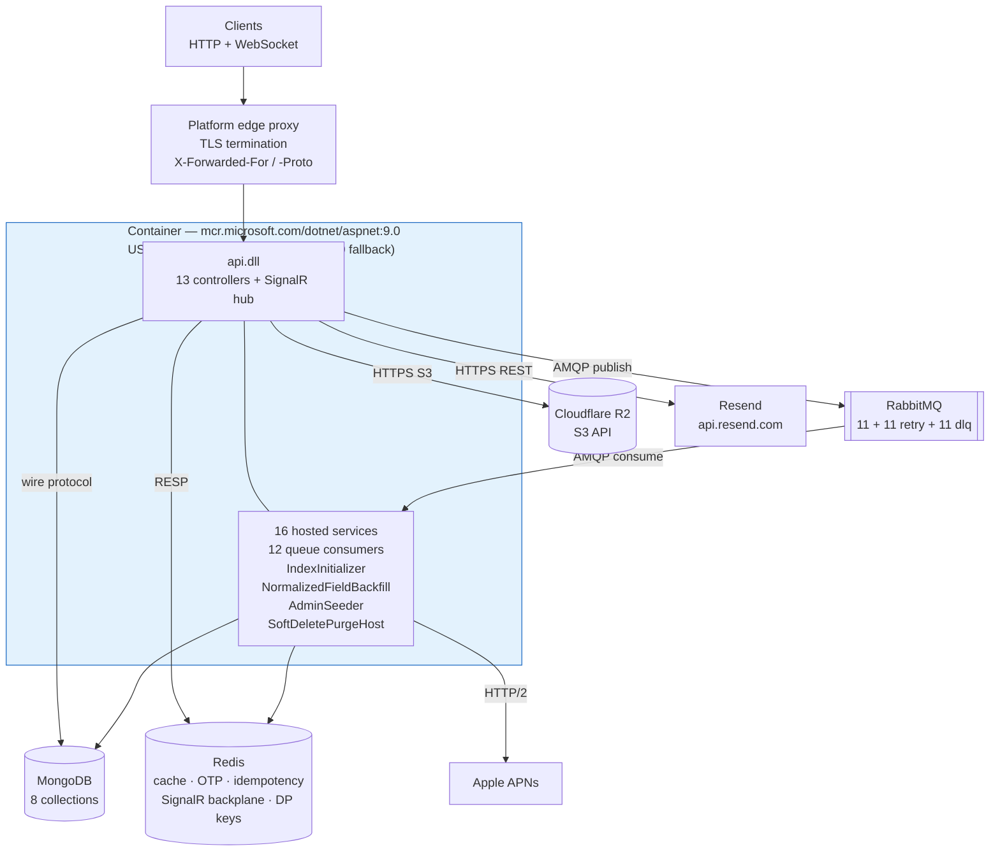

# Infrastructure

Every external service the system integrates with, how it is configured, how the application is
packaged, and how it is deployed and observed. Runtime data flow is in
[`system-design.md`](./system-design.md).

## Configuration

All configuration is read through `IConfiguration` with colon-separated keys
(`configuration["MongoDB:ConnectionString"]`). The default ASP.NET provider chain reads **process
environment variables**, where ASP.NET's double-underscore nesting maps `A__B` to `A:B`.

A gitignored `.env` at the repository root holds these for local work. Nothing in the repository
parses it — locally the shell or the IDE run configuration sources it; in production the platform
supplies the same names as service variables. `api.csproj` also declares a `UserSecretsId`, so local
values may come from .NET user secrets instead.

Committed settings files carry **no secrets**: `appsettings.json` holds Serilog minimum levels and
`AllowedHosts: "*"`; `appsettings.Development.json` only lowers the log level to `Debug`. The console
sink itself is configured in `Program.cs` (see *Logging and monitoring*).

### Required variables — 20

| Variable | Configuration key | Consumed by |
|---|---|---|
| `MongoDB__ConnectionString` | `MongoDB:ConnectionString` | `IMongoClient` singleton, `infra/DependencyInjection.cs` |
| `MongoDB__DatabaseName` | `MongoDB:DatabaseName` | `DbContext`, `IndexConfiguration.CreateAsync` |
| `Redis__ConnectionString` | `Redis:ConnectionString` | `IConnectionMultiplexer` singleton; SignalR backplane in `api/DependencyInjection.cs` |
| `RabbitMQ__ConnectionString` | `RabbitMQ:ConnectionString` | `IConnection` singleton |
| `R2__AccountId` | `R2:AccountId` | Builds `ServiceURL` = `https://{AccountId}.r2.cloudflarestorage.com` |
| `R2__AccessKeyId` | `R2:AccessKeyId` | `AmazonS3Client` credentials |
| `R2__SecretAccessKey` | `R2:SecretAccessKey` | `AmazonS3Client` credentials |
| `R2__BucketName` | `R2:BucketName` | `R2Service` |
| `R2__FolderName` | `R2:FolderName` | Object key prefix |
| `R2__PublicUrl` | `R2:PublicUrl` | Public URL returned after upload |
| `Jwt__SecretKey` | `Jwt:SecretKey` | HS256 signing key — `JwtService` and `TokenValidationParameters` |
| `Jwt__Issuer` | `Jwt:Issuer` | Token issuance and validation |
| `Jwt__Audience` | `Jwt:Audience` | Token issuance and validation |
| `Jwt__ExpiryMinutes` | `Jwt:ExpiryMinutes` | Access token lifetime |
| `Email__ApiKey` | `Email:ApiKey` | Resend bearer token |
| `Email__Address` | `Email:Address` | Resend `from` address |
| `Apns__TeamId` | `Apns:TeamId` | `ApnsTokenProvider` — the provider JWT's `iss` claim |
| `Apns__KeyId` | `Apns:KeyId` | `ApnsTokenProvider` — the provider JWT's `kid` header |
| `Apns__PrivateKey` | `Apns:PrivateKey` | `ApnsTokenProvider` — base64 of the whole `.p8` file, so the multi-line PEM survives as a single-line variable |
| `Apns__BundleId` | `Apns:BundleId` | `ApnsService` — the `apns-topic` header; must equal the iOS app's `PRODUCT_BUNDLE_IDENTIFIER` |

### Optional variables — 8

| Variable | Effect when set | Effect when unset |
|---|---|---|
| `Maps__TeamId` | `MapsTokenProvider` — the Maps auth JWT's `iss` claim | Place resolution is unavailable, so **no post about a shop the catalogue does not already hold can be created** — the identifier cannot be resolved and the post is answered `400`. A post about a shop already in the catalogue is unaffected: it is found on `PlaceId` and makes no Maps call. Every other path still works |
| `Maps__KeyId` | `MapsTokenProvider` — the Maps auth JWT's `kid` header | Same |
| `Maps__PrivateKey` | `MapsTokenProvider` — base64 of the whole Maps `.p8` file, same single-line convention as `Apns__PrivateKey` | Same |
| `Admin__Email` + `Admin__Password` | `AdminSeeder` creates the account, or promotes an existing one to `Role.Admin` | Seeding is skipped and logged at `Information` |
| `Admin__Name` | Display name for a newly seeded administrator | Defaults to `admin` |
| `ForwardedHeaders__KnownProxies__0` | Pins `X-Forwarded-*` trust to a specific proxy IP | Trust is open to whatever can reach the container |
| `ForwardedHeaders__KnownNetworks__0` | Pins trust to a CIDR range | Same |

### Two behaviours to know before a deploy

**Fail-fast on JWT and APNs, fail-obscurely on everything else.** Most values are dereferenced with
the null-forgiving `!` operator, so a missing variable throws at composition without naming the key.
Two groups are exceptions:

- `AddApi` calls `RequireJwtConfiguration` before anything else and throws an
  `InvalidOperationException` naming the missing key. That check exists because `Jwt:ExpiryMinutes` is
  read with `GetValue<int>`, which silently yields `0` when unset — every access token would then be
  minted already expired, and the only symptom is that nothing authenticates.
- The four `Apns__*` keys are read eagerly in `AddInfra`, because a push failure is swallowed by
  design and a misconfigured key would otherwise be indistinguishable from a working one.
- The three `Maps__*` keys are read eagerly too, but **warn instead of throwing**. The whole API is
  not post creation: a deployment without a Maps key still serves every read, every other mutation,
  and posts about shops the catalogue already holds. Only a post about a *new* shop fails, and
  refusing to boot would take everything else down with it. The startup warning is what keeps
  "unconfigured" from being mistaken for "Apple rejected it".

**Values must be supplied unquoted.** The local `.env` wraps values in double quotes as a file
convention. Whatever supplies them as container environment variables must not: a literal `"10"`
reaching `Jwt:ExpiryMinutes` fails `GetValue<int>` conversion, and a quoted connection string is
passed to the driver with the quotes included.

### Forwarded-headers trust

`ConfigureForwardedHeaders` ([src/api/DependencyInjection.cs](../src/api/DependencyInjection.cs))
clears the framework's loopback-only defaults before applying `ForwardedHeaders:KnownProxies` and
`KnownNetworks`. With both unset the middleware honours `X-Forwarded-For` and `X-Forwarded-Proto` from
whatever fronts the container.

That is necessary when the edge proxy's address is not fixed: without it the original scheme is lost —
leaving `UseHttpsRedirection` to act on a plain-HTTP request — and every IP-partitioned rate limit
sees the proxy's address instead of the caller's. It also means those headers are trusted from
anything able to reach the container, which holds only while the container publishes no port of its
own. When the proxy address or its subnet is fixed and known, setting either key narrows trust back to
exactly that.

`app.UseHttpsRedirection()` runs after `UseForwardedHeaders`, so `X-Forwarded-Proto: https` makes the
request scheme `https` and the redirect is a no-op behind a TLS-terminating edge; it still protects a
deployment that receives plain HTTP directly.

## Integrated services

### MongoDB — system of record

Registered as an `IMongoClient` singleton; `DbContext` resolves the database by name and exposes
`GetCollection<T>`. Eight collections
([src/app/common/CollectionName.cs](../src/app/common/CollectionName.cs)): `account`, `post`,
`comment`, `report`, `shop`, `refreshtoken`, `devicetoken`, `notification`.

#### Indexes

**45 index models** are declared in
[src/infra/persistence/configuration/IndexConfiguration.cs](../src/infra/persistence/configuration/IndexConfiguration.cs)
and created by `IndexInitializer`, a `BackgroundService` so builds never block startup.

| Collection | Indexes |
|---|---|
| `account` | Unique `Email` partial on `IsDeleted: false`; `(Name, IsDeleted, CreatedAt desc, Id desc)`; `(IsDeleted, CreatedAt desc, Id desc)`; multikey `Followers.AccountId`, `Followings.AccountId`, `Blocks.AccountId`, `SavePosts.PostId`, `SaveShops.ShopId`; `DeletedAt` partial on `IsDeleted: true` |
| `post` | By `AccountId`, `ShopId`, `IsDeleted`, `CaptionNormalized` — the first three are what the related feed's four account tiers, its nearby tier and its global-recent backstop walk, so that feed added **no index of its own**; multikey `Reactions.AccountId` backing `ReactionMembership`, the affinity ranking and `ReactedPostSet`; `DeletedAt` partial on `IsDeleted: true` |
| `comment` | `(PostId, IsDeleted, CreatedAt desc, Id desc)`; `(AccountId, IsDeleted, CreatedAt desc, Id desc)`; `(IsDeleted, CreatedAt desc, Id desc)` backing the unfiltered administrator listing; multikey `Reactions.AccountId`; `DeletedAt` partial on `IsDeleted: true` |
| `shop` | Unique `PlaceId` partial on `IsDeleted: false`, the field `CreatePostHandler`'s lookup and its duplicate-key recovery both filter on — and the **only** unique index on the collection; by `Name`, `Address`, `NameNormalized`, `AddressNormalized`, `IsDeleted`; **2dsphere on `Location`** backing both `GetBestShopAround` and the related feed's `NearbyShopResolver`; `DeletedAt` partial on `IsDeleted: true` |
| `report` | By `IsDeleted`, `PostId`, `CommentId`, `AccountId`, `ReporterId` |
| `notification` | `(ToAccountId, IsDeleted, CreatedAt desc, Id desc)`, backing both the recipient's listing and the per-account delete in `AccountService`; `ActorAccountId`, backing the actor-avatar refresh in `ProfileService` |
| `refreshtoken` | Unique `Token`; **TTL on `ExpiryDate` with `ExpireAfter = TimeSpan.Zero`**; by `IsDeleted`; `IsRevoked` partial on `IsRevoked: true` |
| `devicetoken` | Unique `Token`, the key `RegisterDeviceHandler` upserts on; `(AccountId, IsDeleted)` backing the per-account lookup `ApnsService` runs once per notification |

The four `DeletedAt` indexes and the `IsRevoked` index exist only to back the retention sweep; their
partial filters keep them holding soft-deleted rows rather than whole collections.

There is deliberately **no** unique index over the shop's name or address. Apple can answer with two
distinct places that format to the same name and address — two kiosks in one mall, two units at one
street number — and a unique index over that text would reject the second of them as a duplicate.

`Shop.PlaceId` and `Shop.Location` are both non-nullable and `BsonConfiguration` no longer sets
`IgnoreIfNull` on either, because neither can be absent: every shop is an Apple place and carries the
coordinate Apple answered. This assumes the collection holds no rows predating that rule. A document
missing `PlaceId` would collide with every other such document on the unique index and the index
build would fail inside `IndexInitializer` — a `BackgroundService`, so the failure is logged rather
than surfaced at startup.

`NormalizedFieldBackfillInitializer` is a second `BackgroundService` that fills `Shop.NameNormalized`
/ `AddressNormalized` and `Post.CaptionNormalized` for documents missing them, scanning with a cursor
and applying `BulkWriteAsync` per batch.

#### Retention — `SoftDeletePurgeHost`

Soft deletes are not permanent: `BaseEntity.Delete` sets `IsDeleted` / `DeletedAt` and `Recover`
clears them. `SoftDeletePurgeHost` makes them permanent once the window has passed. There is no
scheduler dependency.

| Setting | Value | Why |
|---|---|---|
| `Retention` | 30 days after `DeletedAt` | Also the window `Recover()` has to run in |
| `StartupDelay` | 10 minutes | So a deploy never pays for a sweep during startup |
| `SweepInterval` | 6 hours, on a `PeriodicTimer` | Short enough to survive frequent redeploys, which a once-a-day timer would not |
| `BatchSize` | 500 ids per delete | |
| `BatchDelay` | 200 ms between batches | So a large backlog never lands as one long write burst |

Accounts, posts, comments, shops and device tokens are hard-deleted once past retention; revoked
refresh tokens are dropped on sight, since the `ExpiryDate` TTL index would reach them within 7 days
anyway. A sweep resolves its own DI scope, and failures are logged without stopping the loop.

Cascade soft-deletes go through the driver rather than `BaseEntity.Delete`, so each one stamps
`DeletedAt` itself or the row would never expire. Rows written before that was true carry
`IsDeleted: true` with no `DeletedAt`; every sweep stamps those first, which starts their 30-day
window at the sweep that finds them rather than purging them immediately.

R2 objects are removed at soft-delete time, so the sweep itself is pure Mongo work. Post and comment
images are never deleted inside the request: `PostService` owns post images and
`CommentService.ProcessAfterDeleteAsync` owns comment images, and every path — the two self-service
handlers, the two administrator handlers, the account cascade, and `PostService` itself for the
comments it takes down — reaches them by publishing to `delete-post` and `delete-comment`. **Avatars
are the exception and are deleted inline**, by `RemoveAvatarHandler` in the request and by
`AccountService` in the cascade; both are bounded by one account's avatar count.

Three cascade consequences are deliberate:

- **Notifications addressed to a deleted account are hard-deleted immediately** by `AccountService`,
  not left for the sweep: once the account is soft-deleted nothing can read its notifications again,
  and the collection has no retention of its own. That delete is permanent even if the account is
  later recovered. Notifications where the deleted account is the *actor* survive in other people's
  inboxes, carrying an `ActorAccountId` that eventually resolves to nothing.
- **`AccountService` publishes one `delete-post` message per post and one `delete-comment` per
  comment** rather than doing that work inline, because comments other accounts left on the account's
  posts are not covered by the cascade's own filter and would otherwise outlive the post as live rows
  — and because an account's post and comment counts are unbounded, so inline work would scale with
  them and a failure near the end would replay all of it.
- **A purged shop leaves posts holding its `ShopId` and accounts holding it in `SaveShops`.** Nothing
  cascades on shop deletion, so those references already dangle for the 30 days the shop spends
  soft-deleted. `report` carries the same `IsDeleted` / `DeletedAt` fields but is not swept.

### Redis — cache, ephemeral state, SignalR backplane

The multiplexer is built from `ConfigurationOptions.Parse(...)` with **`AbortOnConnectFail = false`**.
The default `true` makes `Connect` throw outright when Redis is momentarily unreachable, and because
the `Lazy<T>` caches that exception for the process lifetime, one blip would leave every Redis call
failing until the container restarted. With it disabled the multiplexer returns immediately and
reconnects in the background; individual operations fail while the connection is down, and
`RedisHealthCheck` reports the outage through `/health`.

One `IConnectionMultiplexer` serves four consumers: `RedisService`, the SignalR backplane, the Data
Protection key ring, and `RedisHealthCheck`. It is created through a `Lazy<IConnectionMultiplexer>` in
`AddInfra` so the singleton registration and the key repository share one connection without either
forcing it open during composition.

| Key pattern | TTL | Purpose |
|---|---|---|
| `account:v1:id:{guid}`, `post:v1:id:{guid}`, `comment:v1:id:{guid}`, `report:v1:id:{guid}`, `shop:v1:id:{guid}`, `notification:v1:id:{guid}` | 7 days | Single-entity cache |
| `account:v1:email:{email}` | 7 days | Administrator lookup by email |
| `list:v1:{entity}:{signature}:{cursor}:{size}:v{version}` | 2 minutes | Cursor page cache. On a block-filtered read the signature carries a trailing `:hidden:{sha256(sorted blocked ids)[..16]}`, so viewers hiding different accounts never share a page |
| `list-version:{entity}:{signature}` | 1 day, sliding | List invalidation counter. Always the **unsuffixed** signature — writers cannot compute a viewer's hidden set, so every hidden variant of a page shares one counter and retires on a single bump |
| `affinity:v1:account:{guid}` | 1 hour | Accounts this account reacts to most, ranked; a query input for `GetRelatedPost` rather than a page of results, so no version counter governs it |
| `trusted:v1:top` | 1 hour | Top trusted accounts by follower count. Carries no per-viewer signal, so one key serves every viewer — the feed drops the viewer and their blocked accounts *after* the read rather than from this list, which is what keeps both it and the `trusted:global` page key shared |
| `nearby-shops:v1:cell:{lat}:{lng}` | 10 minutes | Shops within 10 km of a ~1.1 km cell, each with its distance, resolved from the cell's **centre** so every viewer in it computes the same entry. The one feed input with no per-viewer signal at all; the nearby tier's page key is the cell too. Distances are kept because `FeedScorer` wants them and recovering them later would mean re-reading `shop` |
| `reacted-posts:v1:account:{guid}` | 1 day | Posts this viewer has reacted to, which the feed excludes. Rebuilt from the reactions themselves on a miss and **deleted outright by `ReactPostService` on both react and unreact**, so it is never stale, only cold — the TTL is a backstop against a key nobody revisits, not the invalidation mechanism |
| `otp:{email}` | 10 minutes | `{Code, Attempts, ExpiresAt}`, max 3 attempts. Deleted only when the attempt cap is hit; a correct code is left to expire so a lost verify response can be retried |
| `otp:gen:{email}:{yyyyMMddHH}` | 1 hour | Passcodes issued to this address in the window. Keyed by recipient rather than by caller, which is what the edge limiters cannot do. The UTC hour is in the key so the window **tumbles** — a sliding one would let anyone holding an address keep its owner locked out of password reset for as long as they kept asking |
| `purge:sweep-claim` | 6 hours | Claimed by whichever replica increments it to 1, so the retention sweep runs once per interval rather than once per replica |
| `registration:{token}` | 10 minutes | Data-Protection-wrapped email. Read non-destructively and deleted only once the write it authorises commits |
| `rabbitmq:idempotency:{queue}:{messageId}` | 24 hours | SHA-256 of the processed payload |
| `bump:dataprotection-keys` | none | ASP.NET Data Protection key ring (see *Deployment topology*) |
| `admin:v1:series:{metric}` | 24 hours | Metric history written by the separate **Bump_Admin** panel, never by this server |

The backplane is required for **correctness, not scale**: without it a replica can only push to hub
connections it holds itself, so notifications for users connected to another replica are dropped.

The `admin:v1:` prefix belongs to the Bump_Admin operations panel, which reuses this Redis instance
rather than provisioning its own to hold self-measured uptime and latency history. Nothing in this
repository reads or writes those keys, and the distinct prefix is what keeps the two uses from
colliding. They are sorted sets trimmed to a 24-hour window with an expiry, so they cannot grow
without bound.

### RabbitMQ — asynchronous work

One `IConnection` singleton built with `RequestedHeartbeat = 30s`, `AutomaticRecoveryEnabled = true`
and `NetworkRecoveryInterval = 5s`. The factory blocks on
`.CreateConnectionAsync().GetAwaiter().GetResult()`, so **the broker must be reachable at startup** —
unlike Redis, there is no non-blocking fallback.

12 durable, non-exclusive, non-auto-delete queues, each declared alongside a `.retry` queue (which
holds nothing, and whose fixed `x-message-ttl` expires messages back to the main queue as the retry
delay) and a `.dlq` — **36 queues in total**. Consumers use `prefetchCount: 1` with manual ack. Each
of the 12 `QueueConsumerHost<TMessage>` instances restarts its consume loop after a 5-second delay if
it throws.

Messages are published with `Persistent = true` onto durable queues, so a broker restart does not lose
them. The queue table, message payloads and worker mappings are in
[`developer-guide.md`](./developer-guide.md#32-the-12-queues); the ordering rationale is in
[`system-design.md`](./system-design.md#43-sequential-ordering-for-inverse-operation-pairs).

Publishing goes through `RabbitMQPublishChannel`, a singleton holding **one** channel behind a
semaphore, with each queue declared once per channel lifetime. It previously opened a channel and
re-declared the queue on every message — three broker round trips to send one, on the path every
reaction, follow, save and comment takes, and once per post and per comment in the account delete
cascade. A single channel is enough because publishing without publisher confirms does not wait on
the broker, so the semaphore is held across a socket write and nothing else; `IChannel` is not
thread-safe in RabbitMQ.Client 7, which is the only reason it is there. The channel is recreated, and
its declared set cleared, if the broker closes it.

Consumers keep a channel each: a consumer's channel carries its delivery acknowledgements and cannot
be shared. Broker latency still adds to the latency of every endpoint that publishes, which makes
co-locating the broker with the application a correctness-adjacent concern rather than a tuning
detail.

### Cloudflare R2 — object storage

Accessed through `AWSSDK.S3` against an R2 endpoint:

```csharp
ServiceURL = $"https://{configuration["R2:AccountId"]}.r2.cloudflarestorage.com",
ForcePathStyle = true,
RequestChecksumCalculation = RequestChecksumCalculation.WHEN_REQUIRED,
ResponseChecksumValidation = ResponseChecksumValidation.WHEN_REQUIRED
```

The two checksum settings and `UseChunkEncoding = false` on `PutObjectRequest` are R2 compatibility
requirements. Objects are keyed `{R2:FolderName}/{guid}{extension}` with an explicit `ContentType`
resolved from the extension, defaulting to `application/octet-stream` for anything outside the image
allowlist.

`DeleteAsync` derives the key from `new Uri(url).AbsolutePath.TrimStart('/')`, which **assumes
`R2:PublicUrl` has no path segment of its own.** A public URL such as `https://cdn.example.com/media`
would make every derived key wrong.

Stores avatars, post images and comment images. Deletions are best-effort and not transactional with
MongoDB.

### Resend — transactional email

`AddHttpClient<IEmailService, EmailService>` with a 10-second timeout, posting to the hardcoded
`https://api.resend.com/emails` with a bearer `Email:ApiKey`. Sends the 6-digit OTP for registration
and account verification. A `text` part is derived from the HTML by stripping tags with
`Regex.Replace(htmlBody, "<.*?>", string.Empty)`.

### Apple APNs — push notifications

`AddHttpClient<IApnsService, ApnsService>` with a 10-second timeout,
`DefaultRequestVersion = HttpVersion.Version20` and `RequestVersionExact` — **APNs refuses HTTP/1.1
and `HttpClient` downgrades silently unless told not to.** No `BaseAddress` is set: the host belongs
to the device token, not to the client.

`ApnsTokenProvider` mints the ES256 provider JWT from the base64-decoded `.p8` key, caching it for
**45 minutes** with a **20-minute** minimum reissue interval — inside Apple's 20–60 minute window. The
JWS signature is the IEEE P1363 `r||s` pair (exactly 64 bytes for P-256), not DER.

`ApnsService` sends one `alert` push per live `DeviceToken`, with headers `apns-topic`
(`Apns:BundleId`), `apns-push-type: alert`, `apns-priority: 10`, an `apns-expiration`, and the
notification id as `apns-id`. The host is chosen **per token** from `DeviceToken.Environment`, because
one deployment serves Xcode (sandbox) and TestFlight (production) builds at the same time — which is
why there is no single `Apns__UseSandbox` switch. A token answered `410 Unregistered` or
`400 BadDeviceToken` is soft-deleted.

### Apple Maps Server API — place verification

`AddHttpClient<IPlaceService, ApplePlaceService>` with a 10-second timeout. Two credentials steps,
one more than APNs needs: `MapsTokenProvider` signs an ES256 JWT from the base64-decoded Maps `.p8`
key — the same P1363 `r||s` signature APNs requires — carrying `iss`, `iat`, `exp` and
`scope: server_api`, then exchanges it at `GET https://maps-api.apple.com/v1/token` for an access
token. Only the access token is accepted by the API itself.

The access token is cached process-wide in a singleton, refreshed a minute before the
`expiresInSeconds` Apple reports (1800 at the time of writing) and clamped to a 60-second floor, so
a missing lifetime cannot spend a quota call per request. **Server API and MapKit JS share one quota
of 25,000 calls per day per team**; a `429` means it is exhausted.

`ApplePlaceService.ResolveAsync` calls `GET /v1/place/{id}` and maps the answer to name, joined
`formattedAddressLines` and coordinate, truncating name and address to the 200 characters the rest of
the system expects. A `404` is an ordinary outcome — an identifier Apple has never issued, or a
retired place — and is not logged; every other status is. Resolution failure returns `null`, which
`CreatePostHandler` answers as `400 Shop could not be verified`. It is the only Maps call the server
makes, and `CreatePostHandler` reaches it only when no shop already holds the identifier, so the quota
is spent per new shop rather than per post.

### Health checks

`GET /health` aggregates three checks registered in `AddInfra`, each resolving the corresponding
singleton:

| Name | Implementation |
|---|---|
| `mongodb` | `db.admin.runCommand({ping: 1})` |
| `redis` | `IDatabase.PingAsync()` |
| `rabbitmq` | `IsOpen` check, then opens and disposes a channel |

None of the three catches exceptions itself, but `HealthCheckService` wraps every registered check, so
a connection failure is reported as `Unhealthy` with the exception attached rather than escaping
unhandled.

**The endpoint is deliberately one aggregate**, so any single backing service being down fails the
whole endpoint: `railway.json` points the deploy health check at it, which makes that coupling the
point — a release is not promoted while Mongo, Redis or RabbitMQ is unreachable. Two consequences
follow:

- The health-check timeout must cover container start plus three connection attempts, including the
  blocking RabbitMQ connect.
- `/health` is **not** excluded from the global 200-requests-per-minute rate limiter, so an uptime
  poller must stay well inside that budget.

## Container image

Multi-stage build, `mcr.microsoft.com/dotnet/sdk:9.0` → `mcr.microsoft.com/dotnet/aspnet:9.0`.
`.csproj` files are copied before sources so the restore layer caches on manifest changes only.

Restore targets `api/api.csproj` rather than the solution, which pulls exactly the transitive chain
that *is* copied (`infra` → `app` → `domain`). Restoring `Bump.sln` instead would fail with MSB3202
for any solution member whose `.csproj` the image does not copy.

The image runs as `USER $APP_UID` (non-root, provided by the base image) and serves plain HTTP — TLS
terminates upstream at the platform edge.

```dockerfile
ENTRYPOINT ["sh", "-c", "exec dotnet api.dll --urls \"http://0.0.0.0:${PORT:-8080}\""]
```

The entrypoint binds `$PORT` when the environment sets it and falls back to the `EXPOSE`d `8080` for a
plain `docker run`, so no target port needs to be configured on a platform that injects `PORT`. `exec`
keeps `dotnet` as PID 1 so `SIGTERM` reaches the host and the 12 queue consumers shut down through
their `stoppingToken` rather than being killed.

`.dockerignore` excludes `bin/`, `obj/`, `.vs/`, `.vscode/`, `*.user`, `.git/`, `.claude/`, `doc/`,
`*.md`, `.DS_Store` and the `Dockerfile` itself. It is tracked by git despite appearing in the root
`.gitignore` — the entry was added after the file was already committed — and **it must stay
tracked**: the build context is the whole repository, and without it the host's `bin/` and `obj/`
directories enter that context and can break `dotnet restore` inside the SDK image.

## Deployment topology



**Every backing service is external to this repository** in production; each arrives as a connection
string or API key in a service variable, and no manifest or IaC provisions them. The one exception is
local development: the root `docker-compose.yml` runs Mongo, Redis, RabbitMQ and a MinIO standing in
for R2, so `dotnet run` and the test suites under `/test` have somewhere to point without a
Railway environment. That MinIO is `cgr.dev/chainguard/minio` — both of MinIO's own registries now
answer `401` to an anonymous pull under its current licensing, and Chainguard's rebuild is a drop-in
that still ships `mc`, so one image serves as the server, the `mc ready local` healthcheck and the
`minio-init` bucket creation alike. `IntegrationTestFixture` pins the same image for the
Testcontainers MinIO the integration suite starts. It publishes only a rolling `latest`, which is
the one thing to know about it. Resend, APNs and Apple Maps have no local emulator and are stubbed
in tests instead of run in a container. See [`developer-guide.md`](./developer-guide.md#local-development) for
how to bring the stack up.

**The API container is stateless.** ASP.NET Data Protection keys — which protect the registration
token payload and therefore gate registration, recovery, password reset and email change — are
persisted to Redis under `bump:dataprotection-keys` with a fixed application name of `Bump`:

```csharp
AddDataProtection()
    .SetApplicationName("Bump")
    .PersistKeysToStackExchangeRedis(() => redisConnection.Value.GetDatabase(), "bump:dataprotection-keys");
```

The default filesystem key ring would be discarded on every deploy and never shared between replicas,
so a token issued before a deploy, or by another replica, would fail to unprotect with no error the
caller could act on. **Redis persistence is therefore a hard requirement, not a cache optimisation.**

**The API and all 12 queue consumers run in the same process**; there is no separate worker
deployment. Scaling the API scales consumers too, and each replica competes for the same queues. It
also means the process must stay resident: a platform that scales to zero would stop the consumers,
`SoftDeletePurgeHost` and the initializers along with the HTTP surface.

### Platform configuration — `railway.json`

The only platform configuration file in the repository. The builder is not configured because the root
`Dockerfile` is detected automatically; the build context is the whole repository, which is why
`.dockerignore` must stay tracked.

```json
{
  "$schema": "https://railway.com/railway.schema.json",
  "deploy": {
    "healthcheckPath": "/health",
    "healthcheckTimeout": 60,
    "restartPolicyType": "ON_FAILURE",
    "restartPolicyMaxRetries": 10
  }
}
```

### Deployment checklist

1. Set all **20 required variables** as service variables, **unquoted**. Add `Admin__Email` and
   `Admin__Password` if an administrator should be provisioned on boot.
2. `Jwt__SecretKey` must be a fresh, high-entropy value — HS256 forgery is a key-strength problem, and
   a hand-typed development string must not be reused in production. All four `Jwt:*` keys are
   validated at startup, so a deploy missing any of them fails fast with the key named.
3. `R2__PublicUrl` must have no path segment, or `R2Service.DeleteAsync` derives the wrong key.
4. `Apns__BundleId` must equal the iOS app's `PRODUCT_BUNDLE_IDENTIFIER`, and `Apns__PrivateKey` must
   be the base64 of the entire `.p8` file on one line.
5. MongoDB, Redis and RabbitMQ must all be reachable before the container serves traffic; all three
   are opened at startup and `/health` gates the release on them.

### Verified commands

```bash
dotnet build src/Bump.sln -c Release
```

Last run: **0 errors, 55 warnings** — all `CS8600` / `CS8604` / `CS8618` nullable warnings. Warnings
are not treated as errors.

## Logging and monitoring

Serilog writes to **the console only** — no file sink or log directory — which suits a containerized
deployment: everything on stdout and stderr is captured by whatever runs the container, with no
further setup.

The console sink is configured in `Program.cs` with an `ExpressionTemplate` (`Serilog.Expressions`)
emitting one single-line JSON object per event, in a shape any JSON-aware collector can parse — a
`message` field, a `level` field in the `debug` / `info` / `warn` / `error` vocabulary, and every
Serilog property flattened alongside them:

```json
{"timestamp":"2026-09-05T07:08:18.90Z","level":"warn","message":"GET /api/v1/Post/search took 812 ms","Method":"GET","Path":"/api/v1/Post/search","ElapsedMilliseconds":812,"CorrelationId":"abc-123"}
```

The template is a `const` in `Program.cs` rather than a `WriteTo` entry in `appsettings.json` because
**the bootstrap logger needs the identical shape**: everything logged before `UseSerilog` takes over —
including the `Log.Fatal` in the startup `catch` — is startup-phase output, which is exactly what gets
read when a deploy crash-loops. `appsettings.json` keeps `MinimumLevel` only.

Because properties are flattened rather than nested, any tool that indexes JSON fields can filter on
them directly:

| Source | Emits | Filter on |
|---|---|---|
| `UseSerilogRequestLogging` | One summary per HTTP request: method, path, status, elapsed | `StatusCode >= 500` |
| `PerformanceMiddleware` / `PerformanceBehavior` | A warning above 500 ms, at the HTTP and MediatR layers | `level: warn`, `ElapsedMilliseconds > 2000` |
| `CorrelationIdMiddleware` | `CorrelationId` on every event in a request scope | `CorrelationId: <id>` to reconstruct one request |
| `QueueConsumerHost` | A **warning** per message that does not apply, and an error when a consume loop restarts | `QueueName: react-post` to isolate one queue. A message that does not apply is acknowledged, never dead-lettered, so this line is the only trace a systematically refusing worker leaves — alert on its **rate**, since a single one is usually just a double tap |

`ReadFrom.Configuration` still runs, so a second sink can be added purely through `appsettings.json` —
a package reference plus a `WriteTo` entry, no code change. Seq, Better Stack, Axiom, Grafana Loki and
Datadog all publish first-party Serilog sinks.

**Retention is a limit to plan around.** Nothing in this repository persists logs beyond the process
lifetime; the console sink relies entirely on whatever captures stdout and stderr, and that capture's
retention window is outside this repository's control.

Uptime alerting is a separate concern from log aggregation: an external checker polling `/health`
answers *is it down*, while the logs answer *why*.
