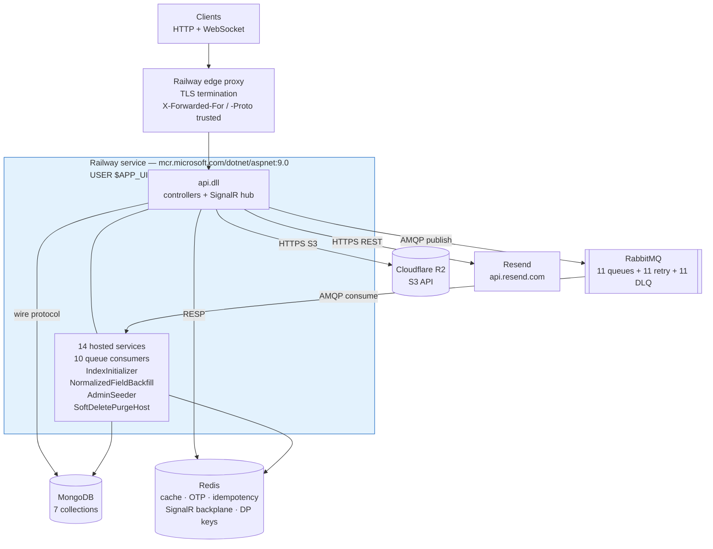

# Infrastructure

Every external service the system integrates with, how it is configured, and how the application is
packaged. Runtime data flow is in [`system-design.md`](./system-design.md).

## Configuration mechanism

All configuration is read through `IConfiguration` with colon-separated keys
(`configuration["MongoDB:ConnectionString"]`). The repository holds a **gitignored `.env` at the root**
(`.gitignore:4`) using ASP.NET's double-underscore nesting, where `A__B` maps to `A:B`.

Configuration is loaded by the default ASP.NET provider chain, which reads process environment
variables. Nothing in the repository parses `.env` — locally it is sourced by the shell or the IDE
run configuration; in production the same 16 names are set as **Railway service variables**, which
the platform injects into the container environment directly.

### Variables (names only — values are secrets and are not reproduced here)

| Variable | Configuration key | Consumed by |
|---|---|---|
| `MongoDB__ConnectionString` | `MongoDB:ConnectionString` | `IMongoClient` singleton, `infra/DependencyInjection.cs` |
| `MongoDB__DatabaseName` | `MongoDB:DatabaseName` | `DbContext`, `IndexConfiguration.CreateAsync` |
| `Redis__ConnectionString` | `Redis:ConnectionString` | `IConnectionMultiplexer` singleton; SignalR backplane in `api/DependencyInjection.cs` |
| `RabbitMQ__ConnectionString` | `RabbitMQ:ConnectionString` | `IConnection` singleton |
| `R2__AccountId` | `R2:AccountId` | Builds `ServiceURL` = `https://{AccountId}.r2.cloudflarestorage.com` |
| `R2__AccessKeyId` | `R2:AccessKeyId` | `AmazonS3Client` credentials |
| `R2__SecretAccessKey` | `R2:SecretAccessKey` | `AmazonS3Client` credentials |
| `R2__BucketName` | `R2:BucketName` | `R2Service` |
| `R2__FolderName` | `R2:FolderName` | Object key prefix |
| `R2__PublicUrl` | `R2:PublicUrl` | Public URL returned after upload |
| `Jwt__SecretKey` | `Jwt:SecretKey` | HS256 signing key, `JwtService` + `TokenValidationParameters` |
| `Jwt__Issuer` | `Jwt:Issuer` | Token issuance and validation |
| `Jwt__Audience` | `Jwt:Audience` | Token issuance and validation |
| `Jwt__ExpiryMinutes` | `Jwt:ExpiryMinutes` | Access token lifetime |
| `Email__ApiKey` | `Email:ApiKey` | Resend bearer token |
| `Email__Address` | `Email:Address` | Resend `from` address |

Committed settings files carry **no secrets** — `appsettings.json` holds only Serilog minimum levels
and `AllowedHosts: "*"`; `appsettings.Development.json` only lowers the log level to `Debug`. The
console sink itself is configured in `Program.cs` rather than in configuration (see *Logging and
monitoring*).
`api.csproj` declares a `UserSecretsId`, so local values may also come from .NET user secrets.

Two configuration keys are read but **absent from `.env`**:
`ForwardedHeaders:KnownProxies` and `ForwardedHeaders:KnownNetworks` (string arrays,
`api/DependencyInjection.cs`). `ConfigureForwardedHeaders` clears the framework's loopback-only
defaults before applying them, so with both unset the middleware honours `X-Forwarded-For` and
`X-Forwarded-Proto` from whatever fronts the container. That is the required behaviour behind a
platform edge proxy such as Railway's, whose address is not fixed and so cannot be pinned; without
it the original scheme is lost and IP-partitioned rate limits see the proxy's address rather than
the caller's. Setting either key narrows trust back to exactly those addresses.

Most values are dereferenced with the null-forgiving `!` operator, so a missing variable throws at
composition rather than reporting which key is absent. The four `Jwt:*` keys are the exception:
`AddApi` calls `RequireJwtConfiguration` before anything else and throws an
`InvalidOperationException` naming the missing key. That check exists because `Jwt:ExpiryMinutes`
is read with `GetValue<int>`, which silently yields `0` when unset — every access token would then
be minted already expired, and the only symptom is that nothing authenticates.

The local `.env` wraps every value in double quotes. Railway service variables must be entered
**unquoted**: a literal `"10"` reaching `Jwt:ExpiryMinutes` fails `GetValue<int>` conversion, and a
quoted connection string is passed to the driver with the quotes included.

## Integrated services

### MongoDB — primary datastore

Registered as an `IMongoClient` singleton; `DbContext` resolves the database by name and exposes
`GetCollection<T>`. Seven collections (`src/app/common/CollectionName.cs`): `account`, `post`,
`comment`, `report`, `shop`, `refreshtoken`, `notification`.

Indexes are declared in `src/infra/persistence/configuration/IndexConfiguration.cs` and created by
`IndexInitializer`, a `BackgroundService` so builds never block startup:

- **account** — unique `Email` partial on `IsDeleted: false`; `(Name, IsDeleted, CreatedAt desc, Id desc)`; `(IsDeleted, CreatedAt desc, Id desc)`; multikey `Followers.AccountId`, `Followings.AccountId`, `SavePosts.PostId`, `SaveShops.ShopId`; `DeletedAt` partial on `IsDeleted: true`
- **post** — by `AccountId`, by `ShopId`, by `IsDeleted`, by `CaptionNormalized`; multikey `Reactions.AccountId` backing both `ReactionMembership` and the affinity ranking in `GetRelatedPost`; `DeletedAt` partial on `IsDeleted: true`
- **comment** — `(PostId, IsDeleted, CreatedAt desc, Id desc)`; `(AccountId, IsDeleted, CreatedAt desc, Id desc)`; `(IsDeleted, CreatedAt desc, Id desc)` backing the unfiltered administrator listing; multikey `Reactions.AccountId`; `DeletedAt` partial on `IsDeleted: true`
- **shop** — unique `(Name, Address)` partial on `IsDeleted: false`; by `Name`, `Address`, `NameNormalized`, `AddressNormalized`, `IsDeleted`; **2dsphere on `Location`** backing `GetBestShopAround`; `DeletedAt` partial on `IsDeleted: true`
- **report** — by `IsDeleted`, `PostId`, `CommentId`, `AccountId`, `ReporterId`
- **notification** — `(ToAccountId, IsDeleted, CreatedAt desc, Id desc)`, backing both the recipient's listing and the per-account delete in `AccountService`
- **refreshtoken** — unique `Token`; **TTL index on `ExpiryDate` with `ExpireAfter = TimeSpan.Zero`**; by `IsDeleted`; `IsRevoked` partial on `IsRevoked: true`

The four `DeletedAt` indexes and the `IsRevoked` index exist only to back the retention sweep; the
partial filters keep them holding soft-deleted rows rather than whole collections.

A 2dsphere index is sparse over its geo field, and `BsonConfiguration` sets `IgnoreIfNull` on
`Shop.Location` so a shop posted without a place pick omits the field entirely rather than writing
`null`. Both together are what let `GetBestShopAround` skip coordinate-less shops instead of failing
to extract a geo key from them.

`NormalizedFieldBackfillInitializer` is a second `BackgroundService` that fills
`Shop.NameNormalized`/`AddressNormalized` and `Post.CaptionNormalized` for documents missing them,
scanning with a cursor and applying `BulkWriteAsync` per batch.

#### Retention — `SoftDeletePurgeHost`

Soft deletes are not permanent: `BaseEntity.Delete` sets `IsDeleted`/`DeletedAt` and `Recover`
clears them again. `SoftDeletePurgeHost` is the `BackgroundService` that makes them permanent once
the window has passed — **accounts, posts, comments and shops whose `DeletedAt` is more than 30 days
old are hard-deleted**, and revoked refresh tokens are dropped on sight (the `ExpiryDate` TTL index
would reach them within 7 days anyway).

There is no scheduler dependency. The first sweep is held back 10 minutes so a deploy never pays
for it during startup, and `PeriodicTimer` runs it every 6 hours after that; a delay short enough
to survive frequent Railway restarts, which a once-a-day timer would not. Each collection is
purged in batches of 500 ids with a 200 ms pause between batches, so a large backlog never lands as
one long write burst. A sweep resolves its own DI scope, and failures are logged without stopping
the loop.

R2 objects are removed at soft-delete time. Post and comment images are never deleted inside the
request: `PostService` owns post images and `CommentService.ProcessAfterDeleteAsync` owns
comment images, and
every path — the two self-service handlers, the two administrator handlers, the account cascade and
`PostService` itself for the comments it takes down — reaches them by publishing to
`delete-post` and `delete-comment`. **Avatars are the exception and are still deleted
inline**, by `RemoveAvatarHandler` in the request and by `AccountService` in the cascade; both
are bounded by one account's avatar count, so neither was moved. Either way the sweep itself is pure
Mongo work.

Cascade soft-deletes go through the driver rather than `BaseEntity.Delete`, so each one has to
stamp `DeletedAt` itself or the row would never expire. Rows written before that was true have
`IsDeleted: true` with no `DeletedAt`; every sweep stamps those first, which starts their 30-day
window at the sweep that finds them rather than purging them immediately.

Notifications addressed to a deleted account are **hard-deleted immediately** by
`AccountService`, not left for the sweep: once the account is soft-deleted nothing can read
its notifications again, and the collection has no retention of its own. That delete is permanent
even if the account is later recovered. Notifications where the deleted account is the *actor*
survive in other people's inboxes, carrying an `ActorAccountId` that eventually resolves to nothing.

Reports, and notifications pointing at a purged **post or comment**, are left behind — the sweep
does not make that worse, since they already dangle for the 30 days the row spends soft-deleted.

`AccountService` publishes one `delete-post` message per post and one `delete-comment` message
per comment instead of doing that work inline. Two reasons: comments other accounts left on the
account's posts are not covered by the cascade's own filter and would otherwise outlive the post as
live rows, and an account's post and comment counts are unbounded — inline, one message's cost
scales with them, and a failure near the end replays all of it.

A purged shop leaves posts holding its `ShopId` and accounts holding it in `SaveShops`; nothing
cascades on shop deletion, so those references already dangle for the 30 days the shop spends
soft-deleted. `report` carries the same `IsDeleted`/`DeletedAt` fields but is not swept.

### Redis — cache, ephemeral state, SignalR backplane

The multiplexer is built from `ConfigurationOptions.Parse(…)` with **`AbortOnConnectFail = false`**.
The default `true` makes `Connect` throw outright when Redis is momentarily unreachable, and because
the `Lazy<T>` would cache that exception for the process lifetime, one blip would leave every Redis
call failing until the container was restarted. With it disabled the multiplexer returns immediately
and reconnects in the background; individual operations fail while the connection is down, and
`RedisHealthCheck` reports the outage through `/health`.

One `IConnectionMultiplexer` serves four consumers: `RedisService` (JSON values and raw counters),
`NotificationHub` via the SignalR backplane
(`AddSignalR().AddStackExchangeRedis(configuration["Redis:ConnectionString"]!)`), the Data Protection
key ring, and `RedisHealthCheck`. It is created through a `Lazy<IConnectionMultiplexer>` in
`AddInfra` so the singleton registration and the Data Protection key repository share one connection
without either forcing it open during composition.

| Key pattern | TTL | Purpose |
|---|---|---|
| `account:v1:id:{guid}`, `post:v1:id:{guid}`, `comment:v1:id:{guid}`, `report:v1:id:{guid}`, `shop:v1:id:{guid}`, `notification:v1:id:{guid}` | 7 days | Single-entity cache |
| `account:v1:email:{email}` | 7 days | Admin lookup by email |
| `list:v1:{entity}:{signature}:{cursor}:{size}:v{version}` | 2 minutes | Cursor page cache. On a block-filtered read the signature carries a trailing `:hidden:{sha256(sorted blocked ids)[..16]}`, so viewers hiding different accounts never share a page |
| `list-version:{entity}:{signature}` | 1 day, sliding | List invalidation counter. Always the **unsuffixed** signature — writers cannot compute a viewer's hidden set, so every hidden variant of a page shares one counter and retires on a single bump |
| `affinity:v1:account:{guid}` | 1 hour | Accounts this account reacts to most, ranked; a query input for `GetRelatedPost`, not a page of results, so no version counter governs it |
| `otp:{email}` | 10 minutes | `{Code, Attempts, ExpiresAt}`, max 3 attempts. Deleted only when the attempt cap is hit; a correct code is left to expire so a lost verify response can be retried |
| `registration:{token}` | 10 minutes | Data-Protection-wrapped email. Read non-destructively and deleted only once the write it authorises commits |
| `rabbitmq:idempotency:{queue}:{messageId}` | 24 hours | SHA-256 of the processed payload |
| `bump:dataprotection-keys` | none | ASP.NET Data Protection key ring (see *Deployment topology*) |
| `admin:v1:series:{metric}` | 24 hours | Metric history written by **Bump_Admin**, not by this server |

The backplane is required for correctness, not scale: without it a replica can only push to hub
connections it holds itself, so notifications for users connected to another replica are dropped.

The `admin:v1:` prefix is written by the separate `Bump_Admin` operations panel, which reuses this
Redis instance rather than provisioning its own to hold the metric history no provider retains for
us — self-measured uptime and latency in particular. Nothing in this repository reads or writes those
keys, and the distinct prefix is what keeps the two uses from ever colliding. They are sorted sets
trimmed to a 24-hour window with an expiry, so they cannot grow without bound.

### RabbitMQ — asynchronous work

The client library is `RabbitMQ.Client` 7.2.2, but **the deployed broker is
LavinMQ** (CloudAMQP serves both; the `lmq` in the instance hostname identifies
it). LavinMQ speaks AMQP 0-9-1, so the client is unaffected — but anything
reading the management HTTP API is: LavinMQ reports `product_name` /
`lavinmq_version` where RabbitMQ reports `cluster_name` / `rabbitmq_version`, and
counts deliveries under `deliver` rather than `deliver_get`. Verified against the
live instance: LavinMQ 2.9.1.

One `IConnection` singleton built with `RequestedHeartbeat = 30s`,
`AutomaticRecoveryEnabled = true`, `NetworkRecoveryInterval = 5s`. The factory blocks on
`.CreateConnectionAsync().GetAwaiter().GetResult()`, so the broker must be reachable at startup.

14 durable, non-exclusive, non-auto-delete queues plus a `{queue}.dlq` for each. Consumers use
`prefetchCount: 1` with manual ack. Each of the 10 `QueueConsumerHost<TMessage>` instances restarts
its consume loop after a 5-second delay if it throws.

Queues: `follow`, `react-post`, `react-comment`, `create-comment`, `recalculate-shop-rate`,
`save-post`, `save-shop`, `delete-account`, `delete-post`, `delete-comment`.

**Each inverse pair shares one queue.** Follow and unfollow, react and unreact, save and unsave all
publish to the same queue with an `IsUndo` flag on the message, because a queue consumed by one
consumer at `prefetchCount: 1` is FIFO. On separate queues they were consumed concurrently, so a
rapid follow-then-unfollow could apply backwards: the unfollow matches nothing, fails, is logged and
acked, and the follow then lands — leaving the user following someone they just unfollowed. Ordering
only holds on the happy path; a retry republishes to the tail of the queue, behind newer messages.

### Cloudflare R2 — object storage

Accessed through `AWSSDK.S3` against an R2 endpoint:

```csharp
ServiceURL = $"https://{configuration["R2:AccountId"]}.r2.cloudflarestorage.com",
ForcePathStyle = true,
RequestChecksumCalculation = RequestChecksumCalculation.WHEN_REQUIRED,
ResponseChecksumValidation = ResponseChecksumValidation.WHEN_REQUIRED
```

The two checksum settings and `UseChunkEncoding = false` on `PutObjectRequest` are R2 compatibility
requirements. Objects are keyed `{R2:FolderName}/{guid}{extension}` with an explicit `ContentType`
resolved from the extension, defaulting to `application/octet-stream` for anything outside the
image allowlist. `DeleteAsync` derives the key from `new Uri(url).AbsolutePath.TrimStart('/')`, which
assumes `R2:PublicUrl` has no path segment of its own.

Stores avatars, post images and comment images. Deletions are best-effort and not transactional with
MongoDB.

### Resend — transactional email

`AddHttpClient<IEmailService, EmailService>` with a 10-second timeout, posting to the hardcoded
`https://api.resend.com/emails` with a bearer `Email:ApiKey`. Sends the 6-digit OTP for registration
and account verification. A `text` part is derived from the HTML by stripping tags with
`Regex.Replace(htmlBody, "<.*?>", string.Empty)`.

`SendWelcomeEmailAsync` is declared on `IEmailService` and implemented, but **no caller exists** —
dead code.

### Health checks

`GET /health` aggregates three checks registered in `AddInfra`, each resolving the corresponding
singleton:

| Name | Implementation |
|---|---|
| `mongodb` | `db.admin.runCommand({ping: 1})` |
| `redis` | `IDatabase.PingAsync()` |
| `rabbitmq` | `IsOpen` check, then opens and disposes a channel |

The endpoint is **not** excluded from the global 200-requests-per-minute rate limiter. None of the
three checks catches exceptions itself, but `HealthCheckService` wraps every registered check, so a
connection failure is reported as `Unhealthy` with the exception attached rather than escaping
unhandled.

`/health` is a single aggregate endpoint covering all three checks, so any one backing service being
down fails the whole endpoint. `railway.json` points Railway's deploy health check at it, which makes
that coupling deliberate: a release is not promoted while Mongo, Redis or RabbitMQ is unreachable.
There is no separate liveness endpoint that would answer without touching them.

## Deployment topology



**All four backing services are external and unmanaged by this repository** — no compose file,
manifest or IaC provisions them; on Railway they are separate services (or external providers) whose
connection strings arrive as service variables.

The API container is **stateless**. ASP.NET Data Protection keys — which protect the registration
token payload and therefore gate registration, recovery, password reset and email change — are
persisted to Redis under `bump:dataprotection-keys` with a fixed application name of `Bump`
(`AddDataProtection().SetApplicationName("Bump").PersistKeysToStackExchangeRedis(…)`). The default
filesystem key ring would be discarded on every Railway deploy and never shared between replicas, so
a token issued before a deploy, or by another replica, would fail to unprotect with no error the
caller could act on.

The API and all 10 queue consumers run **in the same process**; there is no separate worker
deployment. Scaling the API therefore scales consumers too, and each replica competes for the same
queues.

## Container image

Multi-stage build, `mcr.microsoft.com/dotnet/sdk:9.0` → `mcr.microsoft.com/dotnet/aspnet:9.0`.
`.csproj` files are copied before sources so the restore layer caches on manifest changes only.

Restore targets `api/api.csproj` rather than the solution, which pulls exactly the transitive chain
that *is* copied (`infra` → `app` → `domain`). Restoring `Bump.sln` instead would fail with MSB3202
for any solution member whose `.csproj` the image does not copy.

Runs as `USER $APP_UID` (non-root, provided by the base image) and serves plain HTTP — TLS
terminates upstream at the platform edge. The entrypoint binds the port Railway injects and falls
back to the `EXPOSE`d `8080` for a plain `docker run`:

```dockerfile
ENTRYPOINT ["sh", "-c", "exec dotnet api.dll --urls \"http://0.0.0.0:${PORT:-8080}\""]
```

`exec` keeps `dotnet` as PID 1 so `SIGTERM` reaches the host and the 10 queue consumers shut down
through their `stoppingToken` rather than being killed.

The application also calls `app.UseHttpsRedirection()`. Because `UseForwardedHeaders` runs first and
now trusts the platform proxy, `X-Forwarded-Proto: https` makes the request scheme `https` and the
redirect is a no-op; it still protects any deployment that receives plain HTTP directly.

`.dockerignore` excludes `bin/`, `obj/`, `.vs/`, `.vscode/`, `*.user`, `.git/`, `.claude/`, `doc/`,
`*.md`, `.DS_Store` and the `Dockerfile`. It is tracked by git despite being listed in the root
`.gitignore` — the entry was added after the file was already committed, so it has no effect — and it
must stay tracked: Railway builds from the repository, and without it the host's `bin/` and `obj/`
directories enter the build context and can break `dotnet restore` inside the SDK image.

## Deployment — Railway

Deployment is **Railway building this repository's `Dockerfile`**. There is no CI/CD pipeline, no
image registry of our own and no infrastructure-as-code: pushing the tracked branch is the deploy.

`railway.json` at the repository root is the only platform configuration:

```json
{
  "deploy": {
    "healthcheckPath": "/health",
    "healthcheckTimeout": 60,
    "restartPolicyType": "ON_FAILURE",
    "restartPolicyMaxRetries": 10
  }
}
```

- **Build** — not configured, because Railway already detects the root `Dockerfile` on its own. The
  build context is the whole repository, which is why `.dockerignore` must stay tracked.
- **Health check** — a release is only promoted once `/health` returns healthy, so a deploy that
  cannot reach Mongo, Redis or RabbitMQ rolls back instead of taking traffic. The 60-second timeout
  has to cover container start plus the three connection attempts; the RabbitMQ `IConnection` is
  built with a blocking `.GetAwaiter().GetResult()`, so a broker that is slow to accept connections
  delays startup directly.
- **Port** — Railway injects `PORT`; the entrypoint binds `0.0.0.0:$PORT`. No target port needs to
  be set in the service settings.

### Deployment checklist

1. Set all 16 variables from the table above as Railway service variables, **unquoted**.
2. `Jwt__SecretKey` must be a fresh, high-entropy value — HS256 forgery is a key-strength problem,
   and the local `.env` value is a hand-typed development string. It is not committed anywhere
   (`git log --all -- .env` is empty), but it should not be reused in production.
3. `Jwt__SecretKey`, `Jwt__Issuer`, `Jwt__Audience` and a `Jwt__ExpiryMinutes` greater than zero
   are all validated at startup by `RequireJwtConfiguration`; a deploy missing any of them fails
   fast with the key named, rather than starting and issuing tokens nothing will accept.
4. Redis, MongoDB and RabbitMQ must be reachable before the container starts serving; all three are
   opened at startup and `/health` gates the release on them.

### Verified commands

```bash
dotnet build src/Bump.sln -c Release   # verified: 0 errors, 50 warnings
docker build .                         # not verified — Docker is not installed in this environment
```

## Logging and monitoring

Serilog writes to **the console only**, which is exactly right for Railway: the platform captures
everything on stdout/stderr and no file sink or log directory is involved.

The console sink is configured in `Program.cs` with an `ExpressionTemplate` (`Serilog.Expressions`)
that emits one single-line JSON object per event in the shape Railway's log explorer parses — a
`message` field, a `level` field mapped to Railway's `debug`/`info`/`warn`/`error` vocabulary, and
every Serilog property flattened alongside them:

```json
{"timestamp":"2026-09-05T07:08:18.90Z","level":"warn","message":"GET /api/v1/Post/search took 812 ms","Method":"GET","Path":"/api/v1/Post/search","ElapsedMilliseconds":812,"CorrelationId":"abc-123"}
```

The template is a `const` in `Program.cs` rather than a `WriteTo` entry in `appsettings.json`
because the **bootstrap logger needs the identical shape**: everything logged before `UseSerilog`
takes over — including the `Log.Fatal` in the startup `catch` — is startup-phase output, which is
exactly what gets read when a deploy crash-loops. `appsettings.json` keeps `MinimumLevel` only. This
does not stop a second sink being added purely through configuration: `ReadFrom.Configuration` still
runs, so a `WriteTo` entry there is appended to the console sink rather than replacing it.

Because the properties are flattened, they are queryable in Railway as `@CorrelationId:abc-123`,
`@ElapsedMilliseconds:>1000`, `@RequestName:CreatePostCommand`. That turns the three log sources the
application already produces into something searchable rather than flat text:

| Source | Emits | Useful query |
|---|---|---|
| `UseSerilogRequestLogging` | one summary per HTTP request with method, path, status, elapsed | `@StatusCode:>=500` |
| `PerformanceMiddleware` / `PerformanceBehavior` | a warning above 500 ms, at the HTTP and MediatR layers | `level:warn @ElapsedMilliseconds:>2000` |
| `CorrelationIdMiddleware` | `CorrelationId` on every event in a request scope | `@CorrelationId:<id>` to reconstruct one request |

`QueueConsumerHost` logs a warning per message that does not apply and an error when a consumer loop
restarts, so `@QueueName:react-post level:error` isolates one queue's failures.

**Retention is the limit to plan around.** Railway keeps logs for 3 days (Free), 7 (Trial/Hobby),
30 (Pro) or up to 90 (Enterprise), and drops messages above 500 lines per second per replica.
Anything that must outlive that window, or that needs alerting rather than searching, needs a
destination outside Railway. Because Serilog reads its sinks from `appsettings.json`
(`ReadFrom.Configuration`), adding one is a package reference plus a `WriteTo` entry — no code
change. Seq, Better Stack, Axiom, Grafana Loki and Datadog all have first-party Serilog sinks.

Uptime alerting is a separate concern from log aggregation: an external checker polling `/health`
answers *is it down*, while the logs answer *why*. Note that `/health` is not excluded from the
global 200-requests-per-minute rate limiter, so a poller must stay well inside that budget.
