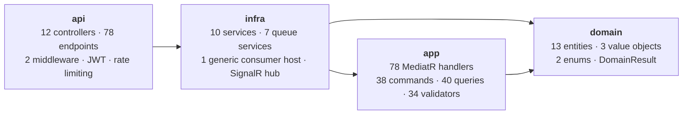

# Project Overview

## What this project is

**Bump** is a .NET 9 HTTP API server for a social food/shop review application. Accounts publish
**posts** that review a **shop** (identified by name + address) with an integer **rate** and optional
images; other accounts **react**, **comment**, **save**, and **follow** each other, and receive
**notifications** in real time over SignalR.

The domain model is in `src/domain/core/entity/`: `Account`, `Post`, `Comment`, `Shop`, `Reaction`,
`Follower`, `Following`, `SavedPost`, `SavedShop`, `Notification`, `Report`, `RefreshToken`, `Avatar`,
`Image`.

Shops are not created directly by any endpoint. `CreatePostHandler`
(`src/app/feature/post/command/Create/CreatePostHandler.cs`) looks up a shop by exact `Name` +
`Address` and inserts one if absent, so the shop catalogue is a side effect of posting. A shop's
`Rate` is the rounded average of its posts' rates, recalculated asynchronously by
`ShopRateService` (`src/infra/queue/shop/ShopRateService.cs`).

## Who and what it serves

- **End users**, through an HTTP JSON API under `api/v1/[controller]` and a SignalR hub at
  `/hubs/notification`. All 12 controllers carry a class-level `[Authorize]`; 8 endpoints opt out
  with `[AllowAnonymous]` (registration, login, refresh, recovery, password reset, and the three
  email/OTP endpoints).
- **Administrators**, through 15 endpoints gated by `[Authorize(Roles = nameof(Role.Admin))]`:
  account listing, lookup-by-email and deletion (`AccountController`), refresh-token
  inspection and revocation (`AuthController`), comment listing and deletion
  (`CommentController`), post deletion (`PostController`), shop deletion
  (`ShopController`), report listing and lookup (`ReportController`), and the whole of
  `DashboardController` (class-level attribute).

  The six administrator-only mutations — `AdminDeleteAccount`, `AdminDeletePost`,
  `AdminDeleteComment`, `RevokeRefreshToken` — sit in their own use-case folders rather
  than adding an ownership bypass to the existing self-service handlers, which the client
  depends on. Each mirrors its self-service counterpart's side effects in full (R2 image
  cleanup, cache invalidation, and the RabbitMQ cascade), because a delete that only flips
  `IsDeleted` would leave shop rates and comment counters stale.
- **No first-party client application exists in this repository.** The server is the only artifact
  here; the iOS client lives in `Bump_Client` and the operations panel in `Bump_Admin`, both
  separate repositories. `src/api/api.http` still contains the `dotnet new` template's `GET /weatherforecast/`
  request, which matches no route in the codebase.

`Role` (`src/domain/core/enum/Role.cs`) has exactly two values, `User` and `Admin`. `Role.User` is
the hardcoded default on `Account`, and **no endpoint or handler assigns `Role.Admin`** — promotion
must happen directly in the database. No custom enum serializer is registered, so the driver stores
the value as an Int32 (`User` = 0, `Admin` = 1) and promotion is:

```js
db.account.updateOne(
  { 'Email.Value': '<address>', IsDeleted: false },
  { $set: { Role: 1 } }
);
```

The role is a claim in the access token, so an existing session keeps its old role until the token
expires and is renewed. *Not found in codebase — needs confirmation* on whether a guarded
provisioning path is wanted instead of the manual update.

## Tech stack

Versions are taken verbatim from the `.csproj` files. All four projects target `net9.0` with
`<Nullable>enable</Nullable>` and `<ImplicitUsings>enable</ImplicitUsings>`.

| Project | Purpose | Key packages (version) |
|---|---|---|
| `domain` | Entities, value objects, `DomainResult` | *(none — no `PackageReference` at all)* |
| `app` | CQRS handlers, DTOs, validators, cache/pagination | AutoMapper 16.2.0, FluentResults 4.0.0, FluentValidation 12.1.1, FluentValidation.DependencyInjectionExtensions 12.1.1, MediatR 14.2.0, Microsoft.Extensions.Logging.Abstractions 10.0.0, MongoDB.Driver 3.11.0 |
| `infra` | Mongo/Redis/RabbitMQ/R2/email adapters, queue consumers, SignalR hub | AWSSDK.S3 4.0.102.4, BCrypt.Net-Next 4.2.0, Microsoft.AspNetCore.DataProtection.StackExchangeRedis 9.0.16, MongoDB.Driver 3.11.0, RabbitMQ.Client 7.2.2, StackExchange.Redis 3.1.31, System.IdentityModel.Tokens.Jwt 8.22.0 + `FrameworkReference Microsoft.AspNetCore.App` |
| `api` | Controllers, middleware, composition root | Microsoft.AspNetCore.Authentication.JwtBearer 9.0.16, Microsoft.AspNetCore.OpenApi 9.0.16, Microsoft.AspNetCore.SignalR.StackExchangeRedis 9.0.16, Serilog.AspNetCore 10.0.0, Serilog.Expressions 5.0.0 |

External services: **MongoDB** (primary store), **Redis** (cache, OTP, registration tokens, queue
idempotency, SignalR backplane), **RabbitMQ** (async work), **Cloudflare R2** via the S3 API (image
storage), **Resend** (transactional email, `https://api.resend.com/emails`).

## Module map

Four projects in a strict reference chain. `domain` is dependency-free
and referenced by everything above it. `app` defines the service interfaces
(`src/app/common/interface/`) that `infra` implements, which is why `infra` references `app` rather
than the reverse. `api` references only `infra` and reaches `app` and `domain` transitively.



## Running locally

Configuration comes from a **gitignored `.env` at the repository root** (`.gitignore:4`) holding 16
variables in ASP.NET's double-underscore nesting form (`MongoDB__ConnectionString` →
`MongoDB:ConnectionString`). Every one is dereferenced with the null-forgiving operator at startup,
so a missing value fails at composition rather than with a named error. Variable names, and the
deployment checklist for setting them on Railway, are in `infrastructure.md`.

`src/api/Properties/launchSettings.json` defines two profiles:

- `http` → `http://0.0.0.0:5294`, `ASPNETCORE_ENVIRONMENT=Development`
- `https` → `https://localhost:7191;http://0.0.0.0:5294`, `ASPNETCORE_ENVIRONMENT=Development`

```bash
dotnet build src/Bump.sln          # verified: 0 errors, 50 warnings
dotnet run --project src/api       # requires reachable Mongo, Redis and RabbitMQ
```

MongoDB, Redis and RabbitMQ connections are all constructed as **singletons at startup**
(`src/infra/DependencyInjection.cs`), and the RabbitMQ factory blocks on
`.CreateConnectionAsync().GetAwaiter().GetResult()`, so all three must be reachable before the app
will serve traffic. The `.env` file is not loaded by any code in the repository — *Not found in
codebase — needs confirmation* on how it reaches the process environment.

In `Development`, OpenAPI is served via `app.MapOpenApi()`. A liveness endpoint is exposed at
`/health` with checks registered for all three backing services.

## The other documents

| Document | Scope |
|---|---|
| [`system-design.md`](./system-design.md) | Components, runtime flows, sequence diagrams, data flow, external integrations |
| [`architecture.md`](./architecture.md) | Layering, dependency rules, boundary violations, cross-cutting concerns |
| [`features.md`](./features.md) | Every implemented feature with its traced code path and business rules |
| [`project-rules.md`](./project-rules.md) | Naming, formatting, scaffolding patterns, git conventions |
| [`infrastructure.md`](./infrastructure.md) | Every external service, its configuration, deployment topology, Railway deployment, logging and monitoring |
