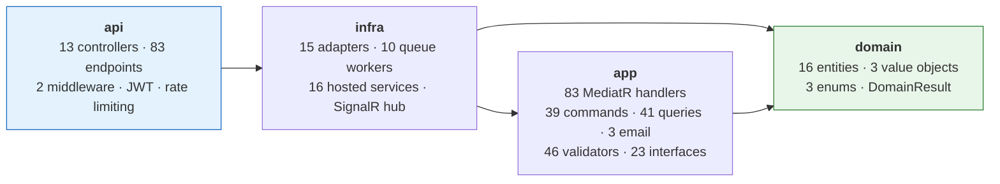

# Project Overview

The entry point to this documentation set. What Bump is, what it is built from, and how to get it
running. Layering rules are in [`architecture.md`](./architecture.md); runtime mechanics in
[`system-design.md`](./system-design.md); per-endpoint behaviour in [`features.md`](./features.md).

## What this project is

**Bump** is a .NET 9 HTTP API server for a social food- and shop-review application. An account
publishes a **post** that reviews a **shop** with an integer rate and optional images; other accounts
**react**, **comment**, **save**, **follow** and **block** each other, and receive **notifications**
both in-app over SignalR and as push banners over APNs.

The server is the only artifact in this repository. The iOS client (`Bump_Client`) and the operations
panel (`Bump_Admin`) are separate repositories that consume this API.

### The one modelling decision worth knowing first

**Shops are never created directly.** No endpoint creates a shop. `CreatePostHandler`
([src/app/feature/post/command/Create/CreatePostHandler.cs](../src/app/feature/post/command/Create/CreatePostHandler.cs))
resolves one while creating a post, so the shop catalogue is a side effect of posting.

**A shop comes in two tiers, and `Shop.PlaceId` is the whole difference.** A post carrying a
`placeId` has that identifier resolved against the Apple Maps Server API *before anything is
uploaded*, and the shop is created from the name, address and coordinate Apple answered — the
request's own shop text is not read at all on that path. A client can claim any name it likes; it
cannot invent an identifier Apple will return a place for. A post without a `placeId` still creates
the shop the client typed, unverified, which is what keeps a street cart Apple has never heard of
postable.

An existing shop is matched by `PlaceId` first and by exact `Name` + `Address` second. The second
arm stamps the identifier onto a shop created before verification existed, so the catalogue upgrades
itself as people post rather than needing a migration.

`Shop.Location` holds an optional `[longitude, latitude]` pair, indexed with 2dsphere and read by
`GetBestShopAround`, which serves **verified shops only** — it is the one surface that exists to be
navigated to. Reusing an existing shop never overwrites its coordinate, so on the unverified tier the
first poster to name a (name, address) pair still fixes that shop's coordinate permanently; on the
verified tier the coordinate is Apple's and the question does not arise. A shop's `Rate` is the
rounded average of its posts' rates, recalculated asynchronously by `ShopRateService`.

## Surface area

| Surface | Count | Notes |
|---|---|---|
| Controllers | 13 | All carry a class-level `[Authorize]` |
| Endpoints | 83 | 41 `GET`, 19 `POST`, 8 `PUT`, 15 `DELETE` |
| Anonymous endpoints | 8 | Registration, login, refresh, recovery, password reset, and the three email/OTP endpoints |
| Administrator endpoints | 15 | `[Authorize(Roles = nameof(Role.Admin))]` |
| SignalR hubs | 1 | `/hubs/notification` |

Endpoints are distributed as follows:

| Controller | Endpoints | Controller | Endpoints |
|---|---|---|---|
| `AccountController` | 17 | `FollowController` | 6 |
| `PostController` | 12 | `ReactionController` | 6 |
| `CommentController` | 8 | `SaveController` | 6 |
| `ShopController` | 7 | `AuthController` | 5 |
| `NotificationController` | 4 | `BlockController` | 3 |
| `ReportController` | 4 | `EmailController` | 3 |
| `DashboardController` | 2 | | |

### Roles and administrator provisioning

`Role` ([src/domain/core/enum/Role.cs](../src/domain/core/enum/Role.cs)) has exactly two values,
`User` and `Admin`. `Role.User` is the hardcoded default on `Account`, and no endpoint or handler
assigns `Role.Admin`.

Administrators are provisioned by **`AdminSeeder`**, a `BackgroundService` that runs on every boot.
Setting `Admin__Email` and `Admin__Password` creates the account when it is absent and promotes it
when it exists but is not yet an administrator; leaving either unset skips seeding entirely. The role
is a claim in the access token, so an existing session keeps its old role until the token expires and
is renewed.

No custom enum serializer is registered, so the driver stores the value as an `Int32`
(`User` = 0, `Admin` = 1). Promoting directly in the database is therefore:

```js
db.account.updateOne(
  { "Email.Value": "<address>", IsDeleted: false },
  { $set: { Role: 1 } }
);
```

## Tech stack

All four projects target `net9.0` with `<Nullable>enable</Nullable>` and
`<ImplicitUsings>enable</ImplicitUsings>`. Versions are taken verbatim from the `.csproj` files.

| Project | Purpose | Key packages |
|---|---|---|
| `domain` | Entities, value objects, `DomainResult`, text normalization | *(none — zero `PackageReference`)* |
| `app` | CQRS handlers, DTOs, validators, cache keys, pagination | AutoMapper 16.2.0 · FluentResults 4.0.0 · FluentValidation 12.1.1 (+ DI extensions) · MediatR 14.2.0 · Microsoft.Extensions.Logging.Abstractions 10.0.0 · MongoDB.Driver 3.11.0 |
| `infra` | Mongo/Redis/RabbitMQ/R2/email/APNs adapters, queue workers, SignalR hub | AWSSDK.S3 4.0.102.4 · BCrypt.Net-Next 4.2.0 · Microsoft.AspNetCore.DataProtection.StackExchangeRedis 9.0.16 · MongoDB.Driver 3.11.0 · RabbitMQ.Client 7.2.2 · StackExchange.Redis 3.1.31 · System.IdentityModel.Tokens.Jwt 8.22.0 · `FrameworkReference Microsoft.AspNetCore.App` |
| `api` | Controllers, middleware, composition root | Microsoft.AspNetCore.Authentication.JwtBearer 9.0.16 · Microsoft.AspNetCore.OpenApi 9.0.16 · Microsoft.AspNetCore.SignalR.StackExchangeRedis 9.0.16 · Serilog.AspNetCore 10.0.0 · Serilog.Expressions 5.0.0 |

**External services:** MongoDB (system of record) · Redis (cache, OTP, registration tokens, queue
idempotency, SignalR backplane, Data Protection key ring) · RabbitMQ (asynchronous work) ·
Cloudflare R2 over the S3 API (images) · Resend (transactional email) · Apple APNs (push) ·
Apple Maps Server API (place verification).

## Module map

Four projects in a strict reference chain. `domain` is dependency-free. `app` declares the service
interfaces that `infra` implements, which is why `infra` references `app` and not the reverse. `api`
references only `infra`, reaching `app` and `domain` transitively.



The three email use cases sit directly under `app/feature/email/` rather than under a `command/`
level; every other use case follows `feature/<area>/<command|query>/<UseCase>/`.

## Running locally

Configuration is read through `IConfiguration` from **process environment variables** using ASP.NET's
double-underscore nesting (`MongoDB__ConnectionString` maps to `MongoDB:ConnectionString`). **20
variables are required**; `AdminSeeder`, the forwarded-headers trust list and the three `Maps__*`
keys add optional ones. The
full table, with what consumes each value, is in [`infrastructure.md`](./infrastructure.md).

A gitignored `.env` at the repository root holds them for local work. Nothing in the repository parses
that file — the shell or the IDE run configuration sources it, and in production the platform supplies
the same names as service variables.

`src/api/Properties/launchSettings.json` defines two profiles:

| Profile | URLs | Environment |
|---|---|---|
| `http` | `http://0.0.0.0:5294` | `Development` |
| `https` | `https://localhost:7191`, `http://0.0.0.0:5294` | `Development` |

```bash
dotnet build src/Bump.sln -c Release
```

```bash
dotnet run --project src/api
```

**All three backing services must be reachable before the app serves traffic.** MongoDB, Redis and
RabbitMQ connections are constructed as singletons in `AddInfra`, and the RabbitMQ factory blocks on
`.CreateConnectionAsync().GetAwaiter().GetResult()`, so a broker that is slow to accept connections
delays startup directly.

In `Development`, OpenAPI is served at `/openapi/v1.json` via `app.MapOpenApi()`. `GET /health`
aggregates one check per backing service and is available in every environment.

## The other documents

| Document | Audience | Answers |
|---|---|---|
| [`system-design.md`](./system-design.md) | Architects, reviewers | What are the quality targets, the system topology, the storage and messaging strategy, and the trade-offs the design accepts? |
| [`architecture.md`](./architecture.md) | Anyone changing code | How are the layers arranged, what may depend on what, and what is explicitly prohibited? |
| [`developer-guide.md`](./developer-guide.md) | New contributors | What exists and how much of it, where does each file live, how are queues wired, and what are the exact call sequences? |
| [`features.md`](./features.md) | Feature work | What does each endpoint do, and what are its business rules? |
| [`project-rules.md`](./project-rules.md) | Feature work | Where does a new file go, what is it named, and how is a new use case scaffolded? |
| [`infrastructure.md`](./infrastructure.md) | Operations | How is each external service configured, how is the image built, and how is it deployed and observed? |

**Start here if you are new:** [`system-design.md`](./system-design.md) for the shape of the system,
then [`architecture.md`](./architecture.md) for the rules, then
[`developer-guide.md`](./developer-guide.md) to find your way around the code.
