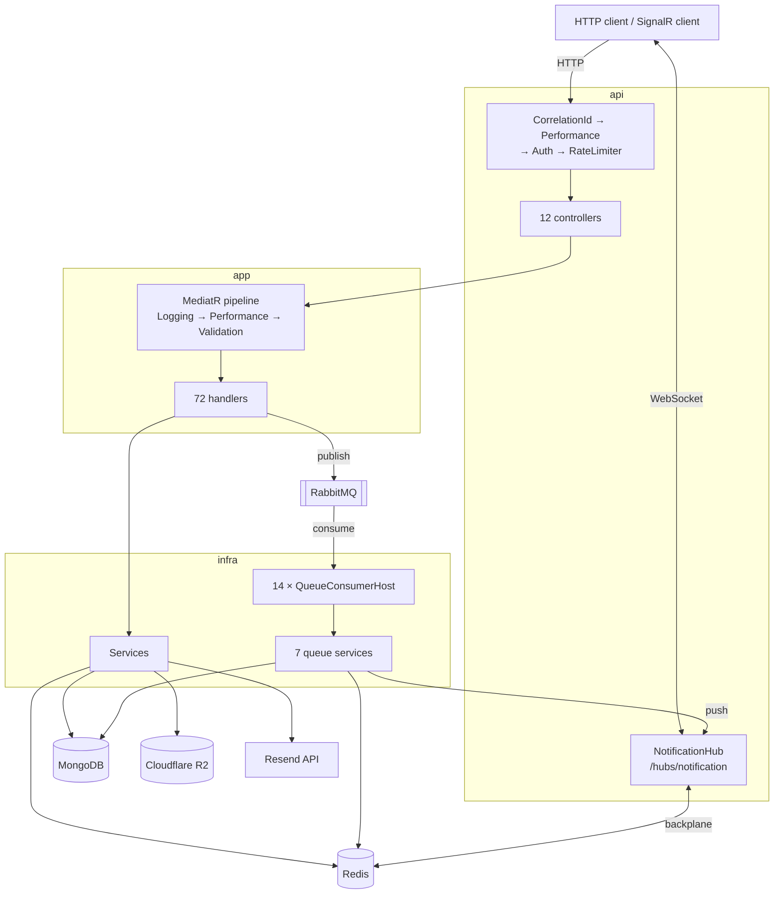
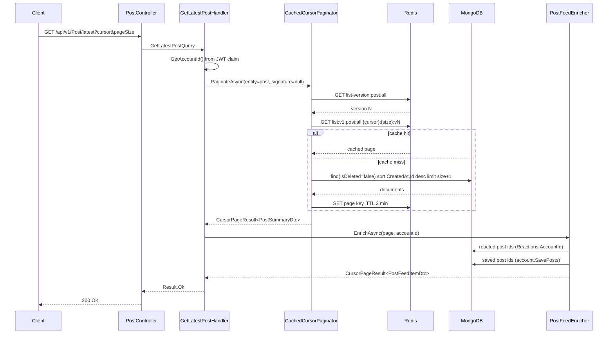
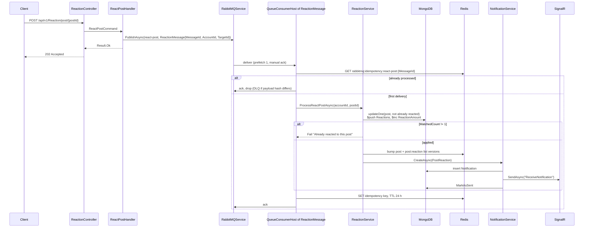
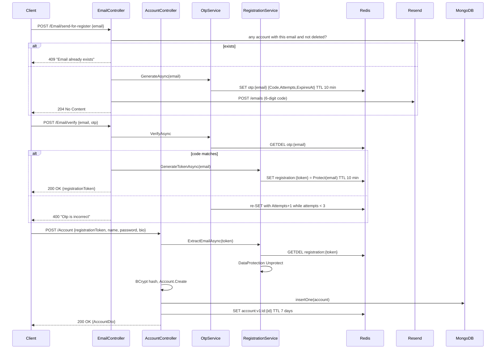

# System Design

How the running components fit together and what happens at runtime. Layering rules are in
[`architecture.md`](./architecture.md); per-feature business rules are in
[`features.md`](./features.md).

## Components

### `api` — HTTP and WebSocket surface

| Component | File | Responsibility |
|---|---|---|
| 12 controllers | `src/api/controller/` | Bind HTTP, construct value objects, send a MediatR request, convert `Result` to `ActionResult`. No business logic. |
| `ResultExtensions` | `src/api/common/ResultExtensions.cs` | `Result` → `OkObjectResult` / `NoContentResult` / `AcceptedResult`; failures → `ProblemDetails`. More than one error becomes a `ValidationProblemDetails` (400). |
| `ResultStatusMapper` | `src/api/common/ResultStatusMapper.cs` | Reads the `status` metadata key off the first `IError`; defaults to 400. |
| `ImageUpload` | `src/api/common/ImageUpload.cs` | Upload trust boundary: 5 MB cap, 10-file cap, `.jpg/.jpeg/.png/.webp` allowlist, and magic-byte signature check (JPEG `FF D8 FF`, PNG signature, `RIFF`/`WEBP`). |
| `CorrelationIdMiddleware` | `src/api/middleware/` | Accepts inbound `X-Correlation-ID` if ≤64 chars matching `^[a-zA-Z0-9-]+$`, else generates a GUID. Echoes it and pushes it into the Serilog `LogContext`. |
| `PerformanceMiddleware` | `src/api/middleware/` | Logs a warning for any request over 500 ms. |
| `RateLimiterPolicy` | `src/api/common/RateLimiterPolicy.cs` | Policy name constants: `auth`, `email`, `search`, `upload`. |

### `app` — use cases

78 MediatR handlers under `src/app/feature/<area>/<command|query>/<Name>/`, each a
`Command`/`Query` record + `Handler` + optional `Validator` (34 of 72 have one). Three pipeline
behaviours run in registration order (`src/app/DependencyInjection.cs`):

1. `LoggingBehavior` — logs request name, then success or the joined error messages.
2. `PerformanceBehavior` — warns above 500 ms.
3. `ValidationBehavior` — runs all `IValidator<TRequest>` in parallel; on failure constructs
   `TResponse` via `Activator.CreateInstance` and pushes `AppError.BadRequest` errors into it,
   short-circuiting the handler.

Shared helpers: `CursorPaginator` and `EmbeddedArrayPaginator` (raw paging), their `Cached*`
wrappers, `CacheKey`, `ListCache`, `AppError`, `PostFeedEnricher`, `ReactionMembership`,
`SaveMembership`, and the `PostProjection`/`AccountProjection` field sets.

### `infra` — adapters and background workers

| Component | Responsibility |
|---|---|
| `DbContext` | Wraps `IMongoDatabase`; only member is `GetCollection<T>(name)`. |
| `RedisService` | JSON get/set/remove, `GetAndRemoveAsync` (atomic `StringGetDelete`), and raw integer `IncrementAsync`/`GetCounterAsync` for list-cache versions. |
| `RabbitMQService` | Publish and consume with per-message idempotency, retry counting, and dead-lettering. |
| `R2Service` | Uploads to a `{folder}/{guid}{ext}` key with an explicit `ContentType`; deletes by URL path. |
| `EmailService` | `POST https://api.resend.com/emails`, 10 s `HttpClient` timeout. |
| `JwtService` | HS256 access tokens carrying `accountId` and `role` claims. |
| `BCryptService`, `OtpService`, `RegistrationService`, `CurrentIdentityService` | Hashing; 6-digit OTP with 10 min TTL and 3 attempts; Data-Protection-wrapped registration tokens with 10 min TTL; `accountId` claim reader. |
| `NotificationService` | Persists a `Notification`, invalidates the recipient's list, pushes over SignalR, marks sent. |
| `NotificationHub` | `[Authorize]` SignalR hub at `/hubs/notification`; empty body — identity comes from `AccountIdUserIdProvider`. |
| 7 queue services | `FollowService`, `ReactionService`, `SaveService`, `CommentService`, `ShopRateService`, `DeleteAccountService`, `DeletePostService` — the actual work behind queued messages. |
| `QueueConsumerHost<TMessage>` | One generic `BackgroundService`, registered 14 times, one per queue. |
| `IndexInitializer`, `NormalizedFieldBackfillInitializer` | `BackgroundService`s that build indexes and backfill normalized search fields without blocking startup. |

## Component interaction

The three flows below are chosen to show **cross-component mechanics** — cache versioning, queue
idempotency and retry, and the token handoff between calls. They are not endpoint documentation:
every one of the 78 endpoints has its own diagram and rules in [`features.md`](./features.md).

## Flow 1 — Cached list read

`GET /api/v1/Post/latest` → `GetLatestPostHandler`. Every cached list query resolves a version
counter first; the version is part of the page key, so bumping the counter retires every cached page
and page size for that entity/signature at once.

`PostFeedEnricher` issues **two additional Mongo queries per list request** to compute the
`IsReacted`/`IsSaved` flags, and these are never cached because they are per-viewer.

## Flow 2 — Write with async fan-out

`POST /api/v1/Reaction/post/{postId}` returns **202 Accepted** immediately; all state change happens
in the consumer. This is the pattern for every reaction, follow and save endpoint.

The idempotency key is written **after** the handler succeeds, so a crash between the work and the
key write causes reprocessing. A failure throws, the retry count in the `x-retry-count` header is
incremented, and the message is republished to the same queue until `MaxAttempts = 3`, after which
it goes to `{queue}.dlq`.

## Flow 3 — Registration

Three separate HTTP calls. The OTP proves control of the address; the registration token is the
carrier of that proof between calls.

The same registration-token mechanism is reused by `POST /Account/recover`,
`PUT /Account/reset-password` and `PUT /Account/me/email`, with
`POST /Email/send-for-verify` as the entry point for existing accounts.

## Data flow

**Entry.** HTTP request bodies bind to `src/api/request/*Request.cs` records or `[FromForm]`
parameters; uploads arrive as `IFormFile`. Value objects (`Email`, `Name`, `Amount`) are constructed
**in the controller** and their `DomainResult` is unwrapped before the command is built, so an
invalid email fails before MediatR is reached.

**Processing.** The command/query flows through the three pipeline behaviours into its handler.
Handlers build MongoDB `FilterDefinition`/`UpdateDefinition`/`ProjectionDefinition` values directly
and call `IMongoDbContext.GetCollection<T>()`.

**Persistence.** MongoDB is the system of record, one collection per aggregate:
`account`, `post`, `comment`, `report`, `shop`, `refreshtoken`, `notification`
(`src/app/common/CollectionName.cs`). Deletion is **soft** everywhere: `BaseEntity` carries
`IsDeleted`, `DeletedAt`, `RecoveredAt`, and effectively every read filters `!x.IsDeleted`.

Entity state is mapped through `BsonConfiguration` (`src/infra/persistence/configuration/`), which
registers class maps that expose the private `_avatars`, `_followers`, `_followings`, `_savePosts`,
`_saveShops`, `_images` and `_reactions` backing fields under their public names, plus a
`BackingFieldBsonSerializer<T>` so those fields remain queryable. Value objects deserialize through
`MapCreator` calls into their static factories.

Counts are **denormalized onto the parent document** — `Account.FollowerAmount`,
`Account.FollowingAmount`, `Post.ReactionAmount`, `Post.CommentAmount`, `Comment.ReactionAmount` —
and maintained with `$inc` in the same update that pushes or pulls the array element.

**Caching.** Redis holds single entities (`{entity}:v1:id:{guid}`, 7-day TTL), list pages
(`list:v1:{entity}:{signature}:{cursor}:{size}:v{version}`, 2-minute TTL), list version counters
(`list-version:{entity}:{signature}`, 1-day sliding TTL), OTP entries, registration tokens,
and queue idempotency keys (24 h).

**Exit.** Entities map to `src/app/common/dto/*Dto.cs` records via 12 AutoMapper profiles. Note that
DTOs still expose the `Amount` **value object** rather than a plain `int`, so
`infra/serialization/AmountJsonConverter` (with `EmailJsonConverter` and `NameJsonConverter`, wired
in `DomainJsonOptions`) exists to flatten them for the Redis JSON payloads.

## External integrations

| System | Direction | Protocol | Wired in | Used for |
|---|---|---|---|---|
| MongoDB | out | MongoDB wire protocol | `IMongoClient` singleton → `DbContext` | All persistence |
| Redis | out | RESP | `IConnectionMultiplexer` singleton → `RedisService` | Cache, OTP, registration tokens, idempotency, SignalR backplane |
| RabbitMQ | out (publish) / in (consume) | AMQP 0-9-1 | `IConnection` singleton → `RabbitMQService` | 14 queues + 14 `.dlq` |
| Cloudflare R2 | out | S3 API over HTTPS | `IAmazonS3` singleton, `ForcePathStyle = true` | Avatars, post and comment images |
| Resend | out | HTTPS REST | `AddHttpClient<IEmailService, EmailService>` | OTP and welcome emails |
| SignalR clients | in/out | WebSocket | `MapHub<NotificationHub>("/hubs/notification")` | Live notification push |

The 14 queues (`src/app/common/QueueName.cs`): `follow`, `unfollow`, `react-post`, `unreact-post`,
`react-comment`, `unreact-comment`, `create-comment`, `recalculate-shop-rate`, `save-post`,
`unsave-post`, `save-shop`, `unsave-shop`, `delete-account`, `delete-post`.

SignalR authentication accepts the JWT from the `access_token` query string when the request path
starts with `/hubs`, configured in `JwtBearerEvents.OnMessageReceived`
(`src/api/DependencyInjection.cs`). `AccountIdUserIdProvider` maps a connection to the `accountId`
claim so `Clients.User(accountId)` addresses a specific account across replicas.
