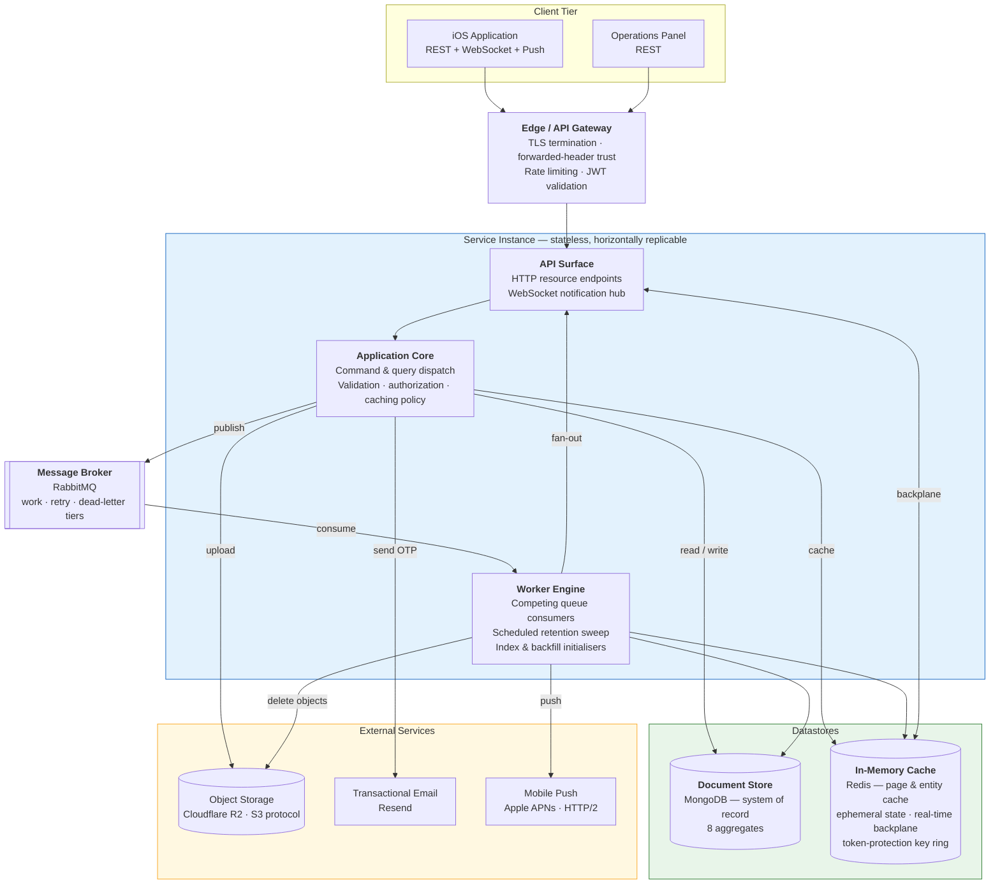
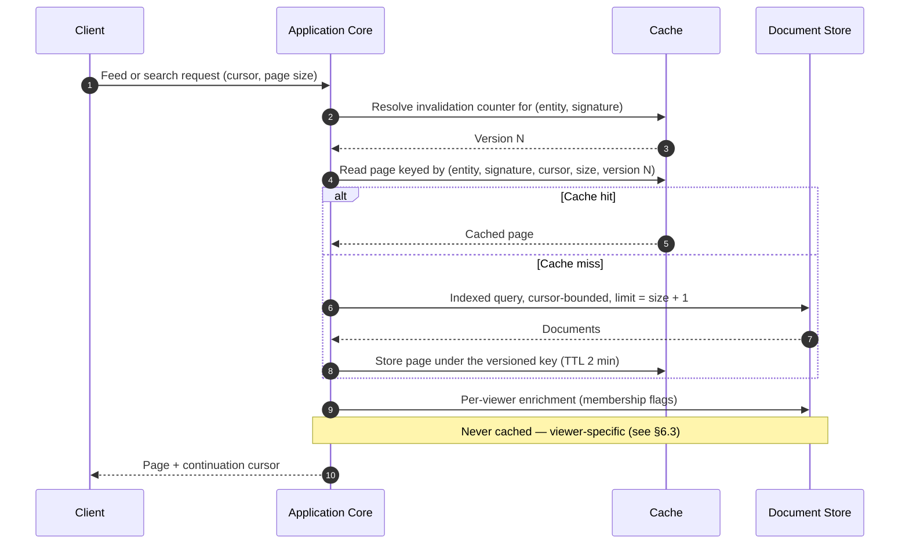
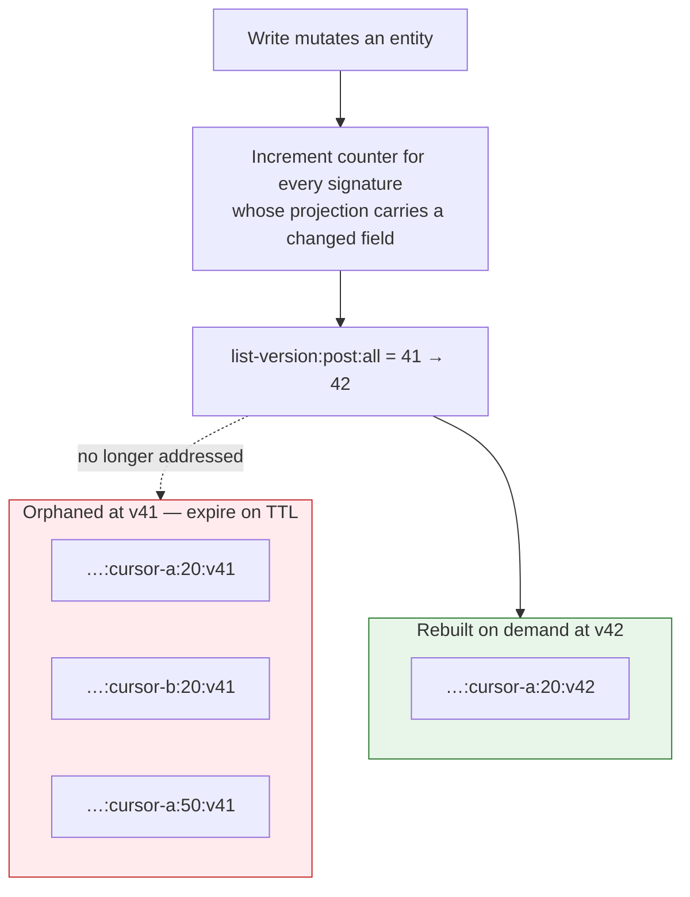
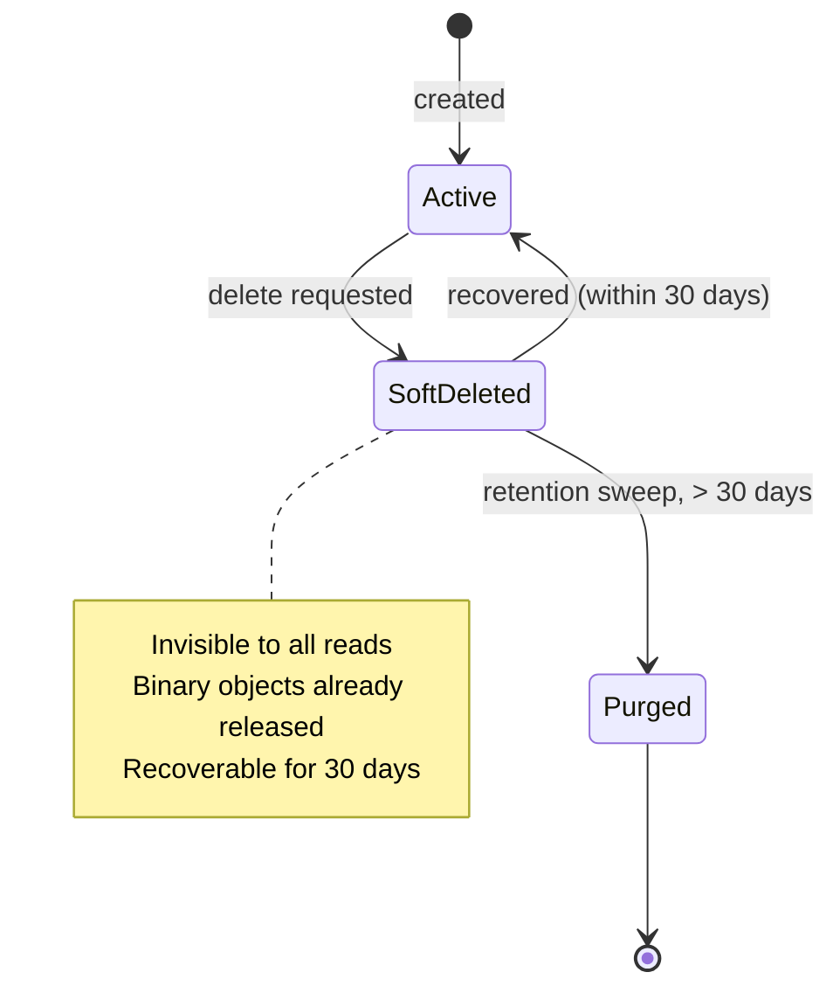
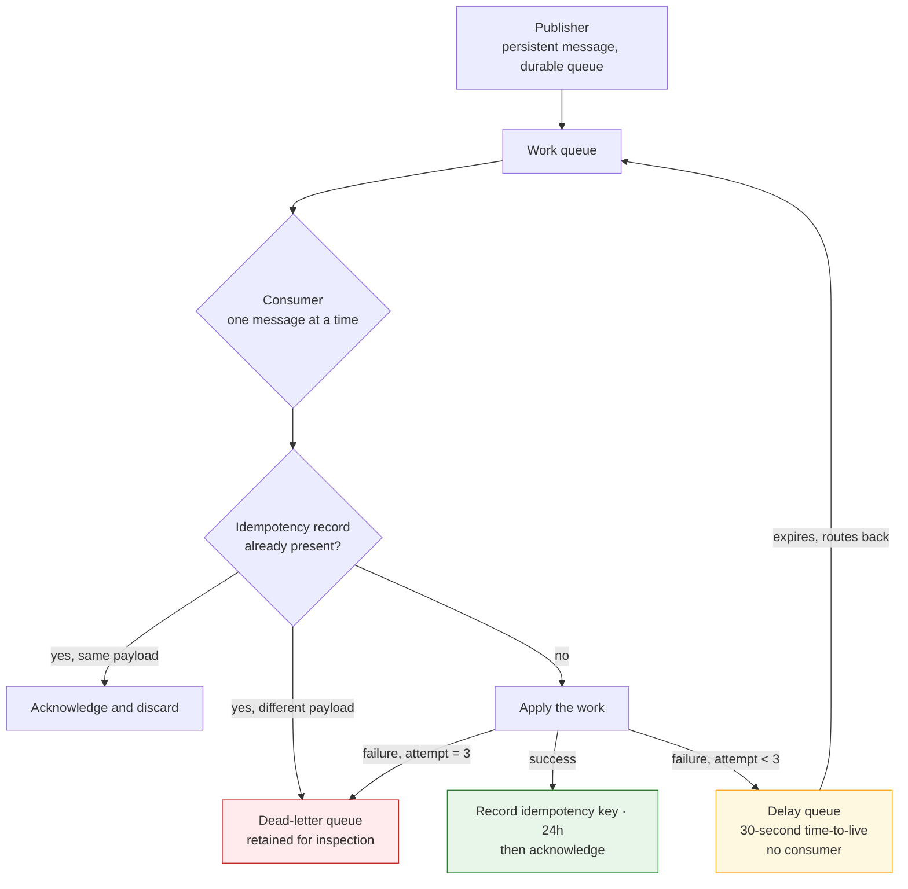
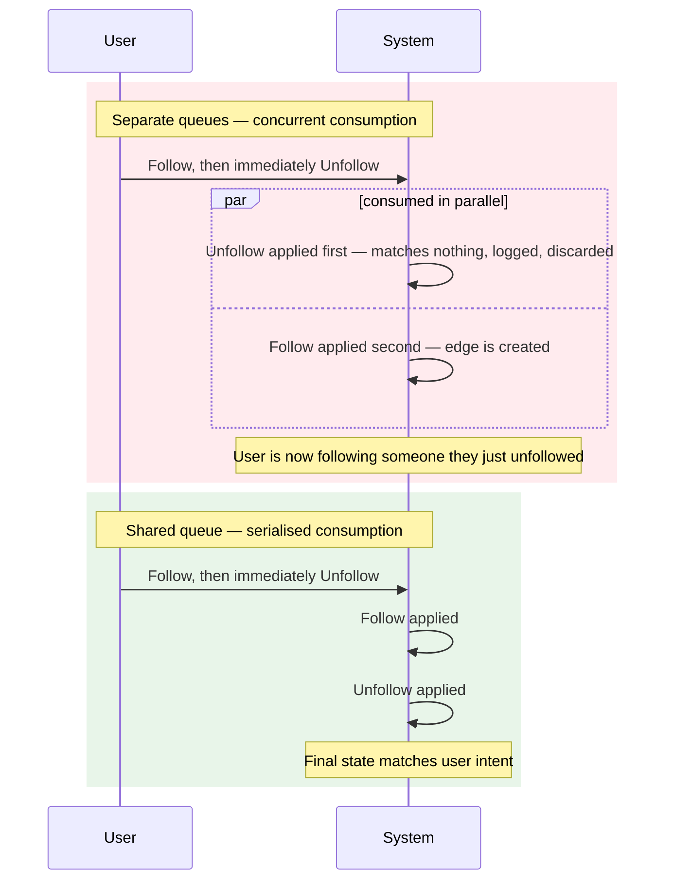
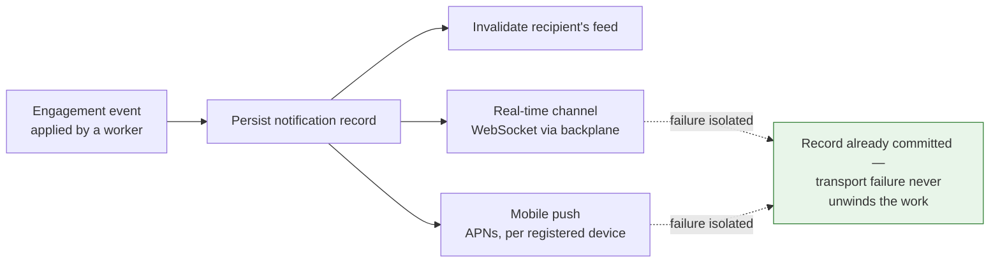
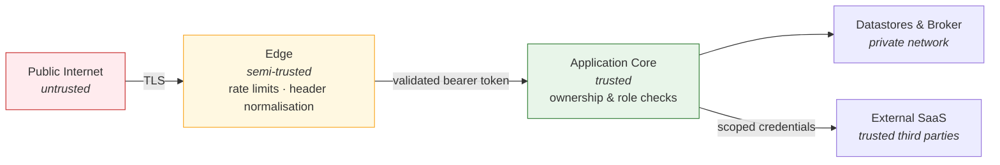

# High-Level Design — Bump

The architecture of the Bump platform at system level: scope, quality attributes, topology, storage
and caching strategy, asynchronous processing model, security posture, and the trade-offs the design
accepts.

This document deliberately stays above implementation detail. Layering rules and the contracts
between projects are in [`architecture.md`](./architecture.md); code inventory, file layout and
step-by-step interaction traces are in [`developer-guide.md`](./developer-guide.md); per-endpoint
behaviour is in [`features.md`](./features.md).

---

## 1. System Overview & Non-Functional Requirements

### 1.1 Scope

Bump is a social review platform for food outlets and shops. The system in this repository is the
**backend service**: a stateless HTTP API plus a real-time notification channel, backed by a document
store, a cache, and a message broker.

| In scope | Out of scope |
|---|---|
| Account lifecycle, authentication and session renewal | Client applications (iOS app and operations panel are separate systems) |
| Content authoring: posts, comments, shop records, images | Content moderation decisioning — the platform captures reports; adjudication is manual |
| Social graph: follow, block, save | Payments, ordering, or any commercial transaction |
| Engagement: reactions, comment threads, shop rating aggregation | Recommendation model training — ranking inputs are computed from first-party engagement data only |
| Notification delivery: in-app real time and mobile push | Analytics warehousing and BI reporting |
| Discovery: keyword search, geospatial "shops near me", affinity-ranked feed | Multi-tenant or multi-region deployment |

A defining domain constraint: **shop records are a by-product of authoring, not a managed catalogue.**
A shop is created implicitly on first review and identified by the exact name-and-address pair, and
the first author to name that pair fixes its geographic coordinate permanently. This keeps the system
free of a catalogue-curation subsystem at the cost of accepting duplicate or imprecise shop entries.

### 1.2 Quality attributes

| Attribute | Target | How the design supports it | How it is observed |
|---|---|---|---|
| **Latency** | **P95 < 500 ms** for read endpoints; write endpoints that fan out acknowledge in **< 100 ms** | Reads are served from a page cache ahead of the document store; fan-out writes acknowledge on enqueue rather than on completion | 500 ms is the instrumented warning threshold at both the transport and application-dispatch layers, so every breach of the SLA emits a structured warning naming the route and elapsed time |
| **Availability** | Best-effort single-region; target 99.5% monthly | Stateless service instances, externalised session and key material, automatic broker and cache reconnection | A single aggregate health endpoint gates every release and backs external uptime polling |
| **Durability** | No acknowledged write may be lost | Persistent messages on durable queues; universal soft delete with a 30-day recovery window before purge | Dead-letter queues retain anything that exhausted its retries |
| **Consistency** | Read-your-writes on synchronous paths; **eventual (seconds) on fan-out paths** | Conditional atomic updates rather than distributed transactions | Counter and array mutations are applied in a single operation and cannot diverge |
| **Concurrency** | 200 requests/min per principal; ~40 sustained concurrent connections per instance | Per-principal rate limiting at the edge; connection multiplexing to cache and broker | Rate-limit rejections are logged with the partition key |
| **Scalability** | Vertical first; horizontal via stateless replicas | Shared-nothing instances; a cache-backed real-time backplane lets any instance serve any subscriber | — |

### 1.3 Availability model and failure posture

The three infrastructure dependencies are **not equal** in how their loss degrades the system:

| Dependency | Loss of it means | Recovery behaviour |
|---|---|---|
| **Document store** | Total outage — nothing can be read or written | Driver-level retry; health endpoint reports unhealthy |
| **Cache** | Degraded, not down — reads fall through to the document store; however, registration, recovery, password reset and email change **fail**, because the key material protecting those tokens lives in the cache | Connection is non-blocking by design: the client returns immediately and reconnects in the background, so a transient blip does not permanently poison the process |
| **Message broker** | Engagement features (reactions, follows, blocks, saves, comment creation) **stop accepting writes**, because those endpoints publish rather than persist | The broker connection is established synchronously at startup, so an unreachable broker prevents the instance from starting at all |

That last row is the single most consequential availability property in the system and is treated as
a deliberate trade-off in §6.

### 1.4 Concurrency expectations

- **Request concurrency** is bounded at the edge by a global fixed-window budget per principal, with
  tighter sliding windows on authentication, email dispatch, search and upload.
- **Worker concurrency is intentionally serialised**: each queue is consumed one message at a time
  per instance. This trades throughput for ordering (§4.3). Throughput scales by adding instances,
  which adds one competing consumer per queue.
- **Write contention** is resolved optimistically. There are no distributed transactions and no
  pessimistic locks; every contended mutation is expressed as a conditional update whose filter
  encodes the precondition, and a non-match is the conflict signal.

---

## 2. High-Level System Topology



### 2.1 Tier responsibilities

| Tier | Responsibility | Explicitly not responsible for |
|---|---|---|
| **Edge** | TLS termination, client address and scheme propagation, rate limiting, bearer-token validation | Business authorization — ownership is decided inside the application core |
| **API Surface** | Protocol binding, request shaping, response status mapping, real-time subscription management | Business rules; it holds no domain logic |
| **Application Core** | Use-case orchestration, invariant enforcement, authorization, cache policy, work dispatch | Transport concerns and adapter mechanics |
| **Worker Engine** | Deferred and fan-out work, cascade propagation, scheduled retention, startup provisioning of indexes and backfills | Serving requests |
| **Datastores** | Durable truth (document store) and derived, expendable state plus coordination (cache) | — |
| **External Services** | Binary storage, email delivery, mobile push transport | — |

### 2.2 Co-location constraint

**The API Surface, Application Core and Worker Engine run inside a single process.** There is no
separate worker deployment. Two consequences follow, and both are load-bearing for capacity planning:

1. Scaling request capacity also scales worker capacity, and vice versa — they cannot be tuned
   independently.
2. **The runtime must remain resident.** A scale-to-zero or request-scoped execution model would
   silently stop the queue consumers, the retention sweep and the startup initialisers while the HTTP
   surface continued to appear healthy.

---

## 3. Data Storage & Caching Strategy

### 3.1 Dual-storage model

The system uses two stores with a strict authority rule: **the document store is the only source of
truth; everything in the cache is derivable and may be discarded at any time** — with one
deliberate exception noted in §3.5.

```mermaid
graph LR
    subgraph primary["Primary — MongoDB"]
        direction TB
        agg["8 aggregates<br/>account · post · comment · shop<br/>report · notification<br/>refresh token · device token"]
        emb["Embedded sub-documents<br/>avatars · images · reactions<br/>followers · followings · blocks<br/>saved posts · saved shops"]
        idx["Compound, partial, multikey,<br/>geospatial and TTL indexes"]
    end

    subgraph cache["Cache — Redis"]
        direction TB
        ent["Entity cache · 7 days"]
        page["Feed page cache · 2 minutes"]
        ver["Invalidation counters · 1 day sliding"]
        eph["Ephemeral state<br/>OTP · registration tokens<br/>idempotency records"]
        coord["Coordination<br/>real-time backplane<br/>token-protection key ring"]
    end

    primary -->|"read-through"| cache
    cache -.->|"miss falls through"| primary

    style primary fill:#e8f5e9,stroke:#2e7d32
    style cache fill:#e3f2fd,stroke:#1565c0
```



**Aggregate boundaries follow write locality rather than entity count.** Only eight concepts own a
collection; everything else is embedded in the aggregate that mutates it. A reaction is written by the
same operation that increments the post's reaction counter, so it lives inside the post; a follower
entry is written alongside the follower count, so it lives inside the account. This keeps every
engagement write to a **single-document atomic update**, which is what removes the need for
transactions entirely (§3.4).

The cost is accepted knowingly: unbounded embedded arrays grow the parent document, and per-viewer
membership questions ("did *I* react to this?") cannot be answered from the cached page and require a
separate lookup (§6.3).

### 3.2 Read path and cache layering

Read-heavy endpoints are served through a two-level cache before reaching the document store:



**Pagination is cursor-based, never offset-based.** A cursor encodes the sort position of the last
returned item, so page cost stays constant as a feed grows and results remain stable while items are
inserted ahead of the reader.

### 3.3 Cache invalidation — version-counter strategy

Deleting cache keys on write does not scale here: one feed exists in as many variants as there are
cursor positions, page sizes and viewer filters. Enumerating them on every write is unbounded work.

The system uses **indirection through a version counter** instead:

```
list-version:{entity}:{signature}          ← a single integer, incremented on write
list:{entity}:{signature}:{cursor}:{size}:v{version}   ← the version is part of every page key
```

Incrementing the counter changes the key prefix that every subsequent read computes, so **all pages,
all page sizes and all cursor positions for that feed retire simultaneously in one operation.** Stale
entries are never deleted; they are orphaned and expire on their own TTL.



Two rules govern correct use of this mechanism:

1. **Invalidate by field, not by entity.** A write must bump every feed whose projection includes a
   field it changed — not merely the feed of the collection it wrote to. Creating a comment changes a
   counter that the *post* feed displays, so it must retire the post feed as well as the comment feed.
2. **Counters are viewer-independent.** Feeds filtered per viewer (for example, hiding blocked
   accounts) add a viewer digest to the **page** key but never to the **counter** key. A writer cannot
   know which viewers have blocked whom, so a counter keyed by viewer would be one that no write could
   ever reach.

Two feeds opt out of invalidation entirely and rely on their short TTL: **keyword search results** and
the **affinity-ranked related feed**. In both cases no write path can determine which readers or which
queries a new item belongs to, so a correct invalidation would require fanning out to every follower
or every past search — precisely the unbounded work this strategy exists to avoid.

### 3.4 Concurrency control without transactions

The system uses **no multi-document transactions and no locks**. Every contended mutation is a single
atomic conditional update in which the filter expresses the precondition:

| Scenario | Precondition encoded in the filter | Conflict signal |
|---|---|---|
| React to a post | Post exists **and** this account has not already reacted | Zero documents matched |
| Follow an account | Each side of the edge excludes the state it is about to write | Zero matched — and a partial edge self-heals on retry |
| Recalculate a shop rating | Shop exists and is not deleted | Zero matched |

Counter maintenance and array mutation happen in the **same** update operation, so a count can never
drift from the collection it summarises — the failure mode that a read-modify-write sequence would
introduce.

### 3.5 The cache exception: token-protection key material

One class of cache data is **not** derivable. The cryptographic key ring that protects registration,
recovery, password-reset and email-change tokens is persisted in the cache under a fixed application
identity, precisely so it survives instance restarts and is shared across replicas.

If it were held per-instance, every deploy would invalidate every token in flight, and every replica
would reject tokens issued by its peers — failing silently, with no error the caller could act on.
**Cache persistence is therefore a correctness requirement for this data, not a performance
optimisation**, and a cache configured as a pure volatile store would break account recovery.

### 3.6 Lifecycle management — soft delete and scheduled purge

Deletion is **universally soft**. Every aggregate carries deletion state and a recovery timestamp;
effectively every read filters deleted rows out, and uniqueness constraints are **partial** — scoped
to live rows only — so a deleted account's email address becomes available for reuse immediately.



| Property | Policy |
|---|---|
| Retention window | **30 days** from deletion — also the window in which recovery is possible |
| Sweep cadence | Every **6 hours**, deferred **10 minutes** after start so a deploy never pays for a sweep |
| Batching | Bounded batches with a pause between them, so a large backlog never lands as one sustained write burst |
| Binary objects | Released at **soft-delete** time, not at purge, so the sweep is pure document-store work |
| Revoked credentials | Dropped on sight; expiry is additionally enforced by a store-level TTL index |

Two lifecycle rules are asymmetric by design and worth stating explicitly:

- **Notifications addressed to a deleted account are purged immediately**, not after the retention
  window, because nothing can read them once the account is gone. This is irreversible even if the
  account is later recovered.
- **Cascades are propagated as messages, not executed inline.** An account's content volume is
  unbounded, so an inline cascade would make one delete arbitrarily expensive and would replay all of
  it on a failure near the end. Emitting one message per affected item makes each unit independently
  retryable.

---

## 4. Async & Event-Driven Architecture

### 4.1 Synchronous versus asynchronous classification

The decision rule is **read-back requirement**, not operation cost:

| Class | Operations | Response | Rationale |
|---|---|---|---|
| **Synchronous** | Account, post and report creation; all content edits | 200/201 with the created representation | The client must immediately render or navigate to the result |
| **Asynchronous** | Reactions, follows, blocks, saves, comment creation, rating recalculation, delete cascades | **202 Accepted** | The client renders the outcome optimistically; the write fans out to counters, notifications and cache invalidation |

For the asynchronous class, **the endpoint publishes a message and returns without touching the
document store.** The write exists only once a worker applies it. This is what makes broker
availability equivalent to feature availability (§1.3, §6.1).

### 4.2 Delivery guarantees

Delivery is **at-least-once with application-level idempotency**. Exactly-once is not attempted;
consumers are instead required to be safe to run twice.



| Mechanism | Setting | Purpose |
|---|---|---|
| Idempotency record | Keyed by message identity, **24-hour** retention, stores a payload fingerprint | Suppresses duplicate delivery; a matching key with a *different* payload indicates identity reuse and is dead-lettered rather than silently applied |
| Retry delay | **30 seconds**, held in a consumer-less delay queue that expires messages back to the work queue | A transient dependency blip must not consume all attempts |
| Attempt ceiling | **3**, then dead-letter | Bounds the cost of a permanently failing message |
| Durability | Persistent messages on durable queues | A broker restart does not lose accepted work |

**Why the retry delay lives in a queue rather than in the consumer.** Because a consumer processes one
message at a time, sleeping inside it would stall every healthy message behind the failing one.
Parking the message in a time-limited queue frees the consumer immediately. This also replaced an
earlier immediate-republish scheme in which all three attempts were exhausted within milliseconds,
dead-lettering work that a brief outage would have allowed seconds later.

Each queue is provisioned as a **three-tier set** — work, delay and dead-letter — so failure handling
is uniform across every category of deferred work.

### 4.3 Sequential ordering for inverse operation pairs

Four operations have inverses that a user can trigger in rapid succession: **follow/unfollow,
block/unblock, react/unreact, save/unsave**.

Routing an operation and its inverse to separate queues allows them to be consumed **concurrently**,
which permits a destructive reordering:



**Both directions therefore share a single queue** and carry a flag distinguishing the operation from
its inverse. A single queue consumed one message at a time is FIFO, which makes the user's ordering
the applied ordering.

The guarantee is precise and bounded: **ordering holds on the success path only.** A message that
fails and is re-queued after its delay rejoins at the tail, behind newer messages. Ordering is a
race-condition mitigation for rapid user input, not a durable sequencing guarantee.

### 4.4 Notification fan-out

Notification delivery is **dual-channel and failure-isolated**:



The two channels are complementary rather than redundant: the real-time channel keeps an **open**
application's list live but cannot reach a backgrounded or terminated app; push reaches the device but
does not update in-app state. Both are attempted, and **both are wrapped so that a transport failure
cannot roll back the committed notification** or cause the queue message to be retried.

The real-time channel is **backed by the cache as a backplane**, which is a correctness requirement
rather than a scaling feature: without it, an instance can only reach subscribers holding a connection
to that same instance, and notifications for users connected elsewhere would be dropped silently.

---

## 5. Security & External Integrations

### 5.1 Trust boundaries



### 5.2 Edge controls

**Rate limiting** is applied per authenticated principal where a session exists and per client address
otherwise, over a global budget with tighter policies on the categories that are individually abusable
or individually expensive:

| Policy | Budget | Rationale |
|---|---|---|
| Global | 200 / minute | Baseline abuse ceiling per principal |
| Authentication | 10 / minute | Credential stuffing and brute force |
| Email dispatch | 5 / minute | Outbound cost and third-party reputation |
| Search | 20 / minute | Query cost against text and geospatial indexes |
| Upload | 10 / minute | Bandwidth and object-storage cost |

Correct attribution depends on the edge forwarding the original client address and scheme. Because a
managed edge does not have a fixed, pinnable address, the service accepts these headers from whatever
fronts it — **valid only while the service publishes no directly reachable port of its own.** Where
the edge address or its network range is fixed, trust should be narrowed to exactly that.

**Image upload inspection** treats uploads as hostile input and validates on four independent axes
before any byte reaches storage:

| Check | Control |
|---|---|
| Size | Per-file ceiling |
| Count | Per-request ceiling |
| Declared type | Extension allowlist — JPEG, PNG, WEBP |
| **Actual content** | **Magic-byte signature inspection** — JPEG `FF D8 FF`, the PNG signature, and the `RIFF`/`WEBP` container marker |

Signature inspection is what makes the extension allowlist meaningful: a renamed executable or
polyglot file passes the extension check and fails the content check. The validation gate is
structured so that **the uploaded bytes are only reachable after every check has passed**, which makes
bypassing the inspection a structural impossibility rather than a matter of remembering to call it.

### 5.3 Authentication and authorization

| Aspect | Design |
|---|---|
| **Token format** | Signed bearer token carrying account identity and role; symmetric signing |
| **Validation** | Issuer, audience, lifetime and signature all validated; inbound claim remapping disabled so claim names are exactly as issued |
| **Session renewal** | Short-lived access tokens paired with persisted refresh tokens that support revocation and carry a store-level expiry |
| **Role model** | Two roles — standard and administrator. **No endpoint grants the administrator role**; elevation happens through configuration-driven provisioning at startup |
| **Role propagation** | The role is a token claim, so an elevation or demotion takes effect only when the session's token is renewed |
| **Ownership** | Enforced inside the application core as a query precondition, not as an edge rule — an unauthorised target is indistinguishable from a non-existent one |

**WebSocket authentication handoff.** Browser and mobile WebSocket clients cannot reliably set
authorization headers during the upgrade handshake. The system therefore accepts the bearer token as a
**query-string parameter, scoped exclusively to the real-time endpoint path**; every other route
continues to require the header. Once the connection is established, it is bound to the authenticated
account identity, which is what allows the backplane to address a specific user across any instance.

The scoping is the security control: the relaxation applies only where the header mechanism is
genuinely unavailable.

### 5.4 Third-party integration topology

| Service | Role | Protocol | Coupling and failure mode |
|---|---|---|---|
| **Cloudflare R2** | Binary object storage for avatars and content images | S3-compatible HTTPS | Objects are referenced by URL from documents. Deletion is **best-effort and not transactional** with the document store — a failed delete orphans an object, which is preferred to blocking a user-facing delete |
| **Resend** | Transactional email — one-time passcodes for registration and address verification | HTTPS REST, bounded timeout | Synchronous in the registration path. A failure surfaces to the caller, who retries; no passcode is consumed |
| **Apple APNs** | Mobile push to backgrounded and terminated clients | **HTTP/2, mandatory** | Asynchronous and failure-isolated. Tokens rejected as unregistered or malformed are retired automatically, so the device registry self-cleans |

Three integration constraints are structural rather than incidental:

- **APNs refuses HTTP/1.1**, and a client library that negotiates protocol version will silently
  downgrade. The version is therefore pinned explicitly rather than negotiated.
- **Push credentials are short-lived by mandate.** The provider assertion is re-minted on a schedule
  that sits inside the provider's accepted validity window — too frequent is rejected as abuse, too
  infrequent is rejected as expired.
- **A single deployment serves both development and production push environments simultaneously.**
  The target environment is a property of each registered device rather than of the deployment, so
  internal builds and released builds coexist without a separate service instance.

### 5.5 Secret and configuration posture

All credentials arrive as runtime environment configuration; none is committed. Two classes are
validated **eagerly at startup** rather than on first use — token-signing parameters and push
credentials — because both fail silently otherwise: a missing signing lifetime would mint
already-expired tokens, and a malformed push key would be indistinguishable from an absence of
notifications. A misconfigured deployment is designed to fail to start rather than to start and
misbehave.

---

## 6. Architectural Trade-offs & Limitations

Each item below is a consequence the design accepts knowingly, with the condition that would justify
revisiting it.

### 6.1 Broker availability is feature availability

Engagement writes acknowledge on enqueue without touching the document store, and the broker
connection is established synchronously at startup.

| Aspect | Assessment |
|---|---|
| **Consequence** | A broker outage stops reactions, follows, blocks, saves and comment creation from being accepted; an outage at start prevents the instance from starting at all |
| **Mitigation in place** | Failures surface to the caller as errors rather than silent data loss; messages are persistent on durable queues, so a broker *restart* loses nothing |
| **Revisit when** | The broker is a shared or best-effort tier, or availability targets exceed what a synchronously-acquired dependency can support. The fix is to make broker acquisition lazy and retrying, so the service starts and serves reads while the broker is unavailable |

### 6.2 Write-after-work idempotency window

The idempotency record is written **after** the work succeeds, not before.

| Aspect | Assessment |
|---|---|
| **Consequence** | A crash in the window between applying the work and recording the key causes the message to be reprocessed on redelivery |
| **Why it is safe today** | Every consumer's work is expressed as a conditional update whose precondition is already false after the first application, so reprocessing is a no-op. The idempotency record is an **optimisation**, not the correctness mechanism |
| **The real constraint** | This property is a **standing requirement on all future consumers**: any new worker performing a non-conditional write — an unconditional increment, an append, an outbound side effect — breaks the guarantee. Non-idempotent work must not be added without a different protocol |

### 6.3 Per-viewer enrichment is not cacheable

Feed pages are shared across viewers, but membership flags ("have I reacted to this?", "have I saved
this?") are viewer-specific.

| Aspect | Assessment |
|---|---|
| **Consequence** | Every feed request issues additional per-viewer lookups that no cache hit can avoid, placing a floor under feed latency that caching cannot lower |
| **Why accepted** | Caching per viewer would multiply cache footprint by the active-user count and collapse the hit rate; materialising flags into the feed would make every engagement write fan out to every cached page containing that item |
| **Revisit when** | Feed latency approaches the P95 budget. The lookups are index-backed and bounded by page size, so the practical lever is reducing the number of round trips, not eliminating them |

### 6.4 Search is substring matching over normalised text

Keyword search normalises text at write time — case folding and diacritic stripping, including the
language-specific letter forms this product's primary market requires — and matches against the
normalised form at read time.

| Aspect | Assessment |
|---|---|
| **What it does well** | Diacritic-insensitive and case-insensitive matching, which is the dominant requirement for the target language; no external search infrastructure to operate |
| **What it does not do** | Relevance ranking, stemming, fuzzy or typo tolerance, multi-term scoring, and phrase weighting. Results are ordered by recency, not by match quality |
| **Scaling limit** | Substring matching cannot use an index prefix for unanchored patterns, so cost grows with collection size rather than result size |
| **Revisit when** | Result quality complaints appear, or search latency becomes the dominant contributor to the P95 budget. The migration path is a dedicated text-search index or an external search service, fed from the same normalised fields |

### 6.5 Eventual consistency is user-visible

A 202-acknowledged engagement action is not yet reflected in the document store when the response is
sent.

| Aspect | Assessment |
|---|---|
| **Consequence** | A client that re-reads immediately may not observe its own write. Correct client behaviour is optimistic local rendering |
| **Bound** | Normally sub-second; up to roughly a minute if a message exhausts its retry delays |
| **Failure visibility** | A rejected action — reacting twice, following oneself — fails inside the worker and is **not** reported back to the client, which has already received 202 |

### 6.6 Denormalised counters have no reconciliation path

Counters are maintained atomically alongside the arrays they summarise, so they cannot drift under
normal operation.

| Aspect | Assessment |
|---|---|
| **Consequence** | Should a counter diverge — through direct database intervention or a future non-atomic write path — nothing detects or repairs it |
| **Revisit when** | Any write path is introduced that updates an array without updating its counter in the same operation. A periodic reconciliation sweep would then become necessary |

### 6.7 Single-region, single-instance-class deployment

| Aspect | Assessment |
|---|---|
| **Consequence** | No geographic redundancy and no independent scaling of request serving versus background work (§2.2) |
| **Why accepted** | Matches current scale and operational capacity; the design is horizontally ready — instances are stateless, sessions and key material are externalised, and the real-time layer is backplane-backed |
| **Revisit when** | Availability targets require multi-region, or worker throughput and request throughput need independent scaling. Splitting the worker engine into its own deployment requires no change to the messaging contract |
